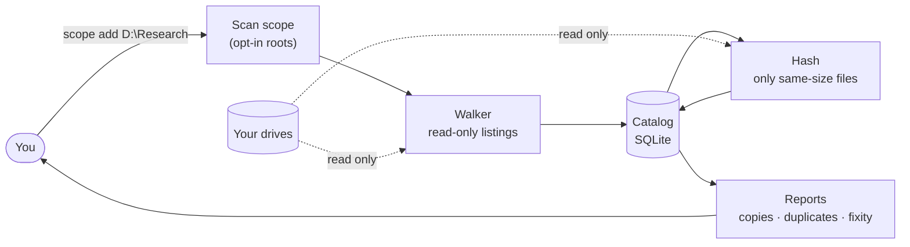
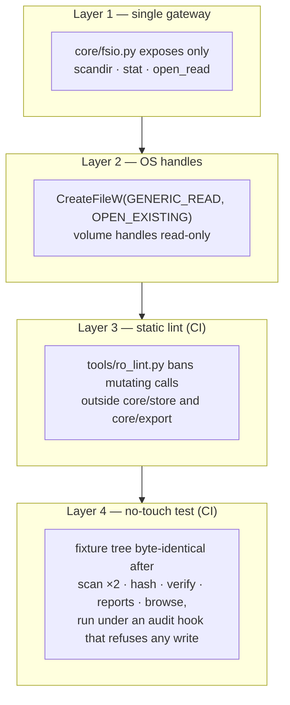

# Drive Fusion

A Windows desktop and command-line tool that **catalogs the drives you point it at**
(internal or external, connected or on a shelf), **tells you how many real copies of each
file exist**, and will produce **reviewable plans** for consolidating that content into a
traceable, FAIR-aligned order.

> **Drive Fusion never modifies, moves, or deletes your data.** It reads only the folders you
> add to its scan scope and writes only to its own catalog database, which it refuses to keep
> on a drive you scan. The one exception is the system drive: there the catalog may sit
> anywhere outside the folders being scanned.

Python 3.11+ · SQLite catalog · optional PySide6 GUI · packaged as a 64-bit Windows one-folder
build.

**Designed for** ~20 drives (about half NTFS, half exFAT), 10–50 million files, local drives
only. **Not for** identifiable human-subjects data, PHI or other regulated data. See the
disclaimer in [docs/PLAN.md §1](docs/PLAN.md#1-scope-and-targets).

---

## How it works



*Figure 1 — The tool reads your drives in two places, listing and hashing, and writes only to
its catalog.*

1. **Scope.** You add root folders. Nothing else is ever listed. Nested roots are refused;
   junctions, symlinks and mount points are recorded but not followed; OS churn (recycle bin,
   page file, `System Volume Information`, `C:\Windows`, …) is excluded by default.
2. **Scan.** A parallel directory walker records names, sizes, timestamps and attributes into
   a staging table, which one transaction then merges into the catalog. Files that can't be
   read, and cloud placeholders, are counted and reported, never opened.
3. **Hash.** Only files whose *size* appears more than once in the catalog are opened. A
   quick hash (size plus head, middle and tail samples, or the whole file for files up to 192 KiB)
   separates most of them; a full hash settles the rest.
4. **Report.** Copies are counted **over distinct physical drives, not over paths**: two
   copies on one drive are one copy, and a hardlink is the same file twice.

## Status

| Milestone | State | What you can use today |
|---|---|---|
| **M0** Skeleton and guardrails | done | read-only gateway, lint, no-touch test, VHDX fixtures, build |
| **M1** Catalog core | done | `scope`, `scan`, `find`, `status`, `volumes` |
| **M2** Fast enumeration | **library done, not wired** | parallel batch walker is used by every scan. The NTFS change-journal path (`dfscan-helper`, journal logic, incremental delta) is implemented and unit-tested but **not called by `scan` or the GUI**, so every rescan is currently a full walk |
| **M3** Identity and analysis | done | `hash`, `report`, `verify` |
| **M4** GUI shell | done, with one gap | `gui`: Scope, Dashboard, Drives and Catalog screens; background scans and hashing with Cancel. The UAC elevation launcher exists but **no screen offers it yet** |
| M5–M8 | planned | health and risk, curation and FAIR scorecards, the planner, exports. See [PLAN §15](docs/PLAN.md#15-milestones) and the [roadmap](docs/ROADMAP.md) |

Before Drive Fusion first reads a drive it shows the scope disclaimer below and asks you to
accept it (`--accept-disclaimer` or `DRIVEFUSION_ACCEPT_DISCLAIMER=1` for scripts). That,
and every scope change, scan, hash and verify pass and drive confirmation, is recorded in an
append-only, hash-chained audit log: `drivefusion audit list`, `drivefusion audit verify`.
Not yet implemented, though described in the plan: portable mode.

## Quick start

```bash
pip install -e ".[gui]"

drivefusion scope add D:\Research
drivefusion scope preview 1        # counts what a scan would cover, writes nothing
drivefusion scan
drivefusion find lake survey       # words, matched as prefixes, in file or folder names; % or --like for substrings
drivefusion hash                   # the only verb that reads file contents
drivefusion report                 # duplication, durability and fixity findings
drivefusion verify                 # re-hash and compare against recorded hashes
drivefusion status
drivefusion drives list            # which physical drive each volume is on
drivefusion drives edit 1 --purchase-date 2021-03 --role archive --location "Shelf B"
drivefusion drives show 1            # what is known, and its estimated failure rate a year
drivefusion report durability      # expected bytes lost a year, and where
drivefusion standards list         # the failure-rate tables in force
drivefusion collections propose    # queue folders that look like datasets, for you to confirm
drivefusion collections queue
drivefusion collections accept 3 --title "Lake surveys"   # or reject / split; nothing joins without this
drivefusion collections edit 1 --license CC-BY-4.0 --creators "A. Smith"
drivefusion collections coverage   # share curated; size and risk of what is unfiled
drivefusion versions find          # near-duplicates grouped, a preferred version proposed
drivefusion score 1                # FAIR and NDSA scorecards: gaps and how to close them
drivefusion plan make              # what to copy where, for you to carry out; nothing is copied
drivefusion plan show --json       # the current plan, steps with their reasons
drivefusion export all --to D:\Exports   # manifests, collection packages, mappings, reports
drivefusion export list            # each into a new folder; the folder is remembered
drivefusion standards import-afr data_Q3_2025.zip   # a Backblaze Drive Stats ZIP you downloaded
drivefusion gui                    # the desktop window
```

The catalog lives at `~/.drivefusion/catalog.db` unless you pass `--catalog PATH` or set
`DRIVEFUSION_CATALOG`. **Portable mode:** put an empty file named `portable` beside
`DriveFusion.exe`, and the catalog lives in a `DriveFusion data` folder beside it instead, so
the program and its catalog can travel together. The drive carrying them can't also be
scanned. `drivefusion status` says which applies.

There are deliberately no `apply`, `move`, `dedupe` or `delete` verbs, and the GUI has no such
controls. A test walks the entire widget tree on every CI run to keep it that way.

## The read-only guarantee



*Figure 2 — Four complementary layers. They overlap, but they are not independent: the lint
is the only layer that would catch some classes of regression (see below).*

What the layers guarantee today:

* Every handle on user media is opened with read access and `OPEN_EXISTING`. It can't write,
  and it can't create a file.
* No module outside `core/store/` (the catalog) and `core/export/` (not yet implemented) calls
  a mutating filesystem function that the lint knows about.
* On Linux and Windows CI, a fixture tree's bytes and metadata are unchanged after a full
  cycle. Access times are also asserted on POSIX, where `O_NOATIME` is available.

### Known limits

These are tracked in [docs/REVIEW.md](docs/REVIEW.md):

* **Where the catalog may live.** Never inside a scanned folder, and never on a drive that
  holds one, except the system drive: scanning `C:\Users\me\Research` with the default
  catalog at `C:\Users\me\.drivefusion` is fine, scanning all of `C:` is not. Both a catalog
  opened in the wrong place and a root added in the wrong place are refused. A catalog on a
  volume Windows can't identify, such as a network share, can't be on a scanned drive, so it
  is allowed.
* **The lint can't follow everything.** It now catches process launches, descriptor writes,
  `io`/`codecs` opens, numeric `os.open` flags, `sqlite3.connect`, Win32 mutators by name, and
  `getattr` indirection on filesystem modules. A computed name on an arbitrary `ctypes`
  library, such as `getattr(dll, name)`, still gets past it.
* **Scope roots are stored as drive-letter paths.** Scan, hash and verify first check that
  the volume at the path is the catalogued one, and skip the root with a message if it isn't
  or if the drive is unplugged. A root doesn't yet follow its drive to a new letter.

## Redundancy rules

| Situation | Counted as |
|---|---|
| Same content on two different drives | 2 copies |
| Same content twice on one drive | 1 copy (plus reclaimable space, reported as an observation) |
| Hardlinks to one file | 1 physical copy |
| Volume whose drive has no serial | identified by its partition table (MBR signature or GPT disk GUID) instead |
| Volume whose drive nothing identifies | at most one proven copy, marked *unverified*, until you say which drive it is on (`drivefusion drives`); never counted as same-drive waste |
| File whose size no other catalogued file shares | 1 copy, known without opening it |
| File sharing its size with another, not yet hashed | unknown, shown as "—" in the GUI |

## Scale

Measured at 3 million files: **222 bytes per file** (≈10.4 GB projected at 50M), 192k rows/s
merge, 555 MB peak RSS. All of these are inside the [§13 budgets](docs/PLAN.md#13-performance-budgets).
Reproduce with `python tools/benchmark.py`. A 50M-file run is still to do.

## Third-party software

Reading drive health with `smartctl` from [smartmontools](https://www.smartmontools.org/)
(GPL-2.0-or-later) is built but **shelved**: the build doesn't bundle it, and neither the CLI
nor the GUI offers a health read. How it would be pinned and checked is in
[packaging/README-smartmontools.md](packaging/README-smartmontools.md).

Failure rates come from [Backblaze Drive Stats](https://www.backblaze.com/cloud-storage/resources/hard-drive-test-data),
credited as their source. The build pins one quarter by SHA-256 (`packaging/backblaze.json`);
Settings imports a newer one you downloaded. Drive Fusion never downloads it itself.

Scorecards use the FAIR Guiding Principles (Wilkinson et al., *Scientific Data* 2016) and the
NDSA Levels of Digital Preservation 2.0, shipped as rubric files under `drivefusion/standards/`.
They were written from the published texts and their wording reviewed and accepted; a
scorecard reports how far a collection is *consistent with* their criteria, and certifies
nothing. `drivefusion standards list` shows how each was checked.

## Builds

Every commit to `main` (each merged PR) is built for Windows once the guardrail tests pass:
open the **CI** run for that commit under Actions, and download **DriveFusion-main-*commit***
from its Artifacts (kept 90 days). The run's summary gives the version and each
executable's SHA-256. Builds of other branches and PRs are kept two weeks as
**DriveFusion-windows-x64**. `.github/workflows/build-windows.yml` is the one build both use.

## Development

```bash
pip install -e ".[dev,gui]"

python tools/ro_lint.py         # read-only guard; non-zero exit on any finding
python -m pytest -q             # full suite
python tools/review_repro.py    # reproductions for docs/REVIEW.md findings
python tools/benchmark.py       # catalog benchmark against the §13 budgets

pyinstaller packaging/drivefusion.spec --noconfirm --clean
```

* The VHDX volume tests need Windows and administrator rights (they call `diskpart`). They
  run on the Windows CI runner and skip elsewhere.
* The GUI tests run headless with `QT_QPA_PLATFORM=offscreen`. CI asserts that Qt can start,
  so a skipped GUI suite can't pass as green. Locally on Linux they **skip** unless the Qt
  runtime libraries are installed (`libegl1 libdbus-1-3 libxkbcommon0 libfontconfig1`), so
  check the skip count.
* CI runs the lint and tests on Windows and Linux, then builds and smoke-tests three Windows
  executables: windowed `DriveFusion.exe`, console `drivefusion.exe`, and `dfscan-helper.exe`.

### V&V tests

`python -m vv` generates randomized test drives full of the cases Drive Fusion has to get right
(copies, same-name-different-bytes, empty files and folders, hardlinks, exclusions, deep paths,
edits, moves, silent corruption…), runs a Drive Fusion version through scan → rescan → verify,
and reports pass/fail per requirement against [docs/PLAN.md](docs/PLAN.md).

```bash
python -m vv all --out ../vv/run1 --drives 6                       # simulated drives
python -m vv all --out ../vv/run2 --drives 6 --drive-size 2GB      # ...each capped at 2 GB
python -m vv all --out ../vv/phys --drive-path D01=E:\DriveFusionVV --drive-path D02=F:\DriveFusionVV
python -m vv reset ../vv/run1 && python -m vv run ../vv/run1 --drivefusion-src ../other-checkout
```

See [docs/VV.md](docs/VV.md) for the requirements, dataset design, and how to read a report.

### The one rule

Nothing outside `drivefusion/core/store/` and `drivefusion/core/export/` may reference a
mutating filesystem call. `tools/ro_lint.py` enforces it, the test suite asserts it, and CI
gates on it. If you find yourself needing to write to a catalogued volume, the answer is that
the tool doesn't do that. It emits a plan describing what *you* might do.

## Documentation

| Document | Contents |
|---|---|
| [docs/PLAN.md](docs/PLAN.md) | The build plan: read-only design, scan scope, Windows enumeration, data model and budgets at 50M files, durability scoring, FAIR/NDSA, planner, milestones |
| [docs/REVIEW.md](docs/REVIEW.md) | Safety, file-integrity and security review: user needs → requirements → specification traceability, findings with reproductions, recommended order of fixes |
| [docs/ROADMAP.md](docs/ROADMAP.md) | Plan addendum: milestone status, what the finished milestones still owe, and the ordered plan to M5–M8 |
| [docs/VV.md](docs/VV.md) | Verification & validation: testable requirements traced to the plan, randomized drive datasets (simulated or physical), the oracle, and the V&V tests; suites, campaigns and the dashboard (`python -m vv gui`) |
| [docs/REAL-DRIVE-TESTING.md](docs/REAL-DRIVE-TESTING.md) | Step by step: testing Drive Fusion on your own drives with generated data, and reading the results |
