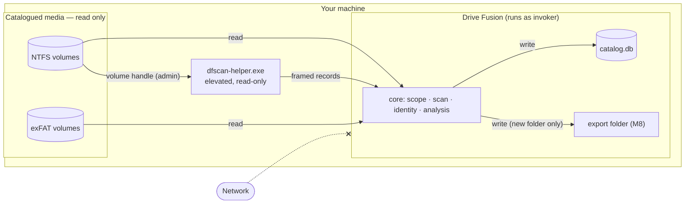
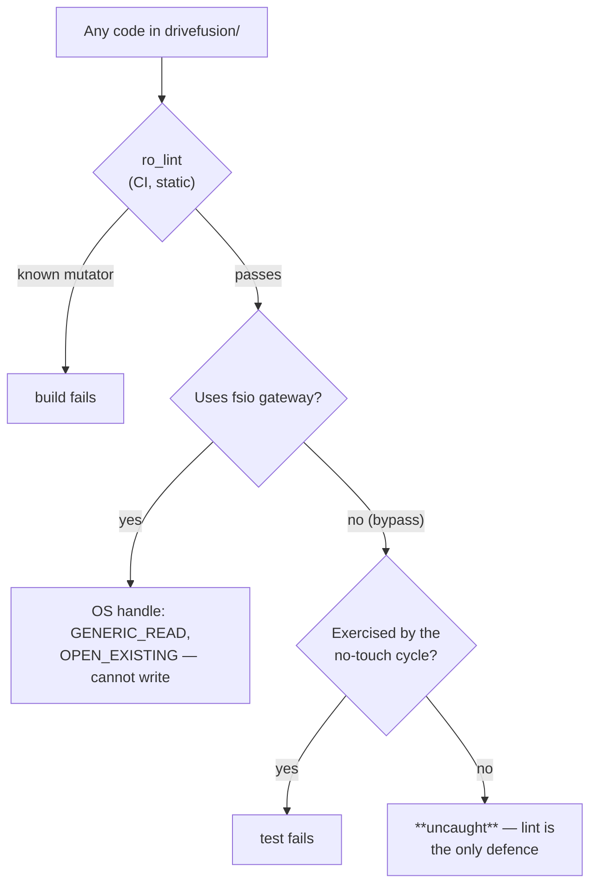
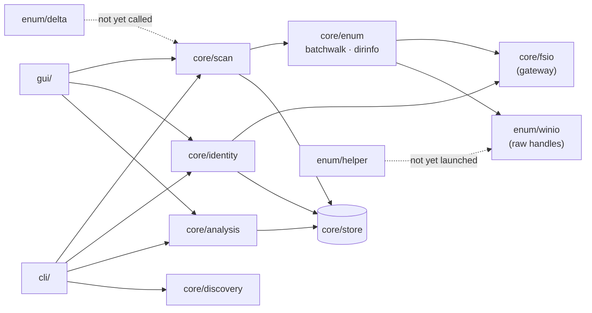
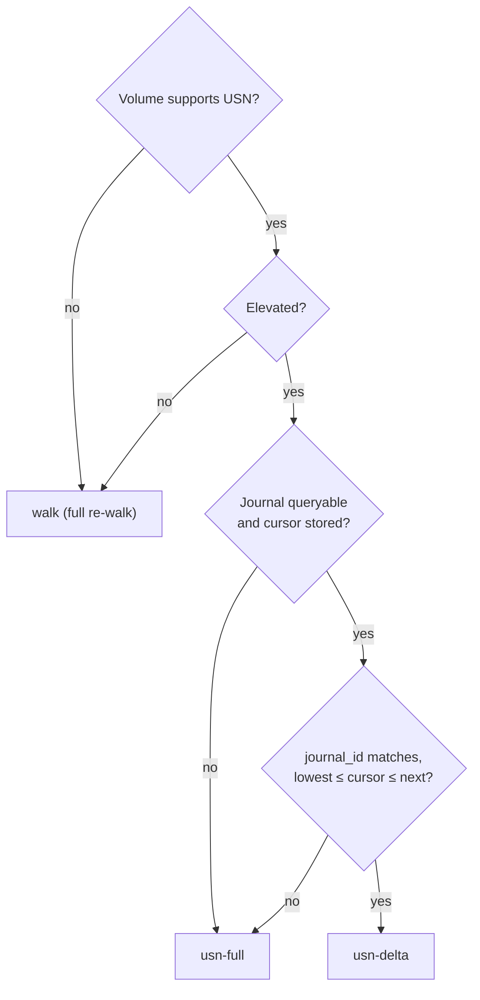
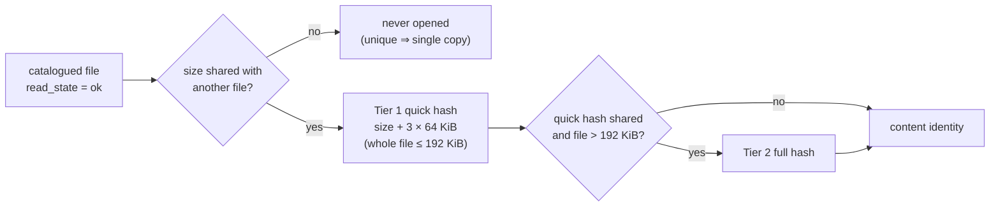

# Drive Fusion — Build Plan

A Windows desktop tool that catalogs the drives you point it at (internal, external,
connected or sitting on a shelf), proves how many real copies of each byte exist, and
produces **plans** for consolidating that content into a traceable, FAIR-aligned order.

**Drive Fusion is a planning and reporting instrument. It never modifies, moves, or deletes
your data.** Its only outputs are a local catalog database and export documents. See §3 —
this is enforced by construction and tested, not merely promised.

> **How to read this document.** This is the design. Where the code at M4 differs from it,
> an **As built** note says so in place. [REVIEW.md](REVIEW.md) traces every safety-relevant
> requirement to its implementation and test, and lists open findings (F-01 … F-16).
> [ROADMAP.md](ROADMAP.md) (Plan Addendum A, 2026-10-28) records where the code stands against
> §15, what the milestones marked done still owe, and the order of work for M5–M8.



*Figure 1 — System context. Solid arrows are the only data flows; the tool makes no network
connections.*

---

## 1. Scope and targets

Locked in from requirements. These are load-bearing: several designs below exist *because*
of these numbers and would be over-built without them.

| Dimension | Target |
|---|---|
| **Drives** | ~20, mixed internal and external, most disconnected at any given moment |
| **Files** | **10–50 million** across the collection |
| **Capacity** | tens of TB total |
| **Platform** | **Windows only** (64-bit). macOS/Linux are not in scope; the discovery layer keeps a seam for them, but nothing else compromises for portability |
| **Filesystems** | **~50/50 NTFS and exFAT.** This is a first-order design constraint, not a detail: exFAT has no MFT, no change journal, and no stable file IDs, so roughly half the fleet cannot use the fast path at all (§6) |
| **Elevation** | **Acceptable.** The privileged fast path is a supported default on NTFS, via a narrow helper binary (§6.5) |
| **Sources** | **Local drives only.** No cloud, no network shares, no sockets. Possible later, deliberately excluded now |
| **Scan scope** | **User-defined.** Nothing is catalogued until you explicitly add it (§4) |
| **Data class** | Non-identifiable data only — see the disclaimer below |
| **NIH DMS Plan** | No active plan of record. FAIR/preservation alignment is the goal; the DMS Plan export becomes an optional module (§8.3) |

### Scope disclaimer (shown at first run, in the About panel, and in every export)

> Drive Fusion is not intended for, and has not been validated for, identifiable human-subjects
> data, protected health information, or otherwise regulated data. Do not add such data to its
> scan scope. The tool assists with documentation and preservation planning. Its scorecards
> report how far your records are consistent with FAIR and NDSA criteria; they do not establish
> that any requirement is met. Responsibility for meeting institutional, funder, and legal
> requirements remains with you.

First run requires explicit acknowledgement, recorded in the audit log with a timestamp.

> **As built (ROADMAP A4):** the text lives in `core/disclaimer.py`. Before the CLI first reads a
> drive (`scope add`, `scope preview`, `scan`, `hash`, `verify`) it shows the text and asks
> for `accept`; without a terminal it refuses and says how to accept. The GUI shows it before
> the window opens, and declining quits; every GUI action that reads a drive checks again.
> Scripts accept with `--accept-disclaimer` or `DRIVEFUSION_ACCEPT_DISCLAIMER=1`. Each
> acceptance is an audit-log entry carrying the SHA-256 of the exact text and how it was
> given, so a reworded disclaimer must be accepted again. Reading the catalog (reports,
> `find`, `status`) is not gated.

---

## 2. The problem, stated precisely

You have:

| Symbol | Quantity | What it drives |
|---|---|---|
| `n` ≈ 20 | drives, each of capacity `cap_d` | the capacity constraint on any consolidation plan |
| `m` | copies and/or near-copies (versions) of a file | the deduplication / redundancy question |
| `l` | manufacturers | **correlated** failure risk — 3 copies on 3 drives from one bad batch is not 3 copies |
| `p` | purchase dates | age → failure rate; also warranty |
| `o` | usage (power-on hours, writes, duty cycle) | wear → failure rate |

Three use cases, in dependency order:

1. **Catalog** — know what exists, where, on which physical device, even when that device is
   unplugged.
2. **Confirm redundancy** — for every distinct piece of *content*, how many copies exist, on
   how many **distinct physical drives**, in how many locations, and the probability that all
   of them are lost.
3. **Plan the merge** — an ordered, reviewable set of *recommended* steps that consolidates
   duplicates, satisfies a preservation policy, fits the capacity you own, and leaves the
   result findable by a human and by a machine.

Two metrics score every plan: **expected bytes lost per year** (durability, §7.3) and the
**FAIR + NDSA scorecards** (stewardship, §8).

---

## 3. Read-only by construction

The requirement is absolute: *there must never be an opportunity for the tool to delete
anything.* A policy statement cannot deliver that — a bug or a bad refactor could violate a
policy. So the guarantee is structural.

### 3.1 The rule

The tool writes to exactly two places: its own application-data directory (catalog, logs,
config), and an **export directory you explicitly choose**, where every export lands in a new
timestamped folder — existing exports are never overwritten or removed. Every catalogued
volume is opened **read-only and nothing else**.

### 3.2 How it is enforced

| Layer | Mechanism |
|---|---|
| **Single gateway** | All access to catalogued volumes goes through `core/fsio.py`, whose entire public surface is `scandir()`, `stat()`, and `open_read()`. It opens with `GENERIC_READ` only and `FILE_SHARE_READ \| FILE_SHARE_WRITE \| FILE_SHARE_DELETE`, so the tool can never block or alter another process's file, and returns handles that raise on any write method. There is no `open_write` to call. `open_read` refuses a link, and checks the opened handle as well as the path: a handle that isn't the file that was checked (a path swapped for a link in between), or that shows recall attributes, is closed unread (REVIEW F-16, fixed). |
| **Raw-volume handles are read-only** | The fast enumeration path (§6.3) opens `\\.\X:` with `GENERIC_READ` alone. A volume handle opened without write access cannot write, at the OS level, regardless of what the code above it does. |
| **Build-time lint** | A custom AST checker fails CI if any module outside `core/store/` and `core/export/` references `os.remove`, `os.unlink`, `os.rmdir`, `os.rename`, `os.replace`, `os.truncate`, `shutil.rmtree`, `shutil.move`, `shutil.copy*`, `Path.unlink`, `Path.rename`, `Path.write_*`, `os.chmod`, `os.utime`, or `open()` with any mode but `"rb"`. Required status check on every commit. **Extended for REVIEW F-08 (fixed):** process launches (`subprocess`, `os.system`/`startfile`/`spawn*`/`exec*`, `ShellExecuteW`, `CreateProcessW`) outside a reviewed allowlist that records why each entry may start a process; `os.write` and relatives; `io.open`, `io.FileIO`, `os.fdopen` and `codecs.open` held to `"rb"`; `os.open` flags that can't be proven read-only (numbers refused, variables followed to their assignments); `sqlite3.connect` outside `core/store`; ~60 Win32 mutators (delete, move, copy, attribute and time setters, `WriteFile`, volume and placeholder APIs) matched by name *and* as string literals; and `getattr`/`__import__` indirection on filesystem modules. **Still not covered:** a computed name on an arbitrary receiver, such as `getattr(dll, name)`, and handles obtained somewhere the AST can't follow. |
| **Export-path assertion** | `core/export/` is the only writer of user-facing files. Every write routes through one function asserting the target resolves inside the chosen export root and does not already exist. It has no delete function. **As built (ROADMAP M8.1):** `core/export/writer.py`. Each export is a new `YYYYMMDDTHHMMSSZ-<kind>` folder; `Bundle.write` refuses absolute paths, `..`, drive names and links, and creates each file exclusively (`O_EXCL`, `O_NOFOLLOW` where the OS has it); `close` writes `_EXPORT.json` listing every file with its SHA-256 and records the export (schema v13 `export`, audited `export.write`). |
| **No hydration of cloud placeholders** | OneDrive-style dehydrated files are detected by attribute and **never opened** (§6.7). Reading one would trigger a download — a state change, and potentially gigabytes of it. |
| **No-touch regression test** | The suite builds a fixture tree, records a Merkle hash of every path, size, timestamp, and byte, runs a **full** scan → analysis → plan → export cycle, and re-hashes. The assertion is byte-and-metadata identity; access times are asserted on POSIX where `O_NOATIME` is permitted, and not on Windows. It covers every path the cycle calls. The elevated helper and the USN delta need a real NTFS volume handle and are **not** exercised. **Runtime guard:** the cycle runs under a `sys.addaudithook` guard (`tests/fixtures/audit_guard.py`) that refuses, and records, any write-mode open, remove, rename, link, `chmod`, `utime`, `truncate`, `mkdir` or `sqlite3.connect` under the tree, and any process launch at all, on every thread, at the moment it's attempted and whatever API made it. Win32 calls made directly through `ctypes` raise no audit event, so the snapshot and the lint remain the defence there. |
| **Denylist on generated text** | Plan exports may include *copy-only* command previews (`robocopy` without `/MIR` or `/PURGE`, `rsync` without `--delete`) for you to review and run yourself. A linter rejects any generated string containing `del`, `rm`, `rmdir`, `erase`, `format`, `diskpart`, `unlink`, `/MIR`, `/PURGE`, `--delete`. The tool will not so much as *print* a destructive command. **As built (ROADMAP M8.4):** `core/export/commands.py`. The check runs on every command preview before it is written: each line is a comment or starts with `robocopy`/`rsync`; every path is quoted, and a path holding a quote is refused, so none can end its quoting; every unquoted token must be an allowed option and none may be on the denylist (which also covers `/MOVE`, `--remove-source-files`, `mv`, `rd`, `shred`, `mkfs`, `dd`). It applies to the previews, not to manifests or mappings, whose file names are the user's own and may be any word. |



*Figure 2 — How the layers combine. They are complementary, not independent: a mutation that
the lint doesn't recognise, outside the gateway, on a path the no-touch cycle doesn't call,
would get through. REVIEW F-08 lists those classes.*

> **As built:** the catalog refuses to sit inside a scope root (REVIEW F-03, fixed).
> `Catalog()` won't open a catalog inside any enabled root. It checks with a lock-free
> read first, so a refused catalog gets no `-wal`/`-shm`. `scope add`, in the CLI and the
> GUI, refuses a root that contains the catalog. **Since 2026-10-28 the rule covers the whole
> drive** (ROADMAP D8): the catalog may not be on a volume that holds any enabled root, unless
> that volume is the system drive (the one holding `%SystemRoot%`), where it may sit anywhere
> outside the roots. So scanning a folder on `C:` works with the default catalog, while
> scanning all of `C:` leaves nowhere on it for the catalog. `Catalog()` checks before
> connecting, and `scope add` and the GUI check once the root's volume is identified, before
> recording anything. There is no override. **The export root follows the same rule (ROADMAP
> M8.1):** `Catalog.check_export_root` refuses an export folder inside an enabled root, or on
> a drive holding one unless it is the system drive, before anything is written.

### 3.3 What this changes about the design

- There is **no executor**. Plans are documents. A plan's terminal state is "exported," never
  "applied."
- **Deduplication is a report, not an operation.** Redundant copies are presented as
  *reclamation candidates* with full evidence — hashes, locations, copy counts, which copy the
  keep-rules favor and why — and the decision and the action are entirely yours.
- **Per-drive manifests are written into the export bundle**, not onto the drive. Copying one
  onto a drive so it is self-describing on the shelf (§10) is a step on your checklist.
- **Reorganization is proposed as a mapping** — an explicit old-path → new-path table with its
  inverse, which you review, diff, archive, and execute with your own tools.

---

## 4. Scan scope: user-defined, opt-in

Nothing is enumerated until you add it. The scope registry is the tool's only notion of what
exists to look at.

- **Add a volume** by drive letter or by its stable volume GUID path. The tool records
  identity (§5) so the entry survives a letter change or a reconnect.
  **As built:** the volume GUID is recorded and the root is stored as its drive-letter path.
  Before every scan, hash and verify, in the CLI and the GUI, `core/scope/binding.py`
  identifies the volume now at each root's path. A root whose `volume_guid` differs, or
  whose folder or volume can't be found (drive unplugged), is refused with a message naming both
  volumes, and none of its files are read; other roots still run (REVIEW F-01, fixed).
  Hash and verify skip removed roots. Opening through the GUID path, so roots survive a
  letter change, is still to do.
- **Add roots within a volume** — you may catalog `D:\Research` without touching `D:\Games`.
- **Include/exclude globs** per root, plus a default exclusion list applied to every scope.
  As built (`core/scope/registry.py`): by name at any depth, `$Recycle.Bin`,
  `System Volume Information`, `pagefile.sys` / `hiberfil.sys` / `swapfile.sys`,
  `DumpStack.log*`, `*.tmp`, `~$*` (Office lock files), `.Trash-*`, `.Spotlight-V100`,
  `$WinREAgent` and `Config.Msi`; and, on Windows, the prefixes `C:\Windows`,
  `C:\Program Files`, `C:\Program Files (x86)`, `C:\ProgramData\Package Cache` and
  `C:\$WinREAgent`, plus every profile's `?:\Users\*\AppData\Local\Temp`. Prefixes match
  whole folders, so `C:\Windows` doesn't also exclude `C:\WindowsBackups` (ROADMAP A3). A default prefix
  excludes what lies beneath a scope root, never the root itself: a folder you add inside
  one, such as a Temp folder, is scanned.
  These are excluded because they are churn, not content — and at 50M files, not enumerating
  10M pieces of noise is a performance feature as much as a scoping one.
- **Reparse-point policy**: junctions, symlinks, and volume mount points are recorded but
  **not traversed** by default, so a junction loop cannot turn a 2M-file volume into an
  infinite walk, and a mount point cannot silently pull an unscoped volume into the catalog.
- A **dry-run scope preview** estimates file and byte counts before a first scan commits to
  anything.

---

## 5. Architecture

Legend: **✓** exists at M4 · **◐** stub or partial · **○** planned (milestone).

```
drivefusion/
├── core/
│   ├── fsio.py           ✓ THE read-only gateway (§3.2) — scandir · stat · open_read
│   ├── errors.py         ✓ ReadOnlyViolation, DehydratedFileError, UnreadableError
│   ├── store/            ✓ SQLite schema v4, migrations, staging+merge loader, queries
│   ├── scope/            ✓ scan-scope registry, exclusion globs (preview lives in scan/)
│   ├── discovery/        ✓ windows.py (IOCTL serials, volume GUIDs), posix.py (dev/test)
│   ├── enum/
│   │   ├── backend.py    ✓ per-volume strategy selection and staleness wording
│   │   ├── journal.py    ✓ USN journal validity decision, IOCTL input builders
│   │   ├── records.py    ✓ USN and directory-info buffer parsers (pure)
│   │   ├── winio.py      ✓ read-only volume/directory handles, paged IOCTLs
│   │   ├── dirinfo.py    ✓ GetFileInformationByHandleEx batch directory reads
│   │   ├── batchwalk.py  ✓ parallel walker (used by every scan)
│   │   ├── pathtree.py   ✓ FRN → path reconstruction
│   │   ├── delta.py      ◐ incremental rescan — tested, not called by CLI or GUI
│   │   └── helper/       ◐ dfscan-helper.exe + framed protocol — not launched by the app
│   ├── scan/             ✓ scan pipeline, checkpointing, dry-run preview
│   ├── identity/         ✓ tiered hashing, content identity, fixity verify
│   ├── analysis/         ✓ duplicate groups, redundancy, integrity, browse queries
│   ├── export/           ◐ docstring only — the only future writer of user-facing files (M8)
│   ├── health/           ○ smartctl, AFR, risk (M5)
│   ├── curate/ fair/     ○ collections, vocabularies, scorecards (M6)
│   └── policy/ planner/  ○ preservation rules, placement solver (M7)
├── standards/            ○ versioned rubric files (M6)
├── cli/                  ✓ scope|scan|find|hash|report|verify|status|drives|volumes|gui
├── gui/                  ✓ PySide6 screens, per-thread catalog, workers; elevation.py ◐
└── packaging/            ✓ PyInstaller spec (three executables), manifest
```



*Figure 3 — Module dependencies as built. Dotted edges are implemented but not connected.*

**Threading rule:** the GUI thread never does I/O. Scans, hashing, scoring, and planning run
in `QThread` workers reporting progress via signals. The catalog has a single writer thread
behind a queue; readers use their own connections in WAL mode.

**Memory rule:** no stage may materialize a per-file collection in memory. The pipeline is
generators and bounded queues end to end, with batch commits. **Peak RSS target: under 2 GB
regardless of catalog size** — at 50M files this is a hard design constraint, not an
aspiration, and it is asserted in the scale test (§13).

**Network rule:** the tool makes **no outbound connections** — no telemetry, no update checks.
Cloud sources are explicitly out of scope; if added later they arrive as an opt-in module,
off by default.

---

## 6. Enumeration and scanning on Windows at 50M files

This is where the scale target bites, and where being Windows-only pays for itself.

### 6.1 Why the naive approach fails

`os.scandir` recursion over 50M files means 50M+ `FindNextFile` round trips plus per-file
`stat` calls. On cold, fragmented NTFS volumes that lands in the many-hours-to-days range,
and it is dominated by metadata seeks, not by throughput. A rescan costing the same as the
first scan makes the tool unusable in practice, because the catalog is only valuable when
it is current.

### 6.2 Two filesystems, two strategies

With the fleet split evenly, the tool needs two genuinely good enumeration paths, not one good
path and one fallback. What each filesystem offers differs sharply:

| Capability | NTFS | exFAT |
|---|---|---|
| Bulk metadata table (MFT) | yes | **no** |
| Change journal | yes (USN) | **no** |
| Stable file IDs | yes (FRN) | **no** — IDs are derived from directory position and do not survive a move |
| Hardlinks | yes | **no** — every path is its own file, which simplifies copy counting |
| Cheap incremental rescan | **yes, seconds** | **no — a rescan is a full re-walk** |
| Read-ordering key | FRN ≈ MFT order | extent start via retrieval pointers, where supported (§6.6) |

The enumeration backend is selected per volume from filesystem and privilege, and which one
ran is recorded on the scan, so a report can always explain how its numbers were obtained.

### 6.3 NTFS: bulk metadata and true incrementals

- **Full enumeration — `FSCTL_ENUM_USN_DATA`** on a read-only volume handle streams one record
  per file: File Reference Number, Parent FRN, name, attributes, and USN, reading the MFT
  largely sequentially. One to two orders of magnitude faster than directory recursion — a
  10M-file volume goes from hours to a few minutes.
- **Path reconstruction** is a join on Parent FRN. At this scale the trick is that only
  *directories* need to be in memory — roughly 5% of entries — so a 50M-file catalog needs a
  ~2.5M-entry FRN → (parent, name) dictionary, a few hundred MB. Files stream straight to the
  staging table carrying only their parent FRN; paths resolve in SQL against the interned
  directory tree (§7.1).
- **What a USN record does *not* contain: size or modification time.** It identifies a file,
  its parent, and its name. This was found while building M2 and it changes the shape of the
  NTFS path: bulk enumeration gives the *tree* very cheaply, but metadata still has to come
  from a directory-info pass. So M2 uses the batch reader (§6.4) for metadata on both
  filesystems, and uses the journal for what it is uniquely good at — telling us the small set
  of things that changed. Reaching the sub-5-minute *full* NTFS enumeration budget in §13 would
  need direct `$MFT` parsing, which carries sizes; that is deferred rather than written blind.
- **Incremental rescan — `FSCTL_READ_USN_JOURNAL`** returns only what changed since a stored
  cursor. Per volume the tool records `journal_id` and `next_usn`; a rescan processes a few
  thousand changed records instead of ten million unchanged ones. If the journal ID changed,
  the journal was deleted, or the cursor fell off the end (`ERROR_JOURNAL_ENTRY_DELETED`), the
  tool detects it and falls back to full enumeration — correctness never depends on the journal
  being intact.



*Figure 4 — `core/enum/journal.decide()`: any doubt about the cursor falls back to a full
pass. **As built:** the CLI and GUI always pass `elevated=False`, so the result is always
`walk`, and `apply_delta` isn't called.*

### 6.4 exFAT: make the walk as cheap as a walk can be

Half the fleet gets no MFT and no journal, so **every exFAT rescan is a full re-walk**. That is
a hard limit, and the plan states it plainly rather than implying parity. What can be done is
to make the walk fast and to make its cost predictable:

- **Batch directory reads.** `GetFileInformationByHandleEx` with `FileFullDirectoryInfo` returns
  many entries — names, sizes, timestamps, attributes — per call against an open directory
  handle, instead of a `FindNextFile` round trip and a `stat` per file. (`FileIdBothDirectoryInfo`
  is the NTFS-side variant; on exFAT the file-ID field is not dependable, so the plain
  full-directory class is used and identity comes from path plus metadata.)
- **Parallel directory enumeration.** Metadata reads are small and latency-bound, so the walker
  uses a work-stealing pool of 4–8 threads even on spinning disks — queue depth lets the drive
  reorder requests. **This is deliberately different from the 1–2 reader limit for bulk data
  hashing** (§6.6): many small metadata reads benefit from depth, while large sequential body
  reads are hurt by contention. Conflating the two is the usual way tools end up slow on HDDs.
- **Change detection by comparison, not by journal.** The re-walk produces
  `(dir, name, size, mtime)` tuples that diff against the previous scan in SQL. The walk is the
  cost; the diff is free. An exFAT rescan is therefore *minutes*, not the *seconds* NTFS
  manages — an honest and acceptable number for archive drives that are mounted rarely.
- **Staleness, surfaced.** Because exFAT volumes cannot be cheaply confirmed current, the UI
  shows per-volume staleness ("last scanned 34 days ago") rather than implying freshness. An
  optional pre-scan probe compares volume free space and a sample of directory timestamps to
  *suggest* whether anything likely changed — but it is labeled a hint, only changes the default
  suggested action, and never updates catalog state. Directory timestamps in the FAT family are
  not reliably propagated on child modification, so trusting them for correctness would silently
  under-report changes.
- **Renames are handled by content, not by identity.** Without stable file IDs, a renamed or
  moved exFAT file looks like a deletion plus a creation. The content-addressed model absorbs
  this: the hash is unchanged, so the file is recognized as the same content at a new path, and
  copy counts stay correct. This is a case where the design decision made for deduplication
  turns out to carry the weight for exFAT history tracking too.
- **Filesystem fragility is reported.** exFAT has no journaling, so an unclean dismount can
  leave inconsistent metadata. The tool reads the volume dirty flag and reports it, and flags
  content whose *only* copy lives on an exFAT volume as a distinct finding alongside the
  drive-level risk score.

### 6.5 Privilege, handled honestly

Opening `\\.\X:` requires administrator rights. Elevation is acceptable in this environment, so
the NTFS fast path is a supported default rather than an opt-in curiosity — but a read-only
cataloging tool that demands *permanent* elevation is still a smell, and it would buy nothing on
the exFAT half of the fleet:

- The main application runs **as invoker** and never silently elevates. It remains fully
  functional unprivileged, which is not a token fallback — it is the only mode exFAT volumes can
  use anyway, so that path is exercised constantly rather than bit-rotting.
- The NTFS path launches **`dfscan-helper.exe`**, a small separate executable whose entire
  capability is: open a volume read-only, enumerate, stream records to stdout, exit. No write
  code, no network code, no delete code — an elevated surface of a few hundred lines that can be
  audited in one sitting. It forwards raw IOCTL buffers rather than re-serialising records, so
  the parent parses them with the same tested functions a same-process read would use and there
  is no second decoder to keep in step.
- **How the helper gets its rights.** `helper/client.run_helper` spawns it directly, so it
  inherits the parent's token: it works when Drive Fusion already runs elevated and reports a
  clear reason when it doesn't. **As built:** `gui/elevation.py` decides what to offer and
  has a `ShellExecuteW("runas")` launcher, still not called by any screen. Since ROADMAP B1
  (REVIEW F-07, fixed) it proves the helper first: the build pins the helper's SHA-256 inside
  the main executables, and the launcher hashes the helper through a handle that denies
  writes and deletes, held until Windows has started it, and refuses any difference; an
  unpinned build won't elevate a helper in a user-writable folder; parameters are quoted with
  `subprocess.list2cmdline`. Still to do before it is wired up: an ACL-restricted pipe to carry
  output back (ROADMAP B2), and Authenticode once there is a certificate.
- The helper is covered by the same AST lint as the main application. The no-touch test
  doesn't exercise it, because it needs a real NTFS volume handle; its protocol is tested
  against a stand-in child process.
- *Planned:* elevation is requested per scan, and consent is recorded in the audit log.

### 6.6 Tiered hashing, ordered by physical layout

Three tiers keep hashing tractable:

1. **Tier 0 — metadata only.** If `(volume, parent, name, size, mtime, file_id)` matches the
   previous scan, reuse the existing `content_id`. With USN deltas, an unchanged drive is
   confirmed in seconds and never read.
2. **Tier 1 — quick hash.** Only for sizes appearing more than once *anywhere in the catalog*.
   Hash size + first 64 KiB + last 64 KiB + a midpoint block. A unique size implies unique
   content, so most files are never opened at all.
3. **Tier 2 — full hash.** Only where quick hashes collide. The only tier that reads whole
   files, over a small fraction of total bytes.

At this scale the ordering of reads matters as much as their number. Hashing 20M candidate files
in directory order on a spinning external drive is seek-bound — tens of hours. So candidates are
sorted by an approximation of physical layout before reading, and the available ordering key
differs by filesystem:

- **NTFS** — sort by File Reference Number, which approximates MFT and allocation order. Free,
  since the FRN is already captured during enumeration.
- **exFAT** — no file IDs, so ordering uses the file's starting extent, obtained per handle via
  `FSCTL_GET_RETRIEVAL_POINTERS`. That costs one open per file, so it is applied only to files
  above a size threshold (~1 MB) where the seek saving dominates the open cost. Smaller files
  are ordered by `(dir_id, position within directory)`, which approximates allocation order well
  on the mostly-append-only drives this tool targets.
  **Verification task at M2:** confirm that the exFAT driver on the target Windows versions
  supports retrieval pointers; if it does not, directory-order reads become the only option for
  those volumes and the exFAT hashing budget in §13 must be re-measured. This is called out as a
  task rather than assumed, because the whole exFAT hashing budget rests on it.



*Figure 5 — Tiered hashing as built. Tier 0 is the merge itself: a file whose size and mtime
are unchanged keeps its `content_id`.*

Concurrency for **body reads** is set per device from the discovered media type: **1–2 readers
for HDD** (more only adds seek thrash), **4–8 for SSD/NVMe** — distinct from the metadata
enumeration pool in §6.4. Scans checkpoint continuously, so an unplugged cable costs seconds,
not a pass.
**As built (ROADMAP M5.6):** `core/identity/readers.py`. Each physical drive gets its own
pool: HDD 2 readers for quick hashes and 1 for full hashes (long sequential reads), SSD 6 and
4, unknown media or an unverified drive 2. A volume whose drive is unverified is its own
device. Files are handed out in layout order, so a single reader reads in that order. Only the
reads run on the pools; the calling thread writes the catalog. On cancel or error no new read
starts, and running reads are waited for.

### 6.7 Windows realities the design must handle

| Reality | Handling |
|---|---|
| **Cloud placeholders** (OneDrive et al.) | `FILE_ATTRIBUTE_RECALL_ON_DATA_ACCESS` / `RECALL_ON_OPEN` / `OFFLINE` → recorded as `dehydrated`, **never opened**. Opening one downloads it. They are catalogued by metadata and excluded from hashing, with a clear report line. **As built (REVIEW F-11, fixed):** a reparse point is a link only when its reparse tag is a *name surrogate* (symlink, junction, mount point); the tag comes from `EaSize` in the batch directory read, or `st_reparse_tag`. A placeholder that also shows the reparse attribute is catalogued by metadata. A downloaded cloud file, a deduplicated file or a WOF-compressed file is catalogued as the real file it is; before, all three were dropped as links. A directory that is any kind of reparse point is still not traversed, because listing a cloud folder can make the provider fetch |
| **Long paths** | All paths use the `\\?\` prefix; the app manifest also declares long-path awareness. A tool that dies at 260 characters is useless on an archive drive |
| **Hardlinks** | NTFS `NumberOfLinks` + File Reference Number; entries sharing an FRN on a volume are **one physical copy**. Counting them twice would inflate redundancy — a correctness bug, not a cosmetic one. exFAT has no hardlinks, so the question does not arise there |
| **Sparse / compressed files** | Record logical size *and* allocated size; report both, since capacity planning needs allocated and dedup needs logical |
| **Cluster slack** | exFAT volumes are frequently formatted with 128 KiB clusters, so a million 4 KiB files can consume ~128 GB rather than ~4 GB. Cluster size is recorded per volume and drives destination-footprint estimates (§9); ignoring it would make plans wrong by a wide margin, in the unsafe direction |
| **Dirty volume flag** | Read and reported per volume; exFAT has no journal, so an unclean dismount is a real integrity signal rather than a curiosity |
| **Server Data Deduplication** | Files report full logical size while sharing chunks on disk. Flagged, so free-space projections do not lie |
| **Alternate Data Streams** | Enumerated and sized optionally; off by default, since they are rare and cost a pass |
| **Case-insensitivity** | Normalized for matching, stored as observed |
| **Permissions / locked files** | Inaccessible paths are recorded as `unreadable` with the error, never fatal. A scan reports coverage: "9,998,412 of 10,000,000 entries read; 1,588 access denied" |
| **Antivirus interference** | Real-time scanning intercepts every open and can halve throughput; the docs recommend an exclusion for the archive volumes, and the scan reports measured throughput so the effect is visible |
| **Volume Shadow Copy** | Optional read-only VSS snapshot for scanning a live system volume consistently |

---

## 7. Data model at 50M rows

Naive schemas fall over here, so the storage design is driven by row-count arithmetic.

> **As built:** the DDL in this section and §7.3 is the *target* model. The live schema is
> `core/store/schema.py` (version 4). It implements `drive`, `volume`, `scope_root`, `scan`,
> `dir`, `dir_rollup` (files/bytes/subtree counts only), `content`, `file`, `stage_file`,
> `stage_dir`, `fixity_check` and `audit` (unused). The collection, similarity, version,
> health and plan tables arrive with M5–M7.

### 7.1 Path interning is mandatory

Storing `dir_path TEXT` on every file row means ~80 bytes of duplicated path text per file —
**~4 GB of pure redundancy at 50M files**, plus the index cost. Instead, directories are
interned into a tree table (~2.5M rows), and a file row carries an 8-byte `dir_id` plus its
own name.

```sql
CREATE TABLE dir (
  id INTEGER PRIMARY KEY,
  volume_id INTEGER NOT NULL,
  parent_id INTEGER REFERENCES dir(id),
  name TEXT NOT NULL,
  frn INTEGER,                   -- NTFS File Reference Number
  depth INTEGER,
  UNIQUE(volume_id, parent_id, name)
);

-- Maintained at scan time so the tree view never aggregates on demand.
CREATE TABLE dir_rollup (
  dir_id INTEGER PRIMARY KEY,
  files INTEGER, bytes INTEGER,
  subtree_files INTEGER, subtree_bytes INTEGER,
  subtree_unique_bytes INTEGER,  -- deduplicated within the subtree
  max_depth INTEGER
);

CREATE TABLE file (
  id INTEGER PRIMARY KEY,
  volume_id INTEGER NOT NULL,
  dir_id INTEGER NOT NULL,
  content_id INTEGER,
  name TEXT NOT NULL,
  ext TEXT,
  size_bytes INTEGER, alloc_bytes INTEGER,
  mtime_ns INTEGER, ctime_ns INTEGER,
  frn INTEGER, nlink INTEGER,
  attrs INTEGER,                 -- bitfield: readonly, sparse, compressed, reparse, dehydrated…
  first_seen_scan INTEGER, last_seen_scan INTEGER,
  vanished_at TEXT,              -- metadata outlives the bits (FAIR A2)
  read_state TEXT                -- ok|unreadable|skipped-dehydrated|skipped-excluded
);
CREATE INDEX ix_file_dir     ON file(dir_id, name);
CREATE INDEX ix_file_content ON file(content_id) WHERE content_id IS NOT NULL;
CREATE INDEX ix_file_size    ON file(size_bytes);      -- drives duplicate detection
CREATE INDEX ix_file_vol_frn ON file(volume_id, frn);  -- drives layout-ordered reads
```

Budget: ~100 bytes per file row plus ~60 bytes of index entries. **50M files ≈ 8–12 GB
catalog** — large but entirely workable for SQLite on a modern disk, and the design target is
stated explicitly so it can be measured rather than assumed.

### 7.2 Loading strategy

Random inserts into four indexes across 50M rows is the classic way to make SQLite look slow.
Instead each scan writes to an **unindexed per-scan staging table**, then a single set-based
merge folds it into `file`, `dir`, and `content`, followed by `ANALYZE`. Connection settings:
`journal_mode=WAL`, `synchronous=NORMAL`, `page_size=8192` (before first write),
`cache_size=-262144` (256 MB), `temp_store=MEMORY`, `mmap_size` sized to available RAM,
batched `executemany` of 10k rows per transaction.

> **As built:** the merge tombstones only what a scan actually examined (REVIEW F-02, fixed).
> A full scan records every directory it listed in `stage_dir` and merges with
> `vanish_scope="listed-dirs"`. Files missing from a listed directory are marked vanished,
> as is a child directory missing from a listing, with its subtree. Nothing beneath a
> directory whose listing failed is touched. If the root itself can't be listed (an unplugged
> drive, say), nothing is merged and the scan is recorded as `failed`. The delta path keeps
> `"staged-dirs"`.

**Benchmark gate at M1 — measured, decision: single database.** `tools/benchmark.py`
builds a synthetic catalog through the real loader and checks it against §13. At 3M files:

| Measure | Result | Budget |
|---|---|---|
| Bytes per file | **222.6** (218.9 at 200k — essentially flat) | ≤ 250 |
| Projected catalog at 50M files | **10.4 GB** | ~12 GB |
| Merge throughput | **192k rows/s** (flat from 200k to 3M) | — |
| Duplicate scan, projected to 50M | **47 s** | < 300 s |
| Peak RSS | **555 MB** | < 2 GB |

Both bytes-per-file and merge throughput held flat across a 15× increase, so the linear
projection is credible and sharding is not needed. One finding worth recording: at
`mmap_size=1GB`, peak RSS reached 934 MB, because a memory-mapped region counts toward RSS.
It is file-backed and reclaimable rather than a leak, but it left too little headroom under
the 2 GB budget, so the map is now 256 MB. **Still to do before this is fully settled: a run
at `--files 50000000`,** which needs ~11 GB of scratch disk.

### 7.3 The rest of the model

```sql
CREATE TABLE drive (
  id INTEGER PRIMARY KEY,
  serial TEXT UNIQUE,            -- identity anchor, from IOCTL_STORAGE_QUERY_PROPERTY
  model TEXT, manufacturer TEXT, bus TEXT, media TEXT,   -- hdd|ssd|flash|optical
  capacity_bytes INTEGER,
  nickname TEXT,                 -- "Shelf B, blue Seagate"
  purchase_date TEXT, purchase_price_cents INTEGER, vendor TEXT, warranty_end TEXT,
  batch_key TEXT,                -- an override only; otherwise derived as maker+model+purchase month
  role TEXT,                     -- working|replica|archive|offsite
  location TEXT, disaster_zone TEXT,
  encryption TEXT, retired_at TEXT, notes TEXT
);

CREATE TABLE volume (
  id INTEGER PRIMARY KEY,
  drive_id INTEGER REFERENCES drive(id),
  volume_guid TEXT UNIQUE,       -- \\?\Volume{...}\ — stable identity, unlike drive letters
  label TEXT, fs_type TEXT,      -- NTFS|exFAT|FAT32
  capacity_bytes INTEGER, free_bytes INTEGER,
  cluster_bytes INTEGER,         -- drives footprint estimates; often 128 KiB on exFAT
  last_letter TEXT, last_seen_at TEXT,
  usn_journal_id INTEGER, usn_next INTEGER,   -- NTFS incremental cursor; NULL on exFAT
  dirty_flag INTEGER,
  supports_hardlink INTEGER, supports_usn INTEGER, supports_file_ids INTEGER,
  rescan_cost TEXT               -- delta|full-walk — sets expectations in the UI
);

CREATE TABLE scan (
  id INTEGER PRIMARY KEY, volume_id INTEGER, scope_id INTEGER,
  started_at TEXT, finished_at TEXT, status TEXT,
  method TEXT,                   -- usn-full|usn-delta|walk|dir-info
  elevated INTEGER, mounted_readonly INTEGER,
  files_seen INTEGER, bytes_seen INTEGER, hashed_bytes INTEGER,
  unreadable INTEGER, dehydrated_skipped INTEGER,
  tool_version TEXT, standards_version TEXT
);

CREATE TABLE content (
  id INTEGER PRIMARY KEY,
  size_bytes INTEGER NOT NULL,
  quick_hash BLOB NOT NULL, full_hash BLOB, hash_algo TEXT,
  media_kind TEXT, format_id TEXT,      -- PRONOM PUID where identifiable
  format_risk TEXT,                     -- open|proprietary|at-risk|unknown
  UNIQUE(size_bytes, quick_hash, full_hash)
);

-- The curation unit: a dataset a human reasons about.
CREATE TABLE collection (
  id INTEGER PRIMARY KEY,
  local_pid TEXT UNIQUE,         -- stable local persistent identifier (FAIR F1)
  title TEXT, description TEXT, creators_json TEXT, contact TEXT,
  license TEXT,                  -- FAIR R1.1; NULL is a reportable gap
  external_pid TEXT,             -- DOI / accession once deposited
  data_type TEXT, project TEXT,
  ndsa_target INTEGER,           -- 1..4
  min_copies INTEGER, require_diversity INTEGER, require_offsite INTEGER,
  retention_note TEXT
);
CREATE TABLE collection_rule (collection_id INTEGER, kind TEXT, pattern TEXT);  -- membership by rule
CREATE TABLE collection_relation (from_collection INTEGER, to_ref TEXT, relation_type TEXT);

CREATE TABLE similarity (content_id INTEGER, kind TEXT, hash BLOB);
CREATE TABLE version_set (id INTEGER PRIMARY KEY, label TEXT, method TEXT, confidence REAL);
CREATE TABLE version_member (version_set_id INTEGER, content_id INTEGER, is_preferred INTEGER);
-- As built (schema v9, ROADMAP M6.1): plus collection_candidate (the review queue: a
-- subtree, score, evidence_json, proposed|accepted|rejected), rule kind 'subtree' by dir_id,
-- created_at stamps, and version_set.rationale. Written only by core/store/curation.py:
-- inference only proposes, a rejection sticks, and every decision and edit is audited.
-- Schema v10 (ROADMAP M6.5): version_member is keyed by file_id, with content_id optional,
-- because a file of unique size has no content id.

CREATE TABLE fixity_check (
  content_id INTEGER, file_id INTEGER, checked_at TEXT,
  expected_hash BLOB, observed_hash BLOB, result TEXT   -- ok|mismatch|unreadable|missing
);

CREATE TABLE drive_health (
  drive_id INTEGER, observed_at TEXT,
  power_on_hours INTEGER, temperature_c INTEGER,
  reallocated INTEGER, pending INTEGER, uncorrectable INTEGER, crc_errors INTEGER,
  wear_leveling INTEGER, tbw_written INTEGER,
  self_test_status TEXT, smart_json TEXT,
  annual_failure_prob REAL, confidence TEXT   -- measured|estimated|unknown
);
-- As built (schema v7, ROADMAP M5.1): plus id, source (e.g. smartctl version) and an
-- index on (drive_id, observed_at). One row per observation, never overwritten.

-- Plans are documents. No state beyond "exported", no step kind that removes.
CREATE TABLE plan (id INTEGER PRIMARY KEY, created_at TEXT, name TEXT,
                   policy_snapshot TEXT, standards_version TEXT,
                   objective_json TEXT, status TEXT);   -- draft|exported|superseded
CREATE TABLE plan_step (
  id INTEGER PRIMARY KEY, plan_id INTEGER, seq INTEGER,
  kind TEXT,           -- copy|organize|describe|verify|review-candidate|acquire
  rationale TEXT,
  src_volume_id INTEGER, src_dir_id INTEGER, dst_volume_id INTEGER, dst_path TEXT,
  content_id INTEGER, collection_id INTEGER, bytes INTEGER,
  depends_on TEXT, risk_delta REAL
);

-- As built (schema v12, ROADMAP M7.1): plan.status is CHECKed to draft|exported|superseded,
-- plan_step.kind to the six kinds above, so no stored plan can hold a step that removes;
-- steps name source and destination drives, carry bytes and footprint on the destination,
-- and every step must state its rationale. Written by core/store/plans.py, audited.

-- Append-only, hash-chained (FAIR R1.2 provenance).
CREATE TABLE audit (id INTEGER PRIMARY KEY, at TEXT, actor TEXT, action TEXT,
                    detail_json TEXT, prev_hash BLOB, entry_hash BLOB);
```

> **As built (ROADMAP A4):** `core/store/audit.py`. `entry_hash = SHA-256(prev_hash, id, at,
> actor, action, detail_json)`; triggers (schema v6) refuse UPDATE and DELETE; appends take the
> write lock first, so concurrent connections keep one chain. Recorded: scope add and remove,
> every scan's outcome, hash and verify passes, drive confirmations, schema upgrades, and the
> disclaimer. The actor is the OS user and the front end. `drivefusion audit verify` reports
> any changed, missing or reordered entry, and prints the head hash: the chain cannot vouch
> for entries cut off the end, so that hash is worth noting elsewhere.


### 7.4 Search at this scale

FTS5 over 50M full paths would add several GB and a long build. Instead:

- FTS5 indexes **filenames only** (short tokens, and the common case), built as an **opt-in
  post-scan step per volume** so a first scan is never held hostage to index construction.
- A second, tiny FTS index covers the ~2.5M directory paths, so "find that folder" is instant.
- Structured filters — extension, size range, date range, drive, collection, copy count — run
  off ordinary indexes and cover most real queries.
- Substring search with a leading wildcard is honestly labeled as a scan, with a progress bar
  and a cancel button, rather than pretending to be instant.

---

## 8. Analysis, durability, and stewardship

### 8.1 Redundancy and duplication

- **`copies(content)`** — distinct *drives* holding it; not paths, not hardlinks.
  **As built (REVIEW F-05, fixed):** a drive is identified by its serial, or failing that by
  its partition table (MBR signature or GPT disk GUID, `drive.identity`, schema v5), so a
  serial-less disk is still one drive across its partitions and its reconnections. A volume
  that nothing identifies gets two counts, each used where it errs safely: for protection
  (copies, the under-protected list, repair sources) it adds no drive that isn't proven, so
  at most one copy; for reclamation it counts as a drive of its own, so a copy that may be
  on another disk is never offered as waste. Reports and the browser mark such counts
  *unverified* ("1?"), and `drivefusion drives confirm|assign` or the Drives screen record
  which drive it is on. A drive identified by hardware can't be overruled by hand. Cloned
  disks without serials share a partition-table identity and are counted as one drive,
  which errs safe.
- **Under-protected set** — `copies < policy.min_copies`, ranked by `size × P(loss)`. The queue
  that actually matters, and the first screen you should look at. **As built:** ranked by
  size. A file whose size no other live file shares is counted as one copy on one drive and
  included without being hashed; empty files are left out. The summary's "unhashed" count
  covers only files whose size is shared, the ones that are genuinely unknown (REVIEW F-04,
  fixed).
- **Reclamation candidates** — content above the copy target, or duplicated *within* one drive
  (zero durability gain, real space cost), with reclaimable byte totals. **A report, never an
  action** (§3.3).
- **Version sets** — near-duplicates grouped by perceptual/text similarity, with a *proposed*
  preferred member under configurable keep-rules. Proposed and exported, never applied.
- **Integrity drift** — content whose hash changed while its mtime did not (silent corruption).
  **As built (REVIEW F-06, fixed):** `verify` compares each file's mtime with the catalog
  first. A file whose mtime changed was edited since the last scan: it is recorded as
  `modified`, not hashed, and not reported as a fixity failure. A size change alone is still
  hashed, because truncation by filesystem damage keeps the date. Also tracked:
  files now unreadable, and content that has vanished since a prior scan. Each incident names
  the other drives holding a verified copy that could repair it — a repair *you* perform.
  **Verification covers both hash tiers.** A full hash is exact by definition; at or
  below `SMALL_FILE_BYTES` the quick hash also read every byte, so it is an equally valid witness.
  Checking only full hashes would skip most of a real catalog by file count while still
  reporting "0 mismatches" — a fixity result that silently excludes the majority of the data
  is worse than none, because it reads as a clean bill of health. Files whose size is unique
  in the catalog are never hashed at all, and reports say so rather than implying coverage
  they do not have.

### 8.2 Durability: turning `l`, `p`, `o` into a number

```
f_d = base_afr(model_family)                # published fleet statistics, user-editable
      × age_factor(now − purchase_date)     # bathtub: elevated year 0, low 1–3, rising 4+
      × duty_factor(power_on_hours, media)  # HDD: hours; SSD: TBW against endurance rating
      × smart_factor(reallocated, pending, uncorrectable, crc)
      × bus_factor(bus, enclosure)          # USB bridges fail too, and take the drive with them
```

A pending sector is a step change, not a nudge, and dominates when non-zero. Where SMART is
unavailable — common over USB bridges, and you will have several — the estimate degrades to
age and capacity heuristics and is labeled `confidence = estimated` rather than silently
guessing. For content on drive set `D`:

```
P(loss) = Π f_d × corr(D)
```

`corr(D) > 1` when drives share a `batch_key` (same manufacturer + model + purchase month) or
a `disaster_zone`. **This is what makes `l` and `p` first-class:** two copies from one purchase
order are worth measurably less than two copies across manufacturers bought a year apart, and
the tool says so in bytes rather than in vibes. It is also the reasoning behind NDSA's
geographic-separation levels and the 3-2-1 rule, so the durability model and the preservation
rubric agree by construction.

```
expected_bytes_lost_per_year = Σ_over_content ( size × P(loss) )
```

Reports translate it back: *"1.4 TB — 12,300 files — sits only on a 2019 drive with 4 pending
sectors. Expected loss: 380 GB/yr. Copying it to ARCHIVE-2 costs 1.4 TB and drops that to 3 GB/yr."*

**As built (ROADMAP M5.4):** `core/health/afr.py`. Base rates and every factor's
parameters are versioned files under `drivefusion/standards/afr/`; each factor is 1.0 when its
input is unknown. With SMART shelved (D11), duty and SMART factors are 1.0 and confidence is
`estimated` (or `unknown` when neither model, media nor purchase date is known). Until a
Backblaze snapshot is imported with `tools/import_backblaze.py`, base rates are provisional
media-class values (D12). Per D13 the build pins a Backblaze quarter
(`packaging/backblaze.json`), and Settings or `drivefusion standards import-afr` imports a
newer ZIP the user downloaded, kept in the catalog (`afr_table`, schema v8). The network rule
holds: only the build downloads; the app reads a file it is given.

**As built (ROADMAP M5.5):** `core/health/durability.py`, per drive set. `corr(D)` is
`same_batch^(k−1)` × `same_zone^(k−1)` for each group of `k` drives sharing a batch or zone, and
P(loss) is capped at the lowest single AFR. Drives with no disaster zone recorded are assumed
to share one. `drivefusion report durability` and the Dashboard show the expected loss with its
confidence.

### 8.3 Standards alignment

Every rubric ships as a **versioned, citable file under `standards/`** with its source URL,
version, and retrieval date; reports name the version they scored against. This is not
theoretical caution: NIH replaced the DMS Plan format in May 2026, mid-design. Adopting a
revised standard is a data change, not a code change.

| Framework | Role |
|---|---|
| **FAIR Principles** (Wilkinson et al. 2016) | The per-collection scorecard — the primary stewardship rubric |
| **NDSA Levels of Digital Preservation v2.0** | Scored across Storage, Integrity, Control, Metadata, Content at four levels; supplies the planner's policy targets |
| **OAIS** (ISO 14721) | Vocabulary for export bundles (SIP/AIP/DIP) |
| **BagIt** (RFC 8493) | Export packaging with `manifest-sha256.txt` and tag manifests |
| **RO-Crate** / schema.org `Dataset` | Machine-readable collection description (JSON-LD) |
| **DataCite Metadata Schema** | Deposit-ready metadata; `relationType` links between versions |
| **PREMIS** / **PROV-O** | Fixity and provenance events in exports |
| **NIH DMS Policy** (NOT-OD-21-013) and the **2026 Plan format** (NOT-OD-26-100) | **Optional module, deferred.** With no active plan of record this is not a build driver; the schema keeps the fields (`license`, `local_pid`, `external_pid`, `data_type`) that make a DMS or repository export a small addition later rather than a migration |

**As built (ROADMAP M6.6, D14):** `drivefusion/standards/fair/rubric-fair-2016.json` and
`drivefusion/standards/ndsa/rubric-ndsa-2.0.json`, written from the published texts; each
criterion cites its source section. Their wording was reviewed by the project owner on
2026-10-31 and accepted (`retrieval: reviewed`), without a line-by-line comparison with the
sources, which this environment could not reach (D14). Scorecards therefore say a collection is
*consistent with* a criterion, and certify nothing; `drivefusion standards list` shows each
file's state, and `confirmed` stays available for a later line-by-line check.

**As built (ROADMAP M8.3, D19):** `core/export/packages.py`. Each confirmed collection is a
BagIt 1.0 bag named by its `local_pid`: `data/ro-crate-metadata.json` (RO-Crate 1.1, a
`Dataset` with one `File` per member, `file:` URIs, sizes, dates and the catalog's hash),
`data/datacite.json` (DataCite 4 properties; publisher and year marked unpublished until
deposit; relations as `relatedIdentifiers`) and `data/members.csv` (path, bytes, modified,
hash, holding drives), with `manifest-sha256.txt`, `tagmanifest-sha256.txt` and a
`bag-info.txt` carrying the Payload-Oxum. The payload is the metadata, not the content.

**As built (ROADMAP M6.7):** `core/fair/scorecard.py` and `drivefusion score`. Results are pass,
partial, fail, *planned* (capability not built yet) or *judgement* (outside what the tool can
see); every gap names its remedy. NDSA gives a level per functional area; control, which the tool
cannot observe, has none. Output is headed by coverage and names the rubric version.

**FAIR scorecard**, scored per collection with each failing criterion naming the gap and its
remedy: persistent local identifiers and content hashes as permanent names (**F1**), metadata
completeness against the collection profile (**F2**), manifests binding PID ↔ checksums ↔ paths
↔ holding drives (**F3**), local full-text index plus JSON-LD export for indexing (**F4**),
"which drive is this on" answers for offline media and open export formats (**A1**), tombstone
records so descriptions and checksums survive failed or retired media (**A2**), RO-Crate/DataCite
rather than bespoke CSV (**I1**), controlled vocabularies including PRONOM format IDs (**I2**),
typed relations with detected version sets proposing `IsVersionOf` (**I3**), reuse-weighted
completeness (**R1**), license required with NULL as a top-line finding since unlicensed data is
not reusable (**R1.1**), scan history plus fixity events plus the hash-chained audit log as
PROV-O/PREMIS (**R1.2**), and format-risk flags recommending open preservation alternatives —
a recommendation only; the tool never converts anything (**R1.3**).

### 8.4 Collections without a directory convention

There is no existing convention to import, so collections must be **inferred and then
confirmed**. Inference is a proposal engine, never an assignment:

- **Candidate detection** walks `dir_rollup` and scores subtrees on signals that survive at
  50M files: subtree size falling inside a target band, file-type homogeneity, temporal
  clustering of modification times (one project, one period), sibling-name patterns (dates,
  repeated tokens, sequence numbers), and depth at which a subtree stops looking like a
  container and starts looking like content.
- **Every candidate carries its evidence** — why it was proposed, sample paths, counts, size,
  date span — because a proposal you cannot audit is a proposal you cannot safely accept.
- **Confirmation is explicit and required.** Accept, rename, merge, split, or reject. Bulk
  accept above a confidence threshold exists for efficiency, but it is still an act you take.
- **Confirmed collections become rules**, not fixed lists (`collection_rule`), so files that
  later appear inside a confirmed subtree join automatically — while genuinely *new* subtrees
  return to the review queue rather than being silently absorbed.
- **Unfiled content is first-class.** At 50M files most bytes will start unfiled, and hiding
  that would make every scorecard a lie. The "unfiled" bucket reports its size, its risk, and
  its under-protected share, and it is a legitimate permanent state for content you never
  intend to curate.

**As built (ROADMAP M6.2):** `core/curate/infer.py`, one bottom-up pass over the tree. Score =
size factor × (0.4 homogeneity + 0.35 time clustering + 0.25 series); a folder is proposed when it
clears 0.6 and nothing inside it scores better, so proposals never nest and a scan root is never
one. Evidence: reasons, signals, file and byte counts, date span, top types, sample names.
`drivefusion collections propose` and `collections queue`.

Crucially, **the planner does not wait for any of this** (§9): placement units fall back to
directory subtrees drawn from `dir_rollup`, so consolidation planning works on day one, and
confirmed collections simply make the units better.

---

## 9. The planner

**Placement units.** Solving per-file across 50M files is intractable and, worse, unreviewable.
The planner works over units — a collection, or a directory subtree chosen by walking
`dir_rollup` down to the depth where subtree size falls under a threshold — targeting a few
thousand units. Units are what a human can approve, and they preserve locality.

Binary `x[u][d]` = unit `u` is stored on drive `d`.

```
minimize   α · Σ_u size_u · P(loss | drives holding u)      # durability, batch and zone included
         + β · Σ bytes copied                               # work
         + γ · Σ drives touched                             # human effort: plugging things in
         + δ · imbalance(free space across drives)           # headroom
         + ε · Σ unmet FAIR / NDSA findings                  # stewardship

subject to Σ_u footprint(u, d) · x[u][d] ≤ cap_d − reserve_d  for all d
           Σ_d x[u][d] ≥ k_u                                 copy target for u's NDSA level
           x[u][d] = 1                                       every existing copy, pinned
           x[u][d] = 0                                       for excluded drives
```

**Batch diversity and zone separation are costs, not constraints (decision D18).** P(loss)
already treats drives of one purchase batch, and drives in one recorded disaster zone, as
failing together (§8.2), so the durability term makes a copy on a diverse drive worth more,
and the planner prefers one wherever it is the safer place. Forbidding the rest would
leave a fleet bought in one go, or kept in one house, with no second copy planned at all,
when a second copy from the same batch beats none. So such a copy is allowed, and named:
a copy that leaves more than k_u − 1 of a unit's copies in one batch or zone says so in its
step, so the person carrying the plan out knows which copies still share a fate.

**`footprint(u, d)` is deliberately not `size_u`.** A unit's cost on a destination depends on
that volume's cluster size: with a million small files, a 128 KiB-cluster exFAT target can
consume many times the logical byte count. The planner computes footprint per candidate
destination as `Σ_files ceil(size / cluster_bytes_d) × cluster_bytes_d`, so a plan that says
"this fits" is right. Estimating from logical bytes would produce plans that overflow the
destination partway through a copy — the failure mode most likely to make a user distrust the
tool, and one that only shows up on the exFAT half of the fleet.

The pinning of every current location is the formal expression of read-only operation: **the
solver may only add placements.** It cannot represent a state where an existing copy is gone,
so no plan can imply a deletion, and capacity shortfalls surface honestly as *"you need another
N TB"* — an `acquire` step — rather than being resolved by quietly proposing removals.

Greedy seed (riskiest and largest units first, then hill-climb over add/swap neighborhoods),
with CP-SAT via `ortools` when installed, warm-started from the greedy solution so the
optimizer can only improve on an explainable baseline.

*As built (ROADMAP M7.2–M7.4):* units are confirmed collections plus unfiled subtrees cut
at max(total / 2000, 1 MiB); a unit's holders are the proven drives holding every item, and
its footprint is kept per cluster size. Its copies are counted per item, the fewest any item
has, so a copy onto a drive that already holds some of its items is not counted for them (M7.8). Room at a destination is free space less a reserve of
max(10 % of capacity, 1 GiB); retired drives, working drives and drives of unknown size take
nothing. The greedy pass adds each copy where it leaves the unit's P(loss) lowest, a copy
sharing a batch or zone named as such (D18), then a swap pass moves added copies to a safer
fit. CP-SAT (M7.5) maximises copies placed, then
bytes × fall in P(loss), then fewer drives connected; its plan replaces greedy's only when it
leaves fewer copies short, or as few with less expected loss.
The document (M7.6) puts copies by destination drive, each followed by its verify step,
then describe and review-candidate steps, then acquire; copies land under
`Drive Fusion copies/<source drive>/<path>`. The NDSA projection only counts a unit's
guaranteed holders. The wall-clock estimate waits for measured throughput.

**The plan document** is a dependency-ordered checklist of `copy` / `organize` / `describe` /
`verify` / `review-candidate` / `acquire` steps, each with a plain-language rationale and its
`risk_delta`, plus: a before/after simulation (per-drive free space, bytes to copy, wall-clock
from measured throughput, change in expected bytes lost per year); FAIR and NDSA scorecards
before and after; an old-path → new-path mapping with its inverse; optional copy-only command
previews subject to the §3.2 denylist; and a segregated reclamation-candidates appendix that is
evidence only. Plans export to JSON as well as human formats, so they diff against later plans
and archive as provenance.

---

## 10. Findability — the "traceable order" requirement

1. **Naming templates** per collection, rendered as a reviewable old → new mapping table with
   its inverse, which you execute yourself. **As built (ROADMAP M8.4):** `core/export/mappings.py`;
   fields `{collection}`, `{pid}`, `{yyyy}`, `{mm}`, `{dd}`, `{name}`, `{stem}`, `{ext}`, `{path}`,
   default `{collection}/{yyyy}/{name}`; clashes get ` (2)`, ` (3)`…, so the mapping stays one to
   one and `inverse.csv` restores every path.
2. **Per-drive manifest** generated into the export bundle as `_DRIVE-FUSION.json` (machine)
   and `_CATALOG.md` (human): drive identity, contents by collection, counts, sizes, checksums,
   and where the sibling copies live. Copy it onto the drive and a shelved drive becomes
   self-describing without the app.
   **As built (ROADMAP M8.2):** `core/export/manifests.py`, one folder per drive (partitions
   of one device together) and one per volume whose drive is unconfirmed. The JSON lists
   every live file with size, modified time, hash where known (`blake3:…`), collection and
   `copies_elsewhere` (drive and path); the Markdown gives identity, volumes, totals, and
   contents by collection and by top-level folder.
3. **Global index** — the catalog, searchable by name, extension, size, date, drive, collection,
   or copy count (§7.4). It answers "which drive is this on" for drives in a box in a closet.
4. **Stable identifiers** — the content hash is the permanent name of a piece of content and
   `local_pid` the permanent name of a collection; renames and relocations never orphan history.

---

## 11. GUI

Eight screens over the same core. No screen has an "Apply," "Move," or "Delete" control,
because no such capability exists behind them.

1. **Scan scope** — the drives and roots you have chosen; add/remove scope, globs, dry-run
   preview with estimated counts. Per volume it shows filesystem, enumeration method, rescan
   cost (`delta` or `full-walk`), and staleness age — so it is always obvious which drives can
   be confirmed current in seconds and which require a re-walk.
2. **Dashboard** — drives with capacity/free bars colored by health; total unique bytes,
   duplicate overhead, under-protected bytes, expected loss/yr, scorecard distribution.
3. **Drives** — inventory; edit purchase date, price, vendor, warranty, location, disaster zone,
   role, nickname; SMART detail with history sparklines; "connected / last seen 12 days ago."
   **As built (ROADMAP M5.2):** "Edit drive…" opens a form over the same fields
   `drivefusion drives edit` takes, validated in `core/health/metadata.py` and audited with old
   and new values; Purchased and Role columns. SMART detail arrives with M5.3.
4. **Catalog** — tree plus virtualized table; size, copies, holding drives, riskiest holder,
   collection; subtree sizes served instantly from `dir_rollup`.
5. **Collections** — two panes. A **review queue** of *inferred* collection candidates (§8.4),
   each with its evidence, sample paths, file and byte counts, and accept / rename / merge /
   split / reject actions; and the confirmed collections themselves, with title, creators,
   license, data type, relations, membership rules, and a metadata completeness meter. Nothing
   becomes a collection without an explicit confirmation, and coverage — the share of bytes in
   confirmed collections — is shown at the top, because a scorecard over 12% of the archive
   should not look like a scorecard over all of it.
   **As built (ROADMAP M6.9):** coverage heads the screen; the queue's acts are Find proposals,
   Accept (new, or into an existing collection), Reject, Split and Accept all above a score;
   each confirmed collection shows how much of it is described and its FAIR and NDSA results,
   with a scorecard dialog listing every criterion and its remedy.
6. **Duplicates & Versions** — groups with reclaimable bytes, side-by-side compare, proposed
   preferred member with rationale. Output is a report.
   **As built (ROADMAP M6.9):** a Duplicates tab and a Versions tab; members side by side with
   size and date, ★ marking the proposed preferred one, the rationale on hover.
7. **Plan** — proposed steps grouped by drive with rationale and risk delta; simulation panel;
   "requires: connect ARCHIVE-3, then ARCHIVE-7."
8. **Exports** — RO-Crate/BagIt bundles, DataCite metadata, per-drive manifests, CSV/HTML
   reports, each timestamped into its own folder recording the standards versions used.
   **As built (ROADMAP M8.5):** `core/export/reports.py` writes `summary.csv`,
   `under-protected.csv`, `duplicates.csv`, `durability.csv`, `scorecards.csv`, `plan.csv` and a
   self-contained `report.html` (no scripts, no links out, every value escaped; tables capped at
   200 rows, the CSVs complete). **As built (ROADMAP M8.6):** `drivefusion export
   {manifests,collections,mappings,reports,all} [--to FOLDER]` and `export list`
   (`core/export/run.py`), and this screen: choose the folder once, then one button per kind
   or Make all, each run as a background task; past exports listed with the standards versions
   they used; Open folder. The folder is remembered as the last export's root (D22).

**Threading, because a frozen window is a bug:** a ``sqlite3`` connection belongs to the
thread that created it, so the GUI keeps **one catalog per thread** — never one shared
connection, and never `check_same_thread=False`, which converts a loud failure into silently
interleaved transactions. WAL mode lets the UI thread read while a worker writes, which is what
keeps the browser scrolling during a scan. Cancellation is cooperative and should be checked
*per directory* rather than per root: a root can take hours, and a Cancel button that only
takes effect when the work finishes is a lie. **As built (REVIEW F-13, fixed):** `scan_root`
takes a `cancel` callback it calls once per directory listed, and `hash_pass` and
`verify_pass` once per file. A cancelled scan is rolled back and recorded as `aborted`.

**Virtualization rules, non-negotiable at 50M rows:** models fetch pages on demand via
`canFetchMore`/`fetchMore`; **keyset pagination** (`WHERE (dir_id, name) > (?, ?) LIMIT 200`),
never `OFFSET`, which degrades linearly; filtered row counts are computed asynchronously and
displayed as "counting…" rather than blocking on `COUNT(*)`; no view ever calls `rowCount()`
over an unbounded query. Every long operation is cancellable, and the read-only guarantee is
stated in the UI wherever a user would expect a destructive action.

Two further rules M4 settled in code:

- **Unknown is rendered as unknown.** A file with no content identity yet shows "—" in the
  Copies column, never "1". "1" would be a confident claim that no copy exists elsewhere, made
  about a file the tool has not read.
- **The browser counts copies with the analysis module's own expression**, imported rather than
  rewritten. Two implementations of "what is a copy" would eventually disagree, and then one
  screen would contradict `drivefusion report` with no way for a user to tell which was right.

---

## 12. Packaging

- **PyInstaller one-folder, 64-bit Windows**, built in CI on `windows-latest`. One-file mode
  unpacks to temp on every launch — slow and antivirus-hostile. 64-bit is required, not
  preferred: the catalog's memory-map and cache settings assume it.
- Application manifest declares **long-path awareness** and `asInvoker` execution level — the
  main app never silently elevates; only `dfscan-helper.exe` requests elevation, and only when
  you choose a fast scan.
- Catalog, logs, and config in `platformdirs.user_data_dir("DriveFusion")`, with a **portable
  mode** keeping the catalog beside the executable so the tool and its catalog can travel on a
  thumb drive to whichever machine the drives are attached to. **As built:** the catalog is
  `~/.drivefusion/catalog.db`, overridable with `--catalog` or `DRIVEFUSION_CATALOG`; there is
  no portable mode yet. **As built (ROADMAP M8.7, D20):** `core/locations.py`. `--catalog`, then
  `DRIVEFUSION_CATALOG`, then portable mode (a `portable` file beside the executable puts the
  catalog in `DriveFusion data` beside it), then `~/.drivefusion`; nothing is moved between
  them, and `status` says which applies. The CLI and GUI now share this default (the GUI had
  ignored `DRIVEFUSION_CATALOG`). A portable mode is bound by the same rule: a thumb drive carrying the
  catalog can't also be scanned. It must refuse a catalog on a catalogued volume (REVIEW
  F-03). A helper in a portable folder is user-writable, so it is elevated only when it
  matches the build's pinned hash (REVIEW F-07, fixed).
- Migrations run on launch; the catalog is **copied, never replaced**, before any schema change.
  **As built:** the copy is taken with SQLite's online backup API on the open connection, so
  it includes transactions still in the WAL. It is written under a temporary name and renamed
  when complete, so a crash can't leave a partial backup that looks finished (REVIEW F-10,
  fixed).
- Bundle `smartctl` (smartmontools) — on Windows it is far more reliable than WMI, especially
  over USB bridges. Degrade to "health unknown" rather than failing.
  **As built (ROADMAP M5.3):** smartmontools 7.5, pinned by installer and `smartctl.exe`
  SHA-256 (`packaging/smartmontools.json`, `packaging/README-smartmontools.md`), fetched and
  verified by `tools/fetch_smartctl.py`, bundled with its GPL text, and pinned in the main
  executables like the helper. Drive Fusion runs it only after checking that pin through a
  locked handle, and only with `--json=c -i -H -A -l selftest`: a runtime guard and lint
  rule DF014 refuse every option that changes a drive. SMART needs administrator rights.
  Without them the CLI warns and says how to run elevated, and the GUI warns and offers
  "Restart as administrator". With them, both confirm before reading (`--yes` for
  scripts). A drive that returns no SMART data is recorded as `unknown` with smartctl's
  reason, never as zeros.
  **Shelved 2026-10-30:** the code and tests stay, but `smart.ENABLED` is off, the build
  fetches and bundles no smartctl, and no front end offers a read. §8.2's duty and SMART
  factors are therefore neutral and every drive's risk is `estimated`.
- **Authenticode signing** is the difference between "it runs" and "users can run it," and it
  matters more than usual here: an unsigned executable that reads raw volume handles is exactly
  what antivirus heuristics flag. Budget for a certificate before any external release.

---

## 13. Performance budgets

Stated as testable numbers, because at this scale "should be fast enough" is not a design.

| Operation | Budget |
|---|---|
| Full enumeration, 10M-file **NTFS** volume, elevated (USN) | **< 5 min** — *requires direct `$MFT` parsing, deferred past M2; the batch reader currently puts NTFS on the same footing as exFAT for a full pass* |
| Full enumeration, 10M-file **exFAT** volume, batch walker | **< 30 min** |
| Incremental rescan, unchanged 10M-file **NTFS** volume (USN delta) | **< 60 s** |
| Rescan, unchanged 10M-file **exFAT** volume (full re-walk + diff) | **< 35 min** — the floor, not a target to optimize away |
| Quick-hash pass, 5M candidate files, external HDD, layout-ordered | < 8 h (and resumable) |
| Duplicate + redundancy report across 50M rows | < 5 min |
| Catalog size | ≤ 250 bytes/file all-in → **50M files ≈ 12 GB** |
| Peak RSS, any catalog size | **< 2 GB** |
| GUI first page of any view | < 200 ms |
| Any UI-thread operation | < 50 ms |

These are the acceptance criteria for M1–M4 and the content of the scale test. Missing one is a
milestone failure, not a footnote.

The NTFS and exFAT rescan figures differ by roughly two orders of magnitude, and no amount of
engineering closes that gap — it is a filesystem capability difference. The design response is
to be honest about it in the UI (§11) rather than to average the two into a misleading single
number. A practical consequence worth planning around: **if any drives are yet to be formatted,
or are due to be reformatted during consolidation, choosing NTFS buys cheap incremental
rescans, hardlink-accurate copy counting, stable file identity, and journaling.** The planner
surfaces that as an advisory note on `acquire` steps; it is a suggestion about drives you are
already going to buy or reformat, never a proposal to reformat anything you own.

---

## 14. Testing

- **The no-touch test (§3.2) is the highest-priority test in the suite** and gates every commit:
  Merkle hash of the fixture tree before and after a full cycle, asserting byte *and* metadata
  identity, plus access times on POSIX where `O_NOATIME` is permitted.
- **AST lint** for forbidden calls, as a CI step, covering `dfscan-helper` too.
- *Added from REVIEW:* a root on another volume being refused by scan, hash and verify
  (F-01); an unlistable directory or root not tombstoning its contents (F-02); a catalog
  inside a scope root being refused (F-03); unique-size files counting as under-protected
  (F-04); the lint catching each blind-spot class, in both directions (F-08); a backup that
  includes WAL-only transactions (F-10); Win32 handle signatures declared, checked on any
  platform with a stand-in `WinDLL` (F-14); a link, a swapped-in link and a mismatched handle
  each refused by `open_read` (F-16); and the audit-hook guard proven to stop each kind of
  change before it happens; partitions of one device counted once, and unverified drives
  counted safely (F-05); an edit since the last scan reported as `modified` (F-06); reparse
  files classified by tag (F-11); "last scanned" taken from the scan (F-12); cancel per
  directory and per file (F-13); unlistable folders reported apart from files (F-15).
- **Synthetic VHDX fixtures in both filesystems**, attached in CI: an NTFS image with known
  duplicate, version, hardlink, sparse, compressed, reparse-point, and long-path structure, and
  an **exFAT image with a large cluster size** carrying many small files. VHDX matters because
  the USN and MFT paths cannot be tested against a plain temp directory, and the exFAT image
  matters because cluster-slack arithmetic and the no-file-ID path are invisible on NTFS.
- **Cross-filesystem parity tests** — the same logical tree on both images must yield identical
  content identity, duplicate groups, and copy counts, differing only where the filesystems
  genuinely differ (hardlinks, allocated size). This is the test that catches an exFAT path
  quietly under-reporting.
- **Rename-on-exFAT test** — move and rename a file between scans and assert it is recognized as
  the same content at a new path, not as a deletion plus a new file, since exFAT has no stable
  file IDs to rely on.
- **Footprint test** — a plan targeting a 128 KiB-cluster volume must estimate the destination
  footprint in clusters; asserting against the volume's actual free-space delta after a manual
  copy in the fixture.
- **Journal-invalidation tests** — delete the journal, rotate the journal ID, and force a USN
  cursor past the end; each must be detected and must fall back to full enumeration rather than
  silently under-reporting. A missed change here means a wrong copy count, which means a plan
  built on a false premise.
- **Dehydrated-file test** — a placeholder file must be catalogued by metadata and must never be
  opened; asserted by monitoring for a hydration attempt.
- **Property tests on the planner** — over randomized populations, no plan may propose fewer
  copies than currently exist, and no plan may exceed any drive's capacity.
- **Scale test** — a generated 50M-row catalog exercising every budget in §13, including the
  RSS ceiling, run nightly rather than per-commit.
- **Scorecard golden tests** pinned to a `standards/` version, so a rubric update appears as an
  intentional diff rather than silent drift.

### 14.1 V&V tests

Unit and fixture tests ask whether each part behaves as its author meant. V&V asks whether the
tool as a whole gives a *user* true answers on drives that look like theirs. Full procedure:
**[VV.md](VV.md)**.

- **Requirements:** 29 testable requirements (`R-RO`, `R-SC`, `R-CAT`, `R-ID`, `R-RED`,
  `R-INC`, `R-FIX`, `R-VER`), each traced to the section of this plan it restates.
- **Datasets:** `python -m vv generate` builds a fresh, randomized dataset across a chosen
  number of drives: **simulated** (folders registered as separate drives) or **physical** (one
  folder per real device: USB-C thumb drives, spare spinners, any NTFS/exFAT/FAT32 mix). Each
  dataset plants every trap: cross-drive and same-drive copies, renamed and case-variant copies,
  same-name files with different bytes (including a difference the quick hash cannot see),
  unique sizes, empty files and folders, hardlinks, link loops, default exclusions, out-of-scope
  copies, hostile names, deep paths, version chains, unreadable files. Then come between-scan
  edits, deletes, moves and a deleted subtree, then silent corruption. Data differs on every run;
  the seed in every report rebuilds it exactly.
- **Oracle and verdict:** `python -m vv run` drives a Drive Fusion version (`--drivefusion-src`
  for any checkout) through baseline scan → rescan → verify with a no-touch snapshot around
  each phase, and judges its conclusions against an oracle that imports nothing from the tool. The
  output is per-requirement PASS / FAIL / N/A / DEFERRED, as Markdown, JSON and JUnit.
- **Gate:** a release candidate should pass a physical-mode run with at least one NTFS and
  one exFAT device, plus a simulated run of 10 drives. N/A is not a pass: any requirement left
  N/A by one run's hardware must be covered by another.

The first runs against 0.1.0 found a defect no unit test had caught: after a rescan, a new or
moved copy of already fully hashed large content was split from its twins, under-counting
copies. It is fixed in `Catalog.quick_hash_collisions()`, with regression tests at both levels
(VV.md §7).

---

## 15. Milestones

| # | Deliverable | Scope |
|---|---|---|
| **M0** | Skeleton **and guardrails** | repo layout, `core/fsio.py`, AST lint in CI, no-touch test, VHDX fixture harness, PyInstaller build. *The safety mechanism ships before any code that reads user media.* |
| **M1** | Catalog core | scope registry, Windows discovery, unprivileged walker, interned-path schema, staging+merge loader, `scope`/`scan`/`find` CLI. **Benchmark gate: single-DB vs. sharded decision (§7.2)** |
| **M2** | Fast enumeration, **both filesystems** | **Done.** USN and directory-info parsers, FRN path reconstruction, journal validity logic, backend selection and staleness, the parallel batch walker, the `dfscan-helper` binary and its framed protocol, and incremental rescan asserted to agree with a full rescan. **As built:** these are libraries with tests; neither the CLI nor the GUI calls the helper or `apply_delta`, so user scans are always full walks. Deferred with reasons: UAC-prompted elevation (→ M4, needs a GUI to host the prompt), retrieval-pointer read ordering (→ M3, where hashing makes it matter), and direct `$MFT` parsing for the sub-5-minute full NTFS pass (§6.3). |
| **M3** | Identity & analysis | **Done.** Tier 1 quick hash and tier 2 full hash with layout-ordered reads, content identity in the catalog, duplicate groups, copies counted over distinct physical drives, under-protected and reclamation reports, the `fixity_check` table and a `verify` pass covering **both** tiers (§8.1). `hash`/`report`/`verify` CLI verbs; the no-touch cycle extended to cover all of it. Deferred with reasons: retrieval-pointer read ordering (→ M4, measurable only against real fragmented NTFS volumes, and the batch walker's ordering already recovers most of the benefit); per-drive parallel hashing (→ M5, where drive health tells us which devices tolerate concurrent reads). |
| **M4** | GUI shell | **Done.** PySide6 app: Scope, Dashboard, Drives and Catalog screens; per-thread catalog connections; cancellable background tasks with progress; a keyset-paged file table and lazily-expanded directory tree; asynchronous row counting; the UAC elevation launcher (`gui/elevation.py`, implemented and unit-tested but **not yet offered by any screen**; §6.5); `drivefusion gui`; two front ends from one build (windowed `DriveFusion.exe`, console `drivefusion.exe`). The no-touch cycle now includes the full browse traversal, and the read-only guarantee is asserted over the *widget tree* — no control may carry a destructive verb. Deferred with reasons: editable drive metadata and SMART sparklines (→ M5, where the durability model gives those fields meaning); retrieval-pointer read ordering (→ M5, measurable only against real fragmented NTFS). |
| **M5** | Health & risk | smartctl integration, AFR tables, purchase/usage metadata, expected bytes lost per year |
| **M6** | Curation & FAIR | collection **inference and confirmation queue** (§8.4), membership rules, unfiled bucket and coverage reporting, controlled vocabularies, `standards/` rubric files, FAIR + NDSA scorecards |
| **M7** | Planner | policy engine, placement units from rollups, greedy + CP-SAT, plan documents with simulation |
| **M8** | Exports & polish | RO-Crate/BagIt/DataCite, per-drive manifests, naming-template mappings, HTML/CSV reports, signed build |

> **Status at 2026-10-28:** M0–M4 are delivered, but each still owes items: open REVIEW
> findings F-05 … F-16, the unwired USN path (M2), the unhardened elevation launcher (M4), and
> the §13 budgets that haven't been measured. [ROADMAP.md](ROADMAP.md) §2–§3 lists them, and §4
> plans a correctness close-out (Track A) before M5.

M1 alone answers use case 1 from the CLI; M3 answers use case 2; M7–M8 deliver use case 3.
M2 is scheduled early and deliberately — everything downstream assumes a catalog that can be
refreshed cheaply, and retrofitting incremental enumeration after the analysis layer is built
would mean reworking the scan pipeline.

---

## 16. Risks and mitigations

| Risk | Mitigation |
|---|---|
| **50M rows overwhelms SQLite** | Path interning, staging+merge loading, keyset pagination, rollup tables; explicit budgets (§13) with a benchmark gate at M1 and a sharding fallback |
| **Enumeration too slow to keep current** | USN journal deltas on NTFS (§6.3); batch reads and a parallel walker on exFAT (§6.4) |
| **USN journal missing, rotated, or truncated** | Detected via journal ID and cursor validation; automatic fallback to full enumeration; tested explicitly |
| **Half the fleet has no cheap rescan** | Accepted and made visible rather than engineered around: per-volume staleness in the UI, honest separate budgets (§13), and an advisory to prefer NTFS on drives being acquired or reformatted anyway |
| **exFAT retrieval pointers unsupported** | Explicit verification task at M2 (§6.6); if unsupported, directory-order reads are the fallback and the exFAT hashing budget is re-measured rather than quietly missed |
| **exFAT cluster slack breaks capacity plans** | Per-volume cluster size recorded; destination footprint computed as clusters, not logical bytes (§9) |
| **Inferred collections get silently wrong** | Inference proposes, never assigns; every candidate carries its evidence; confirmation is explicit; unfiled content is a first-class reported state (§8.4) |
| **Hashing is seek-bound on external HDDs** | Tiered hashing plus reads ordered by File Reference Number; per-media concurrency limits; fully resumable |
| **Cloud placeholders silently hydrate** | Detected by attribute and never opened; asserted by test |
| **A future change reintroduces a write path** | Structural enforcement (§3.2): gateway with no writer, read-only volume handles, CI lint, no-touch test. The layers are complementary rather than independent. The lint's known blind spots are closed and a runtime audit hook guards the no-touch cycle (REVIEW F-08, fixed); direct `ctypes` calls to an unlisted API remain a lint-only case |
| **The wrong drive is mounted at a remembered letter** | Bind every scan, hash and verify to the recorded volume GUID and refuse on mismatch (REVIEW F-01, fixed) |
| **An unreadable directory is mistaken for a deleted one** | Tombstone only inside directories a scan actually listed, as the delta path already does (REVIEW F-02, fixed) |
| **The catalog is written onto catalogued media** | Refuse catalog and export paths inside any scope root (REVIEW F-03, fixed for the catalog; export paths wait for M8) |
| **Elevated helper becomes an attack surface** | Separate binary, read-only handle, enumerate-and-exit, no network or write code, same lint and tests as the main app |
| **Antivirus flags raw-volume access** | Signed binaries, one-folder build, published hashes, documented exclusions |
| **Hardlinks and NTFS dedup inflate apparent redundancy** | FRN-based physical-copy counting; logical vs. allocated size tracked separately |
| **SMART unavailable over USB bridges** | Degrade to age/capacity heuristics, labeled `estimated`; never invent a number |
| **Published standards change mid-project** | Exactly what happened with the May 2026 DMS format; all rubrics are versioned data files naming their source, version, and retrieval date |
| **A scorecard is read as certification rather than consistency with a standard** | Acknowledged disclaimer at first run and in every export (§1) |
| **Optimizer output is unreviewable** | Placement units, per-step rationale, plain-language simulation |

---

## 17. Decisions locked

Every scoping question is now answered; nothing blocks M0.

**Locked:** Windows-only, 64-bit. Local drives only. ~20 drives, 10–50M files, **~50/50 NTFS and
exFAT**. User-defined scan scope, opt-in. **Elevation acceptable** — the NTFS fast path is a
supported default via a narrow read-only helper, while the main app runs as invoker.
**No directory convention** — collections are inferred and require explicit confirmation, and
unfiled content is a first-class state. Non-identifiable data only, with an acknowledged
disclaimer. No active DMS plan — FAIR and NDSA are the stewardship rubrics; the NIH DMS export
is deferred to an optional module. Read-only by construction, non-negotiable.

**Assumptions carried into M0, worth correcting if wrong:**

1. The archive is **cold** — drives are mounted occasionally, and most content does not change
   between scans. This is what makes a 30-minute exFAT re-walk acceptable. If some exFAT volumes
   are actively written daily, tell me and their scan cadence needs separate thought.
2. Drives are **connected one or a few at a time**, not all 20 at once, so plans should sequence
   work by drive and expect gaps between sessions. Plan documents are written to be picked up
   days later, and scans are fully resumable.
3. **Reformatting is off the table** for existing drives. The NTFS advisory (§13) applies only
   to drives being newly acquired or already destined for a reformat.

---

## 18. Sources

- [NOT-OD-21-013: Final NIH Policy for Data Management and Sharing](https://grants.nih.gov/grants/guide/notice-files/NOT-OD-21-013.html)
- [NOT-OD-21-014: Elements of an NIH Data Management and Sharing Plan](https://grants.nih.gov/grants/guide/notice-files/NOT-OD-21-014.html)
- [NOT-OD-26-100: Implementation Update: NIH Data Management and Sharing Plan Requirements](https://grants.nih.gov/grants/guide/notice-files/NOT-OD-26-100.html)
- [2026 Pilot Data Management and Sharing Plan Format Available](https://grants.nih.gov/news-events/nih-extramural-nexus-news/2026/04/2026-pilot-data-management-and-sharing-plan-format-available)
- [NIH Data Sharing: Statements & Notices](https://sharing.nih.gov/data-management-and-sharing-policy/resources/statement-and-notices)

Rubric details for the FAIR Principles, NDSA Levels of Digital Preservation, BagIt (RFC 8493),
RO-Crate, DataCite, and PREMIS are to be pinned from their primary sources into `standards/`
at M6, each with version and retrieval date.
