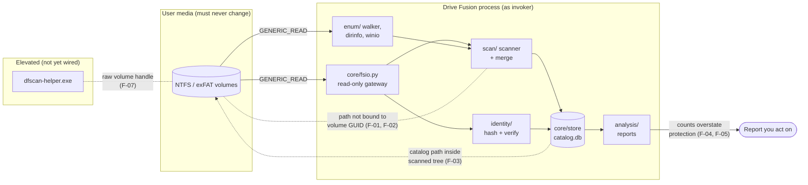
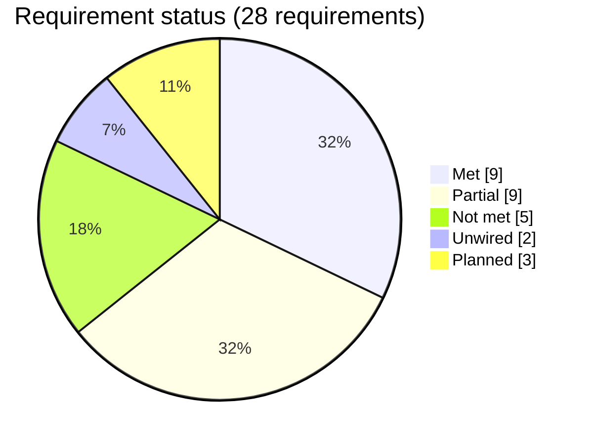
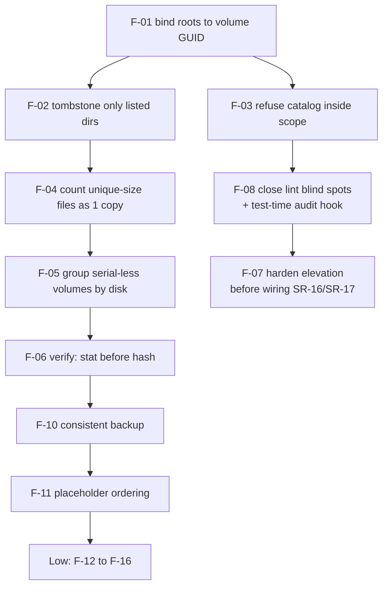

# Drive Fusion — Safety, File-Integrity and Security Review

| | |
|---|---|
| **Scope** | Requirements in [`PLAN.md`](PLAN.md) and [`README.md`](../README.md), and the code at `main` (`ca6c4e0`, milestones M0–M4) that implements them |
| **Focus** | (1) safety of user data on catalogued media, (2) correctness of the file and redundancy facts the tool reports, (3) security of the privileged and packaging surface |
| **Method** | Every source module read in full; lint and full test suite run on Linux (291 passed, 5 Windows-only skipped) and checked against the latest Windows CI log (293 passed, 3 skipped); every finding below reproduced with [`tools/review_repro.py`](../tools/review_repro.py) or shown directly in code. Each claim was checked three times: against the code, against a running reproduction, and against the test that would be expected to catch it |
| **Date** | 2026-10-27 |

---

## 1. Summary

Drive Fusion's central promise, *"never modifies, moves, or deletes your data"*, **holds for
every code path that exists today**. User files are opened through a single gateway with
`GENERIC_READ` and `OPEN_EXISTING`; volume handles are read-only; outside the catalog store
(`core/store`, which creates and backs up its own database), nothing calls a mutating
filesystem API; and a no-touch regression test confirms that a fixture tree stays
byte-identical through scan, hash, verify, report and browse on both Linux and Windows CI.

The weaknesses are elsewhere. They sit in **the facts the tool reports** and in **the edges of
the safety argument**:

* **Wrong answers that look like correct ones.** Four defects can make a report show
  *more* protection or *less* data than really exists. That is the dangerous direction for a
  preservation tool, because a user may act on it, for example by retiring a drive they think
  is redundant ([F-01](#f-01), [F-02](#f-02), [F-04](#f-04), [F-05](#f-05)).
* **One way to write to scanned media.** The catalog database may be placed inside a scanned
  tree, and nothing prevents it ([F-03](#f-03)).
* **A safety argument stronger than its mechanisms.** The documents described the four
  read-only layers as *independent*. In practice the lint has blind spots that no other layer
  covers ([F-08](#f-08)).
* **Documentation ahead of the code.** Several features described as done are libraries with
  no user entry point, or are not implemented: the per-scan UAC prompt, incremental rescan,
  the audit log, and first-run disclaimer acknowledgement ([F-09](#f-09)). This change corrects
  the documents. It does not change any code.

Figure 1 shows where each finding sits in the data flow.



*Figure 1 — Data flow and where each finding attaches. Solid lines are reads; dotted lines are
findings.*

### Findings at a glance

| ID | Severity | Area | One-line statement | Reproduced |
|---|---|---|---|---|
| [F-01](#f-01) | **High** | File facts | Scans, hashes and verifies follow a stored drive-letter path, not the catalogued volume's identity | R1 |
| [F-02](#f-02) | **High** | File facts | A directory that cannot be listed, or a root whose drive is unplugged, gets its whole subtree tombstoned as "vanished" | R1, R2 |
| [F-03](#f-03) | **High** | Safety | The catalog database (plus `-wal`/`-shm`) can be created inside a scanned tree | R3 |
| [F-04](#f-04) | **High** | File facts | Files of unique size, which by definition have exactly one copy, are missing from the under-protected report | R4 |
| [F-05](#f-05) | Medium | File facts | Volumes whose drive serial can't be read each count as a separate drive, which can overstate copies | R6 |
| [F-06](#f-06) | Medium | File facts | `verify` reports an ordinary edit as a fixity mismatch, because it never compares size or mtime | R5 |
| [F-07](#f-07) | Medium | Security | The elevation launcher checks only the helper's filename and existence: no signature or hash check, and parameters are joined unquoted | code |
| [F-08](#f-08) | Medium | Safety | `ro_lint` misses `subprocess`, `os.write`, `io.open`, numeric `os.open` flags, Win32 mutators via ctypes, `sqlite3.connect`, and `getattr` indirection | R8 |
| [F-09](#f-09) | Medium | Accuracy | Docs describe unwired or unimplemented features as done (corrected by this change) | code |
| [F-10](#f-10) | Medium | Catalog integrity | The pre-migration backup is a file copy taken while the database is in WAL mode, so it can miss committed data | R10 |
| [F-11](#f-11) | Medium | File facts | Cloud placeholders that expose the reparse attribute are dropped from the catalog instead of being recorded by metadata | R11 |
| [F-12](#f-12) | Low | Accuracy | "Last scanned" shows when the volume was added, not when it was last scanned | R12 |
| [F-13](#f-13) | Low | Usability | Cancel is checked every 10,000 staged files, not per directory | R7 |
| [F-14](#f-14) | Low | Robustness | `CreateFileW`/`FindFirstVolumeW` have no `restype`, so `INVALID_HANDLE_VALUE` is never matched | R9 |
| [F-15](#f-15) | Low | Accuracy | The coverage line counts unlistable directories as unread *files* | R1 |
| [F-16](#f-16) | Low | Safety | `open_read` checks attributes without following links, then opens the path *with* link following | code |

**Severity scale.** *High*: can write to user media, or can lead a user to believe data is
safer than it is. *Medium*: a wrong or misleading result in a narrower case, or a security
weakness that is latent today. *Low*: misleading presentation or degraded diagnostics with no
wrong safety conclusion.

---

## 2. User needs, requirements and specification

The table traces each **user need** (what the person relying on the tool needs to be true) to
**system requirements** (testable statements derived from the plan) and to the
**specification as built** (the mechanism in code), with how it is **verified** and an
assessed **status**.

Status legend: **Met**, meaning implemented and verified · **Partial**, meaning implemented
with a defect or gap · **Not met**, meaning implemented but the requirement is violated ·
**Planned**, meaning not implemented, scheduled for a later milestone · **Unwired**, meaning
implemented as a library with no user-facing entry point.

### 2.1 User needs

| ID | User need |
|---|---|
| **UN-1** | My data is never modified, moved, renamed or deleted, and the tool writes nothing onto my drives. |
| **UN-2** | I can find out what exists and on which physical drive, even when that drive is unplugged. |
| **UN-3** | I can trust the number of real copies the tool reports, counted over distinct physical drives. |
| **UN-4** | I am told about silent corruption, and not shown false alarms. |
| **UN-5** | Only what I explicitly choose is scanned. |
| **UN-6** | The tool does not need, or misuse, administrator rights. |
| **UN-7** | The catalog itself survives crashes and upgrades. |
| **UN-8** | Nothing leaves my machine, and cloud-only files are never downloaded. |
| **UN-9** | What the tool does not know is shown as unknown: coverage, staleness and unhashed files. |
| **UN-10** | Long operations stay responsive and can be cancelled. |
| **UN-11** | I am not misled into treating the tool as a compliance instrument. |

### 2.2 Requirements and specification traceability

| Req | Need | Requirement | Specification as built | Verification | Status |
|---|---|---|---|---|---|
| SR-01 | UN-1 | No module outside `core/store` and `core/export` may invoke a filesystem mutation. | `core/fsio.py` exposes only `scandir`, `stat`, `open_read`; `tools/ro_lint.py` rules DF001–DF007 run as a CI step. | `test_ro_lint.py`; CI "Read-only lint" step | **Partial**: lint blind spots ([F-08](#f-08)) |
| SR-02 | UN-1 | User files are opened read-only, without blocking other processes. | `CreateFileW(GENERIC_READ, FILE_SHARE_READ\|WRITE\|DELETE, OPEN_EXISTING)` (`fsio.py:326`); `ReadOnlyBinaryFile` raises `ReadOnlyViolation` on `write`/`truncate`. | `test_handles_refuse_to_write`; `test_no_touch.py` | **Met** |
| SR-03 | UN-1 | Volume, directory and device handles cannot write. | `winio.open_volume` / `open_directory`: `GENERIC_READ`, `OPEN_EXISTING`; discovery opens with zero access; DF006 rejects write-access names in raw-handle modules. | Code review; DF006 | **Met**. DF006 matches names only, not numeric literals or creation dispositions ([F-08](#f-08)) |
| SR-04 | UN-1 | The tool writes nothing inside a scope root or on a catalogued volume. | **No check.** Catalog path comes from `--catalog` or `DRIVEFUSION_CATALOG` (`cli/main.py:34`); `validate_new_root` doesn't compare against it. | None | **Not met** ([F-03](#f-03)) |
| SR-05 | UN-1 | An end-to-end regression shows media unchanged after every stage. | `test_no_touch.py` snapshots a fixture tree, runs scan ×2, hash, verify, reports and browse, then re-snapshots. | Linux + Windows CI | **Partial**: access times asserted only on POSIX with `O_NOATIME`; helper, USN and delta paths not exercised |
| SR-06 | UN-8 | Cloud placeholders are never opened, and are catalogued by metadata. | `open_read` refuses `OFFLINE`/`RECALL_ON_OPEN`/`RECALL_ON_DATA_ACCESS` (`fsio.py:368`); scanner marks `skipped-dehydrated`; hash candidates require `read_state='ok'`. | `test_cloud_placeholders_are_never_opened`, `test_dehydrated_files_are_catalogued_but_not_opened`, `test_hashing_refuses_cloud_placeholders` | **Partial**: "never opened" met; "catalogued" fails when the reparse attribute is visible ([F-11](#f-11)) |
| SR-07 | UN-8 | No outbound network connections. | No network modules imported anywhere in `drivefusion/`. | Inspection only (no lint rule) | **Met**, not enforced |
| SR-08 | UN-5 | Only explicitly added roots are scanned; nested roots refused; links not traversed; OS churn excluded. | `scope/registry.py` (`validate_new_root`, `ExclusionSet`); walker refuses to descend reparse points. | `test_scope.py`, `test_enum_batchwalk.py` | **Met** |
| SR-09 | UN-2, UN-3 | A scan, hash or verify acts on the catalogued **volume identity**, never on whatever is now mounted at a drive letter. | Root stored as an absolute path (`E:\Research`); `cmd_scan` passes `root.path` straight to `scan_root` (`cli/main.py:291`); hashing rebuilds paths from that text. No GUID check. | None | **Not met** ([F-01](#f-01)) |
| SR-10 | UN-2, UN-9 | A path that was not examined is *unknown*, not *gone*. | Delta merges use `vanish_scope="staged-dirs"` (correct). Full scans tombstone everything under the root that wasn't seen, including unlistable subtrees (`catalog.py:479`). | Delta: `test_enum_delta.py`. Full scan: none | **Not met** for full scans ([F-02](#f-02)) |
| SR-11 | UN-3 | Copies are counted over distinct physical drives; hardlinks are one physical copy. | `DRIVE_KEY = COALESCE(v.drive_id, -v.id)`; physical copies = distinct `(volume, frn)`. | `test_analysis.py` | **Partial**: serial-less volumes overstate drives ([F-05](#f-05)) |
| SR-12 | UN-3, UN-9 | The under-protected report includes every item with fewer copies than the target. | `under_protected` inner-joins `content`, so only hashed files are considered. | `test_analysis.py` (hashed files only) | **Not met** ([F-04](#f-04)) |
| SR-13 | UN-4 | Fixity separates corruption (bytes changed, metadata unchanged) from modification. | `verify_pass` re-hashes and compares digests only (`pipeline.py:197`). | `test_identity.py` | **Partial** ([F-06](#f-06)) |
| SR-14 | UN-6 | The main application runs as invoker and never silently elevates. | `drivefusion.manifest`: `requestedExecutionLevel="asInvoker"` for all three executables. | CI build smoke test | **Met** |
| SR-15 | UN-6 | Before anything is elevated, the binary is proven to be the genuine helper and its arguments can't be reinterpreted. | `elevation.request` checks the filename equals `dfscan-helper.exe` and the file exists; parameters `" ".join(...)` (`elevation.py:130–170`). | `test_gui_shell.py` (rejects a wrong filename) | **Partial**: no signature or hash check, no quoting ([F-07](#f-07)). Latent: no caller |
| SR-16 | UN-6 | Elevation is offered per scan, and consent is recorded. | `elevation.request` exists; **no GUI or CLI code calls it**; `scan.elevated` is always written as 0. | n/a | **Unwired** ([F-09](#f-09)) |
| SR-17 | UN-2 | An NTFS rescan reads only what changed (USN delta). | `core/enum/delta.apply_delta`, journal validity logic, helper protocol, all unit-tested; **not called by `cmd_scan` or the GUI**; `decide()` returns `walk` whenever not elevated. | `test_enum_delta.py`, `test_enum_journal.py`, `test_enum_helper.py` | **Unwired** |
| SR-18 | UN-7 | A schema migration first takes a consistent backup of the catalog. | `shutil.copy2` of the main file after opening in WAL mode (`schema.py:322`). | None | **Partial** ([F-10](#f-10)) |
| SR-19 | UN-7 | A failed or cancelled scan leaves the previous catalog state. | Staging + one-transaction merge; rollback on exception. | `test_scanner.py`, `test_store.py` | **Met**. Staged rows of a cancelled scan are left behind in `stage_file` |
| SR-20 | UN-9 | Per-volume staleness is shown truthfully. | `describe_age(volume.last_seen_at)`; `last_seen_at` only changes in `upsert_volume`, which runs at `scope add`. | None | **Not met** ([F-12](#f-12)) |
| SR-21 | UN-9 | Unknown copy counts are shown as unknown. | GUI renders "—" for files without `content_id`; CLI report prints the unhashed count. | `test_unhashed_files_show_copies_as_unknown` | **Met** |
| SR-22 | UN-9 | Scan coverage (unreadable, excluded, dehydrated, links) is reported. | `ScanCounters.coverage_line()`. | `test_scanner.py` | **Partial**: wording ([F-15](#f-15)) |
| SR-23 | UN-10 | Cancel takes effect within one directory. | Cancel is checked inside the scanner's `progress` callback, which fires once per 10,000 staged files. | `test_cancellation_stops_work_partway_through` (synthetic task body, not `scan_root`) | **Partial** ([F-13](#f-13)) |
| SR-24 | UN-1 | The UI offers no destructive control. | Widget-tree test bans destructive verbs on every control. | `test_no_control_offers_a_destructive_action` | **Met** |
| SR-25 | UN-11 | First-run disclaimer, acknowledged and recorded. | Not implemented. | n/a | **Planned** |
| SR-26 | UN-7, UN-11 | Append-only, hash-chained audit log. | `audit` table created; nothing writes to it. | n/a | **Planned** |
| SR-27 | UN-1 | Exports go only to a new, timestamped folder inside a chosen root. | `core/export/` is a docstring. | n/a | **Planned** (M8) |
| SR-28 | UN-6 | The elevated helper has a minimal, read-only surface. | `helper/__main__.py`: argparse, `query`/`enum`/`delta` modes, `GENERIC_READ` volume handle, frames to stdout. | `test_enum_helper.py` (stand-in child) | **Met** for the code; no real-volume test |



*Figure 2 — Status across the 28 requirements. SR-03 and SR-07 count as Met, with the notes
given in the table.*

### 2.3 Discussion

**The read-only guarantee (UN-1) holds, and the reasons are concrete.** Every handle that
touches user media requests read access only, and uses `OPEN_EXISTING`, so it can't even
create a file. The only writers are the SQLite catalog and a backup copy next to it. The
no-touch test is well built: it fails if its own snapshot observes nothing, and it checks
named landmark paths, so a broken fixture can't pass silently. Its main gap is coverage of
future paths. The elevated helper and the USN delta never run inside it, because they need a
real NTFS volume handle.

What the guarantee does *not* cover is **where the catalog lives** ([F-03](#f-03)). In a
cataloguing tool whose own plan recommends a "portable mode" on a thumb drive, putting the
catalog on a drive that is also catalogued is a realistic mistake. If it happens, every scan
writes `catalog.db-wal` into the tree being observed, and catalogues it.

**The reported file facts (UN-2, UN-3, UN-9) are where the real risk lies.** A preservation
tool can be wrong in two directions. Under-reporting copies is annoying but safe: you make an
extra copy. Over-reporting copies, or failing to list a single-copy file, is unsafe: you
retire a drive believing the data lives elsewhere. Four findings push in the unsafe
direction:

* **[F-01](#f-01)**: if a different drive comes up as `E:`, its files are recorded under the
  old drive.
* **[F-04](#f-04)**: the files most certainly at risk, those whose size is unique, are absent
  from the at-risk list.
* **[F-05](#f-05)**: two partitions on one serial-less USB disk read as two drives.
* **[F-02](#f-02)**: the reverse failure. Data that was merely unreadable is marked gone,
  which then silently removes those copies from every redundancy count.

All four come from the same principle that the code applies well elsewhere but not here:
*identity and absence must be established, not inferred.* The delta path already follows
that principle, through `vanish_scope="staged-dirs"`, and the full-scan path should be
brought into line with it.

**Security (UN-6, UN-8) is in good shape for what is wired, because very little privileged
code is wired.** The main process runs as invoker; the helper is small and read-only; no
network code exists. The elevation launcher ([F-07](#f-07)) is the one component that would
hand out Administrator, and it is not yet connected. It should be hardened before it is: verify
the helper's Authenticode signature or a pinned hash, keep it out of user-writable
directories, quote its parameters, and give it an ACL-protected pipe back to the parent.
Today `SW_HIDE` + `runas` would start a helper whose stdout reaches no one.

**Documentation accuracy (all needs).** The project documents are unusually candid about
limits, which makes the overstated places easier to spot. [F-09](#f-09) lists each one; this
change fixes them in `README.md` and `PLAN.md`.

---

## 3. Findings in detail

Each finding gives the evidence (file and line), a concrete failure scenario, the
reproduction, and a recommended fix. Reproduction IDs (R1–R12) refer to
[`tools/review_repro.py`](../tools/review_repro.py).

<a id="f-01"></a>
### F-01 · High · Scope roots bind to a drive-letter path, not to the volume

**Evidence.** `scope_root.path` stores an absolute path such as `E:\Research`. `cmd_scan`
(`cli/main.py:291`) and the GUI `scan_body` (`gui/screens/scope.py`) pass that text straight
to `scan_root`. `hash_pass` and `verify_pass` rebuild file paths from the same text
(`identity/pipeline.py:62`). Nothing checks that the volume now mounted at `E:` has the
`volume_guid` recorded for the root.

**Failure scenarios.**
1. Drive A is unplugged and `E:` is empty. The root can't be listed, so the scan tombstones
   every file on it ([F-02](#f-02)).
2. Drive B, a backup of A, is plugged in and receives letter `E:`. The scan records B's files
   under **A's** `volume_id`, and therefore under A's drive. A now looks current; B's copies
   are attributed to A, and copy counts merge two physical drives into one, or split one
   into two.
3. `hash` or `verify` with drive B at `E:` reads B's bytes and records them as A's content or
   fixity.

**Reproduction.** R1 (missing root → 5 of 5 files tombstoned).

**Fix.** At the start of every scan, hash and verify pass, resolve the root's current volume
GUID (`discovery.identify_volume`) and refuse to proceed unless it matches the recorded one.
Better still, store roots relative to the volume and open through the GUID path
(`\\?\Volume{…}\Research`), which survives letter changes, as PLAN §4 intends.

<a id="f-02"></a>
### F-02 · High · Unlisted directories are tombstoned as vanished

**Evidence.** In `scanner.py:153`, a directory whose listing failed is counted and skipped.
`merge_scan` then calls `_mark_vanished` with `vanish_scope="root"` (`catalog.py:479`), which
marks every file and directory under the root that this scan didn't see. Files under the
unlistable directory weren't seen, so they are recorded as vanished. The CLI then prints
"N entries no longer present (recorded, not removed)".

**Failure scenario.** A permissions change, a transient I/O error or an unplugged drive makes
a subtree unreadable for one scan. Its files drop out of `copies()`, out of the duplicate
groups and out of the browser. The next successful scan revives them, but anything decided in
between was based on false data.

**Reproduction.** R1 (whole root) and R2 (one subdirectory, 3 of 3 files tombstoned).

**Fix.** Record the directories a full scan actually listed (`stage_dir`, as the delta path
already does) and tombstone only inside them. Never tombstone anything beneath a directory
whose listing failed. Refuse the merge outright if the root itself couldn't be listed.

<a id="f-03"></a>
### F-03 · High · The catalog can be written inside a scanned tree

**Evidence.** `DEFAULT_CATALOG` is `~/.drivefusion/catalog.db`, but it can be overridden by
`--catalog` or `DRIVEFUSION_CATALOG` (`cli/main.py:34`). Neither `validate_new_root` nor
`Catalog()` checks whether the catalog path lies inside a scope root, or a scope root on the
catalog's volume.

**Failure scenario.** A user follows the plan's "portable mode" idea and keeps the catalog on
an external drive that is itself in scope. Every scan then creates or changes
`catalog.db`, `catalog.db-wal` and `catalog.db-shm` inside the observed tree, and catalogues
them. This breaks UN-1 and makes that volume's catalog self-referential.

**Reproduction.** R3: the tree is `['data.bin']` before the scan and
`['catalog.db', 'catalog.db-shm', 'catalog.db-wal', 'data.bin']` after it.

**Fix.** Refuse to open a catalog inside any enabled scope root. Refuse `scope add` for a root
that contains the catalog or the export root. Exclude the catalog's directory from every
scan as a final defence.

<a id="f-04"></a>
### F-04 · High · Single-copy files of unique size are missing from "under-protected"

**Evidence.** `hash_candidates` deliberately skips files whose size occurs only once. That is
correct, because they can't be duplicates. But `_group_rows` and `under_protected`
(`analysis/duplicates.py:50`, `:93`) inner-join `content`, so a file with no `content_id` is
never considered. A file whose size is unique in the catalog is, by construction, held exactly
once, so it is certainly under-protected for any `min_copies ≥ 2`.

**Failure scenario.** A user runs `drivefusion report` and sees "under-protected: 2 items".
The largest single-copy video, the only file of its size, isn't among them. The headline
`unhashed_files` note says these files "are never opened". It doesn't say they are single
copies.

**Reproduction.** R4: under-protected = 2 items; the unique 999-byte file is not listed.

**Fix.** Treat files of unique size as one copy each, which needs no hashing, and include
them in `under_protected` and `redundancy_summary`. Keep "unhashed" for files whose size *is*
shared but which haven't been hashed yet, because only those are genuinely unknown.

<a id="f-05"></a>
### F-05 · Medium · A volume with no readable serial counts as its own drive

**Evidence.** `DRIVE_KEY = COALESCE(v.drive_id, -v.id)` (`duplicates.py:27`). `drive_id` is
set only when `IOCTL_STORAGE_QUERY_PROPERTY` returns a serial (`cli/main.py:190`), which the
plan itself notes is often missing over USB bridges.

**Failure scenario.** One USB disk with no reported serial carries two partitions. Content on
both partitions is reported as "2 copies on distinct drives" when it is on one device.
Separately, some bridges report the *bridge's* serial, which would merge different disks into
one. That direction is safe but still wrong.

**Reproduction.** R6: two partitions, no serial → 0 under-protected groups.

**Fix.** Group serial-less volumes by `IOCTL_VOLUME_GET_VOLUME_DISK_EXTENTS` disk number,
together with disk signature or GUID (`IOCTL_DISK_GET_DRIVE_LAYOUT_EX`), at discovery time.
Report "drive identity unverified" next to any copy count that depends on such a volume, and
leave those volumes out of the "distinct drives" total until a user confirms them.

<a id="f-06"></a>
### F-06 · Medium · `verify` reports legitimate edits as fixity mismatches

**Evidence.** The docstring and schema define silent corruption as "hash changed while its
modification time did not". `verify_pass` (`pipeline.py:197`) never stats the file or compares
size or mtime with the catalog. Any change since the last scan is recorded as `mismatch`,
shown under "fixity failures", and makes `verify` exit 1.

**Failure scenario.** A user edits a document, then runs `verify` before rescanning. The
report calls it a fixity failure. False alarms of this kind train people to ignore the real
ones.

**Reproduction.** R5: the file is edited (mtime changes) → `mismatched: 1`.

**Fix.** Before hashing, `fsio.stat` the file. If size or mtime differs from the catalog row,
record `modified` (or `stale`) rather than hashing. Report `mismatch` only when the metadata
is unchanged.

<a id="f-07"></a>
### F-07 · Medium · The elevation launcher doesn't authenticate what it elevates

**Evidence.** `gui/elevation.py`:
* `helper_path()` (`:72`) takes the directory of `sys.executable` or of `sys.argv[0]`.
* `request()` (`:130`) refuses only when the resolved name isn't `dfscan-helper.exe` or the
  file doesn't exist. The module docstring says the path is "verified", but there is no
  signature or hash check.
* `parameters = " ".join(arguments)` (`:149`). `ShellExecuteW` takes a single command-line
  string, so an argument containing a space or a quote would be split or reinterpreted.
  (The docstring says this can't happen.)
* The helper is launched with `SW_HIDE` and there is no pipe back, so its framed stdout would
  reach no one.

**Failure scenario (once wired).** In portable mode, or in any per-user install, the
application directory is writable by the user. Any unprivileged process can replace
`dfscan-helper.exe`. The next time the user accepts a UAC prompt for a "fast scan", the
replacement runs as Administrator. The binaries are currently unsigned
(`codesign_identity=None`), so the prompt shows "Unknown publisher" either way and gives the
user no signal.

**Status today.** Latent. `request()` has no caller (see [F-09](#f-09)).

**Fix (before wiring).**
1. Install to a directory that only administrators can write, or verify the helper's
   Authenticode signature (`WinVerifyTrust`) or a hash pinned at build time immediately before
   the `runas` launch.
2. Build the parameter string with `subprocess.list2cmdline`.
3. Carry output over a named pipe whose ACL admits only the launching user's SID.
4. Sign all three executables.

<a id="f-08"></a>
### F-08 · Medium · `ro_lint` blind spots

**Evidence.** `tools/ro_lint.py` bans named filesystem mutators on `os`, `shutil` and
`pathlib`, write-intent `os.O_*` names, non-`"rb"` modes on builtin `open` and `Path.open`, and
raw-handle APIs outside an allowlist. Each probe below passes the lint with **zero findings**
(R8):

| Probe | Why it matters |
|---|---|
| `subprocess.run([...])`, `os.system`, `os.startfile` | Runs any program, including `del`, `format` or `diskpart` |
| `os.open(path, 0x241)` (numeric flags) | `O_WRONLY \| O_CREAT \| O_TRUNC` by value |
| `io.open(path, "wb")`, `io.FileIO(path, "w")` | Same as `open()`, different name |
| `os.write(fd, …)` | Writes through any descriptor |
| `ctypes…kernel32.DeleteFileW / MoveFileExW / SetFileTime / SetFileAttributesW / WriteFile` | DF007 restricts only `CreateFileW/A` and `DeviceIoControl` |
| `sqlite3.connect(path_on_media)` | Creates a database file and its WAL wherever it is pointed |
| `getattr(os, "re" + "move")(…)` | Name indirection |

The lint's docstring is honest that AST analysis "cannot resolve arbitrary receivers". It
argues that the other layers cover the gap. For these probes they don't. The gateway is a
convention, not a sandbox. OS-level read-only enforcement applies only to handles the gateway
opened. The no-touch test only exercises code paths it calls. So the PLAN's statement that a
regression "must defeat four independent mechanisms" overstated the case. The mechanisms are
complementary, and for these classes the lint is the only one.

**Fix.** Add `subprocess`, `os.system`, `os.startfile`, `os.popen`, `os.write`, `io.open`,
`io.FileIO`, `os.open` with a non-literal or write-capable flag expression, `sqlite3.connect`
outside `core/store`, and a deny-list of Win32 mutator names to the rules. Flag `getattr` on
filesystem modules with a non-literal name. Optionally add a runtime audit hook
(`sys.addaudithook`) in tests that fails on `open` events with write modes, and on
`os.remove`, `os.rename` and `subprocess.Popen`, outside the catalog directory.

<a id="f-09"></a>
### F-09 · Medium · Documentation described unwired or unimplemented features as done

Every row below was verified against the code at `ca6c4e0` and **has been corrected in this
change**.

| Claim (where) | Fact |
|---|---|
| "UAC prompt" and "UAC elevation offered per scan" as M4 deliverables (README, PLAN §6.5, §15) | `gui/elevation.request` exists and is unit-tested; nothing calls it. The GUI shows only a status-bar line. |
| "rescan incrementally" from CLI or desktop (README); M2 "incremental rescan" | `core/enum/delta.apply_delta` is implemented and tested, but neither `cmd_scan` nor the GUI calls it. Every user-initiated scan is a full walk. |
| Elevation consent and first-run disclaimer "recorded in the audit log" (PLAN §1, §6.5) | The `audit` table exists; nothing writes to it, and there is no first-run disclaimer. |
| Helper "covered by the same AST lint **and no-touch test**" (PLAN §6.5) | Lint: yes. No-touch: no, because the helper needs a real NTFS volume handle. |
| No-touch assertion "including access times" (PLAN §3.2, §14) | Asserted only on POSIX where `O_NOATIME` is granted; skipped on Windows. |
| Cancel "takes effect within a directory" (README, PLAN §11) | Checked every 10,000 staged files ([F-13](#f-13)). |
| Catalog in `platformdirs.user_data_dir`, with a portable mode (PLAN §12) | `~/.drivefusion/catalog.db`, overridable; no portable mode, and `platformdirs` isn't a dependency. |
| Default exclusions include `C:\Program Files*`, `AppData\Local\Temp` and package caches (PLAN §4) | Code excludes `C:\Program Files`, `C:\Program Files (x86)`, `C:\ProgramData\Package Cache` and named patterns including `*.tmp` and `~$*`; there is no `AppData\Local\Temp` rule. |
| Silent corruption = "hash changed while mtime did not" (PLAN §8.1) | `verify` doesn't compare mtime ([F-06](#f-06)). |
| "A regression must defeat four independent mechanisms" (PLAN §16) | Complementary, not independent ([F-08](#f-08)). |
| Elevation path "derived and then verified"; "no command line for a quoting mistake to escape from" (`gui/elevation.py` docstring) | Name check only; parameters are a joined string ([F-07](#f-07)). *Code comment, not changed here.* |

<a id="f-10"></a>
### F-10 · Medium · Pre-migration backup copies only the main file of a WAL database

**Evidence.** `Catalog.__init__` connects (setting `journal_mode=WAL`) and then calls
`migrate`, which runs `backup_catalog`, which runs `shutil.copy2(path, target)`
(`schema.py:322–330`). Committed transactions that are still in `catalog.db-wal` (for
example after a crash, or while another process holds the catalog open) aren't in the main
file, so the backup is stale. It may not even contain the schema.

**Reproduction.** R10: three committed rows still in the WAL → the copied backup reports "no such
table".

**Fix.** Use `sqlite3.Connection.backup()` or `VACUUM INTO 'target'`. Both produce a
transactionally consistent snapshot that includes WAL content.

<a id="f-11"></a>
### F-11 · Medium · Placeholders with a visible reparse attribute are dropped, not catalogued

**Evidence.** `scanner.py:169` tests `is_reparse_point` *before* `is_dehydrated`
(`scanner.py:191`). Cloud Files API placeholders are reparse points. Whether
`FILE_ATTRIBUTE_REPARSE_POINT` is visible to this process depends on the process's
placeholder-compatibility mode. Where it is visible, the placeholder is counted as "links not
traversed" and never recorded. The existing test injects only `RECALL_ON_DATA_ACCESS`, so it
doesn't cover this combination.

**Reproduction.** R11: `REPARSE_POINT | RECALL_ON_DATA_ACCESS` → "0 of 0 files read; 1 links not
traversed"; 0 files catalogued.

**Impact.** Safe, because the file is never opened, but contrary to SR-06. Cloud-only content
disappears from the catalog, and so does the only record that it exists locally only as a
placeholder.

**Fix.** For non-directories, test dehydration first. Distinguish cloud reparse tags from
symlinks and junctions (the reparse tag is available from `FileAttributeTagInfo` or
`FILE_ID_BOTH_DIR_INFO.EaSize`). Add a test with both attributes set, and verify the behaviour
on a real OneDrive folder.

<a id="f-12"></a>
### F-12 · Low · "Last scanned" is the time the volume was added

**Evidence.** `scope list`, `status` and the GUI Scope and Drives screens all show
`describe_age(volume.last_seen_at)`. `last_seen_at` is written only by `upsert_volume`, which
runs at `scope add`. A scan never updates it.

**Reproduction.** R12: `last_seen_at` is unchanged by a scan. Through the CLI, `scope list`
run straight after a scan printed "last scanned: 9 months ago".

**Fix.** Show the latest `scan.finished_at` with `status='done'` for each root, or update a
`last_scanned_at` column in `finish_scan`.

<a id="f-13"></a>
### F-13 · Low · Cancel granularity is 10,000 files, not one directory

**Evidence.** The GUI checks cancellation inside the scanner's `progress` callback. The scanner
calls `progress` only after staging each batch of `BATCH_ROWS` (10,000) files
(`scanner.py:214`). A root with fewer files, or a deep tree of mostly empty directories, can't
be cancelled until it finishes. The full-hash pass checks once per duplicate group, so one
group of large files can't be interrupted either.

**Reproduction.** R7: a 201-directory scan made 0 progress callbacks.

**Fix.** Pass a cancellation callable into `scan_root` and `hash_pass`, and check it per
directory result and per file.

<a id="f-14"></a>
### F-14 · Low · Missing `restype` defeats the `INVALID_HANDLE_VALUE` check

**Evidence.** `winio.py:55`, `:82` and `discovery/windows.py:104`, `:345` call
`kernel32.CreateFileW` or `FindFirstVolumeW` from a `ctypes.WinDLL` without setting `restype`,
so the return value is a C `int`. Failure returns `-1`, but the code compares against
`ctypes.c_void_p(-1).value`, which is 18446744073709551615 on 64-bit, so failures are never
detected. The `-1` "handle" then goes to `DeviceIoControl` or `GetFileInformationByHandleEx`,
which fail with `ERROR_INVALID_HANDLE`. (`-1` is the current-process pseudo-handle; the
volume IOCTLs reject it, so nothing harmful happens.) `fsio.py` sets `restype` correctly.

**Impact.** Access-denied failures surface as WinError 6, not 5, so the helper's
"administrator rights required" message and the `access` status code are never produced.
Valid handles are also truncated to 32 bits. That is harmless in practice, but it is
undefined behaviour.

**Reproduction.** R9 (the comparison itself).

**Fix.** Declare `argtypes` and `restype = wintypes.HANDLE` for every Win32 call, as
`fsio._open_fd_windows` already does.

<a id="f-15"></a>
### F-15 · Low · Coverage line counts directories as files

`ScanCounters.coverage_line` (`scanner.py:53`) adds unreadable *directories* to the file
total, which yields "0 of 1 files read; 1 unreadable" for a missing root (R1). Report
unreadable directories and unreadable files separately, and say that the unreadable
directories' contents are unknown.

<a id="f-16"></a>
### F-16 · Low · `open_read` checks attributes without following links, then opens following them

`open_read` (`fsio.py:362`) checks dehydration with `stat(path, follow_symlinks=False)`, then
opens the path with `CreateFileW` without `FILE_FLAG_OPEN_REPARSE_POINT` (or `os.open` without
`O_NOFOLLOW`), which follows links. The scanner never catalogues links, so this is reachable
only if a path is replaced by a link between the scan and the hash, a time-of-check to
time-of-use race. If it happens, the read can leave the scope or hydrate a placeholder the
link points to. Fix: after opening, check the attributes of the *handle*
(`GetFileInformationByHandle`, or `fstat`), and refuse if they show a reparse point or a
recall attribute.

---

## 4. Strengths worth keeping

* **Defence in depth at the handle level.** Every `CreateFileW` uses `GENERIC_READ` (or zero
  access) together with `OPEN_EXISTING`, and DF006 rejects write-access names inside
  raw-handle modules.
* **Self-checking tests.** The no-touch snapshot refuses to be empty and checks landmark paths;
  CI asserts that Qt starts, so the GUI tests can't skip silently; the widget-tree test bans
  destructive verbs.
* **Careful SQL.** NULL-in-UNIQUE traps are handled explicitly for root directories and for
  quick-hash-only content. The merge is one set-based transaction, and the journal cursor
  advances only after a merge.
* **Honest delta design.** The journal only says *which* directories to re-read; the listing
  stays the source of truth, and tombstoning is scoped to the directories examined. The
  full-scan path should adopt the same rule ([F-02](#f-02)).
* **Unknown kept as unknown in the GUI.** "—", not "1", for unhashed copy counts.
* **A small, read-only elevated helper** that forwards raw buffers so there is one parser, a
  framed protocol that rejects truncation, and structured error status on stderr.

---

## 5. Recommended order of work



*Figure 3 — Suggested order. Fix the high-severity file-fact and safety findings first,
before M5 builds durability scoring on top of copy counts. Harden elevation before wiring the
UAC prompt and the delta rescan.*

---

## 6. Reproduction

```bash
pip install -e ".[dev]"
python tools/review_repro.py     # prints R1–R12 with FOUND / NOT FOUND
```

The script runs in temporary directories only. As each defect is fixed, its line should flip
to `NOT FOUND`; at that point the corresponding check belongs in the regular test suite.
