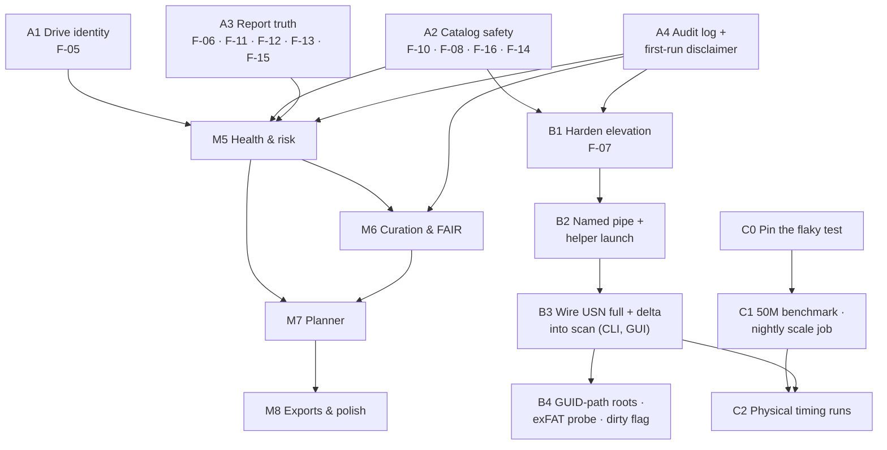

# Drive Fusion — Status and Roadmap (Plan Addendum A)

| | |
|---|---|
| **Date** | 2026-10-28 |
| **Baseline** | `main` at `ce03f64` (PR #8 merged) |
| **Relation to other documents** | Adds to [PLAN.md](PLAN.md); doesn't replace it. PLAN stays the design. This addendum records where the code stands against PLAN §15, what is still owed by milestones marked done, and the order of work to reach M5–M8. It draws on [REVIEW.md](REVIEW.md) (findings F-01 … F-16) and [VV.md](VV.md) (requirements R-*, tests VV-*) |
| **Status** | Accepted 2026-10-28 with the default answer to every decision in §6. **Track A is complete** (A2, A1, A3, A4; §4) |

---

## 1. Evidence gathered for this assessment

Everything below was re-run on 2026-10-28 against `ce03f64`, on Linux (Python 3.13) with the Qt
runtime libraries installed, so the GUI suite ran rather than skipping.

| Check | Result |
|---|---|
| `python tools/ro_lint.py` | clean, 54 files |
| `python -m pytest -q` | **336 passed, 5 skipped** (Windows-only) on most runs. **One run of the first ~20 had 1 failure** that hasn't reproduced in 55 full runs since; see §3.4 |
| `python tools/review_repro.py` | R1–R4 `NOT FOUND` (F-01 to F-04 fixed). R5–R12 **`FOUND`**: F-05, F-06, F-08 (7 probes), F-10, F-11, F-12, F-13, F-14 are still present |
| `python -m vv all` (simulated, 3, 6 and 9 drives, fresh seeds) | **PASS** on every run: 37 PASS, 1 N/A (VV-CAT-06, unreadable files can't be planted as root), 1 DEFERRED (VV-VER-01, M6) |
| GitHub | No open pull requests or issues |
| Code checks | `apply_delta` and `run_helper` have no caller outside their own modules. `elevation.request` has no caller. Nothing writes to the `audit` table. `core/export/` is a docstring. Schema is version 4. There is no `standards/` directory |

---

## 2. Milestone status

Legend: **Done**, meaning delivered and verified · **Done, with debt**, meaning the
deliverable exists but an acceptance criterion or listed item is still owed (§3) ·
**Not started**.

| # | Milestone | Status | Notes |
|---|---|---|---|
| **M0** | Skeleton and guardrails | **Done, with debt** | Gateway, lint, no-touch test, VHDX harness and the PyInstaller build are all in place. The lint has blind spots (F-08), so the guardrail is weaker than PLAN §3.2 implies |
| **M1** | Catalog core | **Done, with debt** | Benchmark gate passed at 3M files, decision: one database. The 50M-file run PLAN §7.2 calls for hasn't been done. F-12 (wrong "last scanned") lives here |
| **M2** | Fast enumeration | **Done, with debt** | The parsers, journal logic, batch walker, helper and delta are tested libraries. **Not wired**: every user scan is a full walk (SR-17). The exFAT retrieval-pointer check (PLAN §6.6, "verification task at M2") has been deferred three times and never done. Direct `$MFT` parsing is deferred, so the NTFS < 5 min budget can't be met |
| **M3** | Identity and analysis | **Done, with debt** | The VV rescan defect is fixed and every VV identity, redundancy and fixity test passes. F-05 (serial-less volumes overstated copies) was fixed in A1. Still open: F-06 (verify reports an edit as corruption) |
| **M4** | GUI shell | **Done, with debt** | Four of the eight PLAN §11 screens exist. The elevation launcher has no caller and isn't hardened (F-07, SR-16). Cancel works every 10,000 files, not per directory (F-13) |
| **M5** | Health and risk | **Done 2026-10-30**, SMART shelved (D11) | Drive metadata, a per-drive AFR model over a pinned Backblaze quarter, P(loss) and expected bytes lost a year, per-drive parallel hashing, and VV-HL-01…04. SMART reads are built but switched off, so every rate is `estimated` at best |
| **M6** | Curation and FAIR | **Done 2026-10-31** | Collections proposed and confirmed, coverage, version sets, FAIR and NDSA scorecards, name search, the Collections and Duplicates & Versions screens, and their V&V. Rubric wording reviewed and accepted; scorecards report consistency with FAIR and NDSA (D14, closed) |
| **M7** | Planner | **Done 2026-10-31** | Placement units, cluster-aware footprint and room, a greedy solver with CP-SAT over it when `ortools` is installed, the plan document with its simulation, `drivefusion plan` and the Plan screen, and VV-PLAN-01…04. Batch and zone are costs, not limits (D18): a copy sharing either is planned when it is the safest place with room, and named |
| **M8** | Exports and polish | **In progress** (breakdown 2026-10-31) | M8.1–M8.9 below, each measured on the V&V bench as it lands |

**Use cases (PLAN §2).** Use case 1 (catalog) and use case 2 (confirm redundancy, by copy
count) work from both the CLI and the GUI. Use case 2's *probability* half, P(loss), needs M5.
Use case 3 (plan the merge) works from M7; its exports (manifests, copy-only command previews) need M8.

---

## 3. What the "done" milestones still owe

PLAN §13 says the performance budgets "are the acceptance criteria for M1–M4… Missing one is a
milestone failure, not a footnote." Taken literally, M1–M4 aren't closed. This section lists
every open item so each one can be closed, scheduled, or formally waived.

### 3.1 Open review findings (from REVIEW.md, re-confirmed)

| ID | Sev. | Why it matters for what comes next |
|---|---|---|
| F-05 | Med | **Blocks M5.** P(loss) is a product over *drives*. If two partitions of one disk count as two drives, durability is overstated in exactly the unsafe direction REVIEW §2.3 warns about |
| F-06 | Med | Fixity incidents feed M6's NDSA Integrity score and M7's `verify` steps. A false alarm there costs credibility |
| F-10 | Med | **Blocks any schema migration.** M5 adds tables (schema v5). The backup taken before that migration has to be consistent |
| F-11 | Med | Cloud placeholders drop out of the catalog, so they're invisible to every later report |
| F-08 | Med | M5 introduces the first legitimate `subprocess` call (smartctl). The lint has to learn to tell an allowlisted call from any other one first, or the guardrail gets weaker just when it's needed |
| F-07 | Med | Has to be fixed before the helper is wired (§4, Track B) |
| F-12 | Low | Staleness is a headline PLAN §6.4 promise, and M5's "last seen 12 days ago" uses the same field |
| F-13 | Low | Cancel granularity; it gets worse once hashing runs per drive in parallel (M5) |
| F-14 | Low | Hides "access denied" from the helper, so it has to be fixed before wiring |
| F-15 | Low | Coverage wording |
| F-16 | Low | TOCTOU in `open_read`; check the handle after opening |

### 3.2 PLAN commitments with no owner yet

These are in PLAN but not attached to any milestone. This addendum assigns them.

| Item | PLAN | Proposed owner |
|---|---|---|
| First-run disclaimer, acknowledged and recorded (SR-25) | §1 | Track A (A4) |
| Append-only, hash-chained audit log (SR-26) | §7.3, §8.3 R1.2 | Track A (A4). Elevation consent (B) and FAIR R1.2 provenance (M6) both need it |
| Opening roots by volume GUID path, so a root follows its drive to a new letter | §4 | Track B |
| `AppData\Local\Temp` default exclusion | §4 | Track A (trivial) |
| Portable mode and `platformdirs` location | §12 | M8 |
| Catalog refused anywhere on a catalogued *volume* (not just inside a root); export root check | §3.2, F-03 | Both done: the volume check in Track A, the export root in M8.1 |
| Dry-run "likely changed?" probe for exFAT, dirty-volume flag | §6.4, §6.7 | Track B |
| Sparse/compressed allocated size, Server Dedup flag, ADS | §6.7 | M5 or later. They matter for capacity, so the M7 footprint needs at least allocated size |
| FTS5 filename and directory-path indexes | §7.4 | M6. The Collections screen needs path search |

### 3.3 Unmeasured acceptance budgets (PLAN §13)

| Budget | State | How to close |
|---|---|---|
| Catalog bytes/file, merge rate, RSS, duplicate scan | Measured at 3M, projected to 50M | Run `tools/benchmark.py --files 50000000` (~11 GB scratch) and record the result in PLAN §7.2 |
| exFAT full enumeration < 30 min, rescan < 35 min (10M files) | **Not measured** | Physical exFAT drive, or a large VHDX on the Windows runner, timed through `scan` |
| NTFS USN delta < 60 s | **Can't be measured until wired** (Track B) | After B3 |
| NTFS full enumeration < 5 min | **Can't be met** without `$MFT` parsing | Decision needed (§6, D3): waive for now, or schedule `$MFT` parsing |
| Quick hash, 5M candidates, external HDD < 8 h | **Not measured** | Physical HDD run |
| Report across 50M rows < 5 min | Projected 47 s | Confirmed by the 50M benchmark |
| GUI first page < 200 ms, UI-thread op < 50 ms | **Not asserted** anywhere | Add timing assertions to the GUI tests against a benchmark-sized catalog |
| Nightly scale test | **Doesn't exist** | A scheduled CI job (Track C) |

### 3.4 Test-suite health

* **One intermittent failure. Root cause found 2026-10-28 (A3).** It recurred during A3 and
  was caught with seed `244279970315808`. `test_simulated_drives_fit_the_size_they_were_given`
  summed file sizes per *path*, so a large file hardlinked three times onto the 12 MB drive
  was counted three times (12.78 MB) although it was stored once (11.52 MB, within the size).
  The generator was right and the test was wrong. The test now counts each inode once, and
  the seed is pinned as a regression test. The bench tests already print their seed on
  failure, which is what made this one catchable (C0).
* **GUI suite on Linux** skips silently unless `libEGL` and its companions are installed. CI
  installs them and asserts that Qt starts, so CI is sound. A local developer can still get a
  misleading green. README's development section should say so.
* PLAN §14 lists tests that don't exist yet: cross-filesystem parity on VHDX images,
  rename-on-exFAT on a *real* exFAT volume (VV covers it on simulated drives only),
  journal invalidation against a real journal (the decision logic is unit-tested), a
  placeholder with both reparse and recall attributes (F-11), and the scale test. The planner
  and scorecard tests belong to M6 and M7.

---

## 4. Plan of work

Four tracks. **A** closes the correctness debt that M5 builds on. **B** delivers the parts of M2
and M4 that were never wired. **C** produces the performance evidence. Then come the
remaining milestones. A comes first. B and C can run alongside M5, because they touch
different modules.

*Figure 1 — Dependencies. An arrow means "must be done first".*

### Track A — Correctness close-out ("M4.1")

Goal: every open finding that can make a report wrong, or that weakens a guardrail, is fixed
before durability numbers are layered on top. Each item ships with the regression test REVIEW
asks for, flips its `review_repro.py` line to `NOT FOUND`, and leaves the V&V bench green.

| Item | Work | Done when |
|---|---|---|
| **A1** F-05 drive identity · **Done 2026-10-28** | At discovery, group serial-less volumes by disk number plus disk signature or GUID (`IOCTL_VOLUME_GET_VOLUME_DISK_EXTENTS`, `IOCTL_DISK_GET_DRIVE_LAYOUT_EX`). Add a `drive.identity_confidence` column (`serial` / `disk-layout` / `unverified`). The report and GUI mark any copy count that depends on an unverified drive. A user can confirm or merge drives (CLI `drives merge`, and Drives screen) | R6 `NOT FOUND`. New VV requirement **R-RED-06**, "copies on two volumes of one device count once": the bench registers two simulated volumes on one mock device **Result:** done as planned, with two changes. The column is `drive.identity` (`serial` / `disk-layout` / `user`; *unverified* is a volume with no drive). And an unverified volume gets two counts, proven for protection and possible for reclamation, so neither report errs unsafely. The CLI verbs are `drives list / confirm / assign` ("merge" read like an operation on data). VV-RED-06 passes on 3–10 drives and fails against the previous code. The audit-log entry for a user's confirmation waits for A4 |
| **A2** Catalog and guardrail safety · **Done 2026-10-28** | F-10: back up with `Connection.backup()`. F-08: add lint rules for `subprocess`/`os.system`/`os.startfile`/`os.popen`, `os.write`, `io.open`/`io.FileIO`, non-literal `os.open` flags, `sqlite3.connect` outside `core/store`, Win32 mutator names, and `getattr` with a non-literal name on `os`/`shutil`/`pathlib`. Add an explicit, reviewed allowlist mechanism (needed for smartctl in M5) and a test-time `sys.addaudithook` that fails on write-mode opens, renames, removes and `subprocess.Popen` outside the catalog directory. F-16: check handle attributes after opening. F-14: declare `restype`/`argtypes` for every Win32 call. ~~Refuse a catalog anywhere on a catalogued volume, with an explicit `--allow-catalog-on-scanned-volume` override recorded in the audit log~~: replaced by the rule decided in D8, which needs no override | R8 (all 7 probes), R9 and R10 `NOT FOUND`. The audit hook runs during the no-touch test. **Result:** all met, plus a new R13 for F-16. Lint rules DF008–DF013, a `PROCESS_LAUNCH_MODULES` allowlist with a stated reason per entry, `tests/fixtures/audit_guard.py` around the whole no-touch cycle, 70 new tests (406 pass). V&V PASS on 3, 6 and 10 simulated drives |
| **A3** Report truth · **Done 2026-10-28** | F-06: `verify` stats first and records `modified` when size or mtime changed, `mismatch` only when they didn't. F-11: test dehydration before reparse, and tell cloud reparse tags apart from links. F-12: add `volume.last_scanned_at`, set in `finish_scan`. F-13: pass a cancel callable into `scan_root` and `hash_pass`, checked per directory and per file. F-15: count unreadable directories separately from files. Add the `AppData\Local\Temp` exclusion | R5, R7, R11, R12 `NOT FOUND`. New VV checks: **VV-FIX-04** (an edited file between rescan and verify is `modified`, not `mismatch`; the bench gets a "touch after rescan" mutation) and **VV-CAT-08** (staleness reflects the last scan) **Result:** all done, with two departures. F-06 compares mtime only: a size change with the date kept looks like damage, not an edit, so it is still hashed. F-11 went further: downloaded cloud, dedup and WOF files were also dropped as links, and are now catalogued, classified by reparse tag. Also: prefix exclusions now match whole folders (`C:\Windows` no longer excludes `C:\WindowsBackups`). V&V adds R-FIX-04 and R-CAT-08; VV-FIX-04 fails against the previous code. Every `review_repro.py` line is now `NOT FOUND` |
| **A4** Audit log and disclaimer · **Done 2026-10-29** | Implement the hash-chained, append-only writer in `core/store` (SR-26): `audit.append(actor, action, detail)` with `prev_hash` and `entry_hash`, plus a `drivefusion audit verify` check of the chain. Write entries for scope changes, scans, hash and verify passes, and the disclaimer. First run of the CLI and the GUI shows the PLAN §1 disclaimer and needs acknowledgement (SR-25). The CLI takes `--accept-disclaimer` for scripted use, which is also recorded | Chain verification test, including tamper detection. GUI test that nothing is scanned before acknowledgement. SR-25 and SR-26 move to Met **Result:** as planned. Also recorded: drive confirmations (A1, D7) and schema upgrades. Append-only is enforced twice: SQL triggers (schema v6) and the hash chain, which catches a change made around them. Acceptance carries the text's SHA-256, so new wording must be accepted again. Known limit: cutting the newest entries off the end isn't detectable by the chain; `audit verify` prints the head hash for that |

**Exit criterion for A:** REVIEW status columns updated. R1–R12 all `NOT FOUND`, except R6
if A1 is waived. VV green on simulated 3/6/10-drive runs **and** one physical run with at
least one NTFS and one exFAT device (the PLAN §14.1 gate, re-run on the A build).

### Track B — Wire the fast path (finishing M2 and M4)

| Item | Work | Done when |
|---|---|---|
| **B1** F-07 elevation hardening · **Done 2026-10-29** | Before `runas`, verify the helper against a SHA-256 pinned at build time (and Authenticode once signing exists). Build parameters with `subprocess.list2cmdline`. Refuse a helper in a user-writable directory unless its hash matches | Tests for a tampered helper, a wrong hash, and arguments with spaces and quotes **Result:** as planned. The pin is a module inside the main executables' archive, not a file beside the helper. The helper is hashed through a handle that denies write and delete sharing, held until it has been launched, so it can't be swapped between check and launch. A CI step checks the pin against the shipped helper. Authenticode waits for a certificate |
| **B2** Output channel | A named pipe whose ACL admits only the launching user's SID. The helper writes framed records to it instead of stdout when launched elevated. `helper/client` reads from either | A stand-in child test over a real pipe on the Windows runner |
| **B3** Wire USN into `scan` | `cmd_scan` and the GUI call `journal.decide()` with the real elevation state. `usn-full` and `usn-delta` run through the helper, and `apply_delta` merges. The GUI Scope screen offers "Fast scan (requires administrator)" per NTFS volume, and the consent goes in the audit log (A4). `scan.method` and `scan.elevated` record what ran | SR-16 and SR-17 Met. Windows CI on an elevated NTFS VHDX: delta after a known set of changes equals a full rescan, and the three journal-invalidation cases (deleted, rotated, cursor purged) fall back to a full pass. The VV bench gains a `--method usn` mode for physical NTFS drives (VV.md §9 lists this as a limit today) |
| **B4** Follow-ons | Open roots through `\\?\Volume{GUID}\` so a root follows its drive to a new letter. Read the dirty-volume flag and report it. Add the exFAT "likely changed?" probe, labelled as a hint. Do the retrieval-pointer check on real exFAT (PLAN §6.6) and record the result in PLAN, either way | PLAN §4 and §6.4 "as built" notes removed. Retrieval-pointer result written into PLAN §6.6 and the exFAT hashing budget re-stated if needed |

### Track C — Performance evidence

| Item | Work |
|---|---|
| **C0** | Seed reporting in `tests/test_vv.py` (§3.4). Optionally a CI job that runs the bench tests over N seeds |
| **C1** | `tools/benchmark.py --files 50000000`, with the result recorded in PLAN §7.2. A scheduled (nightly or weekly) workflow at a smaller size that fails on a budget regression. GUI latency assertions (first page < 200 ms) against a benchmark catalog |
| **C2** | Physical runs on the target hardware: exFAT 10M-file walk, NTFS delta (after B3), quick hash on an external HDD. **Needs the user's drives**. Results go into a new PLAN §13 "measured" column |

### M5 — Health and risk

Starts when Track A is done. Proposed breakdown:

| Item | Work |
|---|---|
| **M5.1** Schema v5 · **Done 2026-10-29** | `drive_health` per PLAN §7.3. Migration backed up by A2's consistent backup **Result:** schema **v7**, since A1 and A4 took v5 and v6. One row per observation, with `source` and a `(drive_id, observed_at)` index. |
| **M5.2** Drive metadata · **Done 2026-10-29** | CLI `drives list / edit` and an editable Drives screen for purchase date, price, vendor, warranty, role, location, disaster zone, nickname and retired date. `batch_key` derived from manufacturer + model + purchase month, overridable. Every edit audited **Result:** `drives show` and `drives edit` (with `--clear`), and an "Edit drive…" form on the Drives screen, over one field list in `core/health/metadata.py`. Everything is validated before anything is written, and each edit is audited with old and new values. `batch_key` stores only an override; otherwise it is derived, which matters for USB bridges that report their own model. |
| **M5.3** smartctl · **Done 2026-10-30, shelved 2026-10-30** (D11) | Bundle smartmontools. Call it through **one** allowlisted module, `core/health/smart.py`, with a fixed argv of read-only queries only: `smartctl -j -i -H -A [-l selftest] -d <type> <dev>`. A lint rule rejects any argv containing `-t`, `-s`, `-o`, `-S`, `--set`, `-X` or `--test`, since smartctl *can* change device state, so this is a read-only-guarantee question, not a convenience. Parse JSON into `drive_health`. "Unknown" when the bridge doesn't pass SMART through **Result:** as planned, per D9 and D10. smartmontools **7.5**, pinned by installer and `smartctl.exe` SHA-256 and checked before every run through a shared `core/pinned.py` (B1's locked open, now used by both bundled programs). The guard and DF014 refuse `-t/-s/-o/-S/--set/-X/-C` and their long forms. ATA, SATA SSD and NVMe are parsed; wear is stored as % life remaining and bytes written in bytes. A USB bridge gets a second try as `-d sat`. No data is `unknown` with smartctl's reason. CLI `health read|show`, a Drives-screen **Read health…** button and a **Health** column. **Shelved** (D11): `smart.ENABLED = False` hides the CLI `health` verb, the button and the column, and CI no longer fetches smartctl. Code, DF014 and tests stay. Before reviving it, confirm the signing key's fingerprint against smartmontools.org (`packaging/README-smartmontools.md`) |
| **M5.4** AFR model · **Done 2026-10-30** | `standards/afr/<source>-<version>.json` with base AFR by model family, versioned and citable (PLAN §8.3). Age, duty, SMART and bus factors per PLAN §8.2, each a pure function with its own tests. `confidence = measured / estimated / unknown` **Result:** `core/health/afr.py` over `drivefusion/standards/afr/`: rate tables (`rates-<source>-<version>.json`, fleet ahead of rated ahead of provisional) and the factor parameters (`model-drivefusion-1.json`), both data. Every factor is 1.0 when its input is unknown, so a missing fact never lowers a rate. Models match by family across suffixes and vendor prefixes; otherwise the media-class rate. Per D13, a fleet table gets in two ways, neither of which makes the app connect anywhere: the build pins a Backblaze quarter by SHA-256 (`packaging/backblaze.json`, `tools/fetch_backblaze.py`) and bundles it; and **Settings** (also **Tools → Settings…**) or `drivefusion standards import-afr` imports a ZIP the user downloaded, kept in the catalog (schema **v8**, `afr_table`) and audited. `standards list` shows the tables in force; an imported one can be forgotten. `drives show` and a Drives-screen **Failure rate** column show the rate, its confidence, the factors and what was assumed. The 2025Q2 quarter (1.07 GB) is pinned at `cb2e7a23…` from its first CI download: trust on first use, since Backblaze publishes no checksum or signature |
| **M5.5** Durability · **Done 2026-10-30** | P(loss) per content over its drive set with `corr(D)` for a shared `batch_key` or `disaster_zone`. Expected bytes lost per year, in total and per under-protected group. Under-protected ranked by `size × P(loss)` instead of size. Report and Dashboard show it, together with confidence **Result:** `core/health/durability.py`. P(loss) = Π AFR × `same_batch^(k−1)` × `same_zone^(k−1)` per shared group, capped at the lowest single AFR; parameters in `model-drivefusion-2.json`. Drives with no disaster zone recorded are assumed to share one (the safe direction); an unknown batch is not assumed shared, since a batch needs the same model. Worked per drive set, grouped in SQLite (0.7 s for 375k files). Drives counted as the redundancy figures count them: an unverified copy adds no protection, and content only on unverified drives is one drive of unknown rate. `report durability` (and the summary) gives the total, the drive sets losing most and what was assumed; the under-protected list is ranked by bytes at risk and shows each item's P(loss). The Dashboard has an **Expected loss a year** tile with its confidence. Unhashed shared-size files are left out and counted |
| **M5.6** Per-drive parallel hashing · **Done 2026-10-30** | Deferred from M3. 1–2 readers on HDD, 4–8 on SSD, by discovered media type, with per-file cancel from A3 **Result:** `core/identity/readers.py`, used by both hash tiers. HDD: 2 readers for quick hashes, 1 for full hashes; SSD: 6 and 4; unknown media or unverified drive: 2. All drives are read at once, each by its own pool, in layout order; results return to the calling thread, the only one that writes the catalog. Cancel stays per file: no new read starts and running ones are waited for. The full pass now reads every collision group's files in one parallel run with checkpoint commits, instead of one group at a time. `verify` is still sequential |
| **M5.7** V&V · **Done 2026-10-30** | New requirements **R-HL-01** (no SMART → `unknown`, never a number), **R-HL-02** (two copies on one `batch_key` score worse than two copies across batches), **R-HL-03** (expected loss equals the oracle's independent arithmetic for the planted drive metadata), **R-HL-04** (smartctl is never called with a state-changing argument). The bench plants purchase dates, models and mock SMART JSON per simulated drive **Result:** as planned, plus disaster zones and one planted purchase batch per dataset (`assign_health`, its own random stream; the `batch-copy` and `cross-batch-copy` scenarios are planned last, so earlier content for a seed is unchanged). The adapter records the metadata with `update_drive` and feeds `vv/smart_mock.py` output through the tool's SMART parser, capturing the argv the tool builds. The oracle redoes §8.2 independently, sharing only the shipped JSON tables. VV-HL-01…04 PASS on 3, 5 and 6 simulated drives; evaluator self-tests show each fails on a planted wrong answer |

### M6 — Curation and FAIR

Breakdown written 2026-10-30, when M6 started. PLAN §8.3–§8.4, §11 screens 5–6, §15.
Collections are *proposed* by inference and exist only once a person confirms them; unfiled
content stays a first-class, reported state. Scorecards come last because they score
collections, and a score over 12 % of the archive must say so.

| Item | Scope and acceptance |
|---|---|
| **M6.1** Schema v9 · **Done 2026-10-30** | `collection`, `collection_rule`, `collection_relation` per PLAN §7.3, plus `collection_candidate` (the review queue: a subtree, its score, its evidence, and proposed / accepted / rejected), `version_set` and `version_member`. Store API to create and read them, every change audited. New tables only, so the migration adds nothing to `file` **Result:** `core/store/curation.py`. `propose` writes only to the queue and never re-opens a decided candidate, so a rejection sticks; `decide`, `create_collection` (with a random `dfc-` local PID, never derived from a path), `edit_collection` and `add_subtree_rule` are audited. A folder belongs to at most one collection's rule. `member_stats` counts live files under the rules by recursive CTE, so files added later are members. `replace_version_sets` swaps a run's sets as one audited entry |
| **M6.2** Candidate inference · **Done 2026-10-30** | Walk `dir_rollup` and score subtrees on the PLAN §8.4 signals: size band, file-type homogeneity, modification-time clustering, sibling-name patterns, and the depth where a container stops and content starts. Every candidate carries its evidence: why, sample paths, file and byte counts, date span. Proposals only: nothing joins a collection. CLI `collections propose`, `collections queue`. V&V requirements added as planned, with planted project folders, *before* this lands (VV.md §9) **Result:** `core/curate/infer.py`. One bottom-up pass over the live tree merges per-folder type and month counts upward (no per-file list). Score = size factor × (0.4 homogeneity + 0.35 time clustering + 0.25 series), where size outside 64 KB–1 TB is ×0.75; threshold 0.6. Walking down from each scan root, a folder is proposed when it clears the threshold and nothing inside it scores better, so proposals never nest and roots are never proposed. Curated subtrees are skipped; a rejection sticks. One audit entry per run. CLI `collections propose`, `collections queue [--all]`. V&V: R-COL-01…04 with a planted `project-series` scenario, VV-COL-01…04 PASS on 2, 3 and 5 drives, where only the planted folders were proposed |
| **M6.3** Confirmation and rules · **Done 2026-10-30** | Accept, rename, merge, split, reject, and bulk-accept above a confidence threshold, each an explicit, audited act. A confirmed collection is a `collection_rule` (a subtree), so files that later appear inside it join it, while a genuinely new subtree returns to the queue. CLI `collections accept / reject / merge / split / show / edit` for the PLAN metadata (title, creators, license, data type, ...) **Result:** `core/curate/confirm.py`: `accept` (a new collection titled after its folder, or `--into` an existing one, which is how proposals merge), `reject`, `split` (set aside; each subfolder holding files proposed with its own evidence), `accept_all --min-score`. Each is one transaction and audited. CLI `collections accept / reject / split / accept-all / list / show / edit`; `show` gives a completeness count over seven descriptive fields and names the missing ones. Merging two *confirmed* collections is not offered: it would retire one PID, which FAIR F1 says never to do. V&V: R-COL-05 (members follow the folders, including a file added after confirmation), VV-COL-05 PASS |
| **M6.4** Unfiled and coverage · **Done 2026-10-30** | Bytes in confirmed collections against all distinct bytes, shown wherever a collection figure is. The unfiled bucket reports its size, its expected loss (M5.5) and its under-protected share. Report and Dashboard **Result:** `core/curate/coverage.py`, over exactly the items and bytes of the redundancy figures. An item is filed when any live copy is in a confirmed collection's folders, and counts in each collection holding one. Filed, unfiled, the total and each collection report items, bytes, expected loss a year (from M5.5's per-drive-set P(loss)) and under-protected items and bytes. CLI `collections coverage`, a line in `report summary`, and an **In collections** Dashboard tile. V&V: R-COL-06, VV-COL-06 PASS |
| **M6.5** Version sets · **Done 2026-10-31** | Near-duplicates grouped into version sets with a proposed preferred member and its rationale (VV-VER-01 goes from DEFERRED to live). Method and confidence recorded per set. A report, never an action **Result:** `core/curate/versions.py`, method `name-stem`: files in one folder sharing a type and a name once version markers are stripped (`_v2`, `(1)`, `final`, `draft`, a date) and holding different content, at least one carrying a marker. Preferred: the highest version number when every member has one, else the most recently modified; confidence 0.6 + 0.4 × smallest/largest size. Members are files, not content: versions usually differ in size, and a file of unique size is never hashed, so schema **v10** rebuilds `version_member` keyed by `file_id` (a report, so nothing is lost). Not found, and said so: versions in different folders or renamed beyond their markers. CLI `versions find`, `versions list`. VV-VER-01 is live and PASSes; it was DEFERRED |
| **M6.6** Standards files · **Done 2026-10-31** | FAIR Principles and NDSA Levels v2.0 as versioned, citable rubric files under `standards/`, each with source URL, version and retrieval date, pinned from the primary sources (PLAN §8.3). Per D14, written from the published texts. **Result:** `standards/fair/rubric-fair-2016.json` (the 15 principles of Wilkinson et al. 2016, Box 2, in four groups) and `standards/ndsa/rubric-ndsa-2.0.json` (37 statements: five functional areas at four levels). Each criterion cites its source section; each file carries citation and URL, and `retrieval: unconfirmed` with no retrieval date, until someone checks it against the source and records the date. `core/fair/rubrics.py` loads them, newest version first. `standards list` names each rubric and whether it is confirmed; CI checks the built app lists both. **D14 closed 2026-10-31:** both files' wording reviewed and accepted by the project owner, `retrieval: reviewed` with that date; scorecards say *consistent with* |
| **M6.7** Scorecards · **Done 2026-10-31** | FAIR (F1–R1.3 as PLAN §8.3 lists them) and NDSA per collection; every failing criterion names the gap and its remedy; the report names the rubric version. Golden tests per criterion **Result:** `core/fair/scorecard.py`. Every criterion of the rubric gets one result: pass, partial or fail where the catalog holds evidence; *planned* where the capability isn't built (exports, format identification, the planner); *judgement* where Drive Fusion can't see it (who may write, virus checks). Every non-pass names its remedy. FAIR: share of assessed criteria met, partial half. NDSA: a level per area, the highest whose assessed statements and every lower level's all pass; an area with nothing assessable (control, and content until formats are identified) has no level. Evidence per collection: PID, descriptive completeness, license, relations, copies on proven drives, recorded zones, batches, purchase dates, content hashes, verifications in the last 365 days. Each card names its rubric version and whether it is confirmed, and `score` heads its output with coverage. CLI `drivefusion score [COLLECTION] [--rubric fair|ndsa|both] [--json]`, replacing the placeholder. Golden tests per criterion for FAIR and NDSA. V&V for scorecards is left to M6.10 |
| **M6.8** Search index · **Done 2026-10-31** | FTS5 over names and paths for `find`, built and kept current at scan time **Result:** schema **v11**: `file_name_fts` and `dir_name_fts`, external-content FTS5 over `file.name` and `dir.name` (unicode61, accents folded, `detail=none`, no column sizes), kept current by insert, rename and delete triggers, and built from the catalog on upgrade. `find` is a word search by default: every word must prefix a token of the file's name or its folder's name; `%` or `--like` keeps the old substring match, and a build without FTS5 falls back to it. Cost at 300k files: 229.6 bytes/file against 219.9 without (budget 250), merge 254k rows/s. Matching across path levels (a word in a grandparent folder) is not done |
| **M6.9** Screens · **Done 2026-10-31** | Collections (review queue with evidence and actions; confirmed collections with metadata, rules and a completeness meter; coverage at the top) and Duplicates & Versions (groups, reclaimable bytes, side-by-side, proposed preferred member) **Result:** `gui/screens/collections.py`: coverage and the unfiled bucket's size and expected loss at the top; the review queue with each proposal's score, size, dates and reasons, its types and sample names below; **Find proposals** (a task), **Accept…** (a new collection, titled after its folder, or into an existing one), **Reject**, **Split**, **Accept all above…**; confirmed collections with files, size, described n/7, FAIR % and NDSA levels; **Describe…** for the descriptive fields and **Scorecard…** listing every criterion with its result and remedy. `gui/screens/duplicates.py`: a Duplicates tab (size, paths, drives, bytes duplicated on one drive, the paths underneath) and a Versions tab (each set's members side by side with size and date, ★ the preferred one, the rationale on hover, **Find version sets** as a task). Both are reports with no control that changes anything, as the shell test checks. Both replace their "planned" entries in the navigation |
| **M6.10** V&V · **Done 2026-10-31** | Requirements for inference, confirmation, rules, coverage and scorecards live; VV-VER-01 live **Result:** inference, confirmation, rules and coverage were made live with their items (R-COL-01…06, VV-VER-01). Scorecards now too: R-FAIR-01 (one result per criterion, a remedy for every gap, the rubric named), R-FAIR-02 (F2, R1, R1.1, I3, A1 against the planted description and drive identity) and R-FAIR-03 (storage-1a, -3a, -2a against proven devices and planted zones). The bench describes the series collections unevenly and backs one up to another device, planned last. VV-FAIR-01…03 PASS on 2, 3 and 5 drives with pass, partial and fail all occurring; self-tests show each fails on a planted wrong answer |

### M7 — Planner

Breakdown written 2026-10-31, when M7 started. PLAN §9, §11 screen 7, §15. The planner
proposes where to put additional copies; it **only adds placements**. Every existing copy is
pinned, so no plan can imply a deletion, and a shortfall becomes an `acquire` step ("you need
another N TB") rather than a quiet removal. A plan is a document for a person to carry out;
Drive Fusion copies nothing itself.

| Item | Scope and acceptance |
|---|---|
| **M7.1** Schema v12 · **Done 2026-10-31** | `plan` and `plan_step` per PLAN §7.3, `kind` limited to copy / organize / describe / verify / review-candidate / acquire by a CHECK constraint, so no step can remove anything. Store API: create a plan with its steps, read it, mark it exported or superseded. Audited **Result:** `core/store/plans.py`. A plan is created whole with its steps, numbered in order, in one transaction, and the previous draft is marked superseded; afterwards only its status changes. Every step must give its rationale. A step kind outside the six is refused by the API and, independently, by the schema's CHECK. Creation and status changes are audited |
| **M7.2** Placement units · **Done 2026-10-31** | Units are confirmed collections, plus `dir_rollup` subtrees of unfiled content cut where a subtree falls under a size threshold, aiming at a few thousand. Each unit carries size, files, current holders (proven devices), P(loss) (M5.5) and a copy target `k` (D16) **Result:** `core/planner/units.py`. A unit is one folder on one volume: each folder of a confirmed collection, and unfiled content cut top down, a subtree becoming a unit once its unfiled bytes fall under `total / 2000` (at least 1 MiB), a too-big folder giving a "loose files" unit for its own files. One pass over live files gives each unit's files, bytes, items, footprint per destination cluster size and holders, the proven drives holding a copy of *every* item, so a partial copy is not counted as one. P(loss) is over the holders (M5.5); units are ranked by bytes at risk. Target per D16 |
| **M7.3** Footprint and capacity · **Done 2026-10-31** | `footprint(u, d) = Σ ceil(size / cluster_d) × cluster_d` per candidate destination, from its volume's cluster size; capacity is free space less a reserve (D17); retired drives and drives marked `working` are excluded as destinations **Result:** `core/planner/capacity.py`. One destination per identified drive, through its volume with the most free space; room is free space less max(10 % of capacity, 1 GiB) per D17; a missing cluster size is taken as 4096 and said to be. A drive that is retired, has role `working`, has no catalogued volume, or reports no capacity or free space is kept in the list with the reason it is not a destination |
| **M7.4** Greedy solver · **Done 2026-10-31** | Riskiest and largest units first; add the cheapest admissible copy that meets capacity, batch diversity and zone separation; `acquire` when nothing fits; then hill-climb over add and swap moves. Property tests: never fewer copies than before, never over a destination's capacity by footprint, diversity and separation respected. *Result:* `core/planner/greedy.py`: each added copy goes where it leaves its unit's P(loss) lowest (ties to a drive already being connected, then most room); no more than target − 1 copies of a unit in one batch or recorded zone (unrecorded zones aren't grouped by the rule; P(loss) still counts them together); then a swap pass moves added copies to a safer fit. Property-tested over 40 seeded random fleets plus a catalog end to end **Changed by D18:** batch and zone are now costs carried by P(loss), not limits |
| **M7.5** CP-SAT · **Done 2026-10-31** | With `ortools` installed, the PLAN §9 objective as a CP-SAT model warm-started from the greedy plan, so it can only improve on an explainable baseline; without it, greedy alone (D15). *Result:* `core/planner/cpsat.py`: a boolean per unit and admissible destination, room by footprint, the same batch and zone limits, maximising copies placed, then bytes × fall in P(loss), then fewer drives to connect; greedy's plan is the hint, and CP-SAT's is kept only when it leaves fewer copies short, or as few and less expected loss. CI runs its tests on Linux; Windows tests greedy alone, as shipped |
| **M7.6** Plan document · **Done 2026-10-31** | A dependency-ordered checklist of steps, each with rationale and `risk_delta`; a before/after simulation (free space per drive, bytes to copy, drives to connect, expected bytes lost a year); scorecards before and after; JSON as well as text. *Result:* `core/planner/document.py`: copies grouped by the drive to connect (most bytes first), each followed by the verify step that depends on it; describe steps for collections missing descriptive fields; one review-candidate step for proposals waiting; the acquire step last (how many drives, the largest unit, the total). Copies land under `Drive Fusion copies/<source drive>/<path>` on the destination. The summary simulates free space per drive, bytes and footprint to copy, drives to connect and source drives, expected bytes lost a year before and after (each copy's `risk_delta` sums to the difference), and units at target; NDSA storage checks are projected per collection from each unit's guaranteed holders, never claiming a pass that depends on a copy not made. Wall-clock from throughput waits for measured throughput, which the catalog doesn't record yet |
| **M7.7** CLI and Plan screen · **Done 2026-10-31** | `drivefusion plan` (replacing the placeholder): make, show, list, `--json`; the Plan screen (steps grouped by drive, rationale and risk delta, the simulation, "requires: connect ARCHIVE-3, then ARCHIVE-7"). *Result:* `drivefusion plan make [--greedy] [--time-limit S] [--json]`, `plan show [ID] [--json]` (default the current draft), `plan list`; the Plan screen lists stored plans, says which drives to connect in order, shows the simulation, and groups steps by destination drive with size, change in loss a year and why. Only Exports (M8) is still a pending nav entry |
| **M7.8** V&V · **Done 2026-10-31** | R-PLAN-01 (no step removes or moves a copy, and every existing copy is still held after the plan), R-PLAN-02 (no destination over capacity by the oracle's own cluster footprint), R-PLAN-03 (after the plan every unit meets its target, or an `acquire` step says by how much it falls short), R-PLAN-04 (every added copy sharing a batch or zone over target − 1 says so, and no other claims to; it was a limit before D18). *Result:* the bench makes a plan after the rescan, as a person would, and the oracle checks it on its own arithmetic: VV-PLAN-01…04 PASS on 5 drives of 4 GB with copies planned and, since D18, on 2 and 3 drives too, whose two devices the bench always puts in one batch: every copy there is named as sharing it. It found a planner bug: a unit's copies were counted from the drives holding *every* item, so a copy onto a drive that already held some items was counted for all of them. Copies are now counted per item, the fewest any item has (`Unit.copies_with`); greedy only adds a drive that raises that, and CP-SAT only considers drives holding none of the unit's items. After D18 the batch and zone checks moved from limits in both solvers to the P(loss) they already minimise, with each sharing copy marked (`Added.crowds`). It also found a scorecard gap from M6.7: storage-3b for a collection on unverified drives only failed without a remedy; it now says to confirm those drives |

### M8 — Exports and polish

Breakdown written 2026-10-31, when M8 started. PLAN §3.1–§3.3, §8.3, §10, §11 screen 8, §12,
§15. Exports are the second and last place Drive Fusion writes (the first is its own catalog):
**every export lands in a new timestamped folder under an export root you choose**, through one
function that refuses any path outside that folder and any file that already exists. Nothing in
`core/export/` can delete. Each item is measured on the V&V bench as it lands: the generator
knows every planted file's bytes, so the oracle can check an export's contents, counts and
checksums on its own arithmetic, and the no-touch snapshot proves the scanned trees are
untouched by the export phase.

| Item | Scope and acceptance |
|---|---|
| **M8.1** Export writer and root · **Done 2026-10-31** | `core/export/writer.py`: open a bundle (a new `YYYYMMDDTHHMMSSZ-<kind>` folder) under an existing export root; write a file only inside it, never over an existing file (exclusive create), never through a link; close it with `_EXPORT.json` (kind, tool version, standards versions, the disclaimer, every file with its size and SHA-256). Schema v13 `export` table and an audited `export.write`. **The export half of F-03:** the root may not be inside a scope root, nor on a scanned drive unless it is the system drive, the catalog's rule. The bench gains an export phase inside the no-touch snapshot. Tests: traversal, absolute and link paths refused; existing files never overwritten; a refused root; the bundle's own record matches what was written **R-EXP-01:** every export file is inside its bundle, no link, and listed with a matching SHA-256 in `_EXPORT.json`. *Result:* `core/export/writer.py` (`open_bundle`, `Bundle.write`, `write_json`, `close`, pluggable `checks` that M8.4's denylist will use), `core/store/exports.py`, schema v13, `Catalog.check_export_root`. The bench runs an export phase after verify, inside the no-touch snapshot, into the run folder, then lists and hashes the export root itself; VV-EXP-01 checks it against what the tool reported. Self-tests plant a stray file, an unlisted file, a false listing and a bundle without `_EXPORT.json`; each fails |
| **M8.2** Per-drive manifests · **Done 2026-10-31** | PLAN §10: `_DRIVE-FUSION.json` (machine) and `_CATALOG.md` (human) per drive, in the bundle: drive identity, volumes, contents by collection, counts, bytes, hashes where known, and where each item's sibling copies live. Copying one onto its drive is a step for the person. **R-EXP-02:** each drive's manifest lists exactly the oracle's live files on it, with sizes and sibling copies by device *Result:* `core/export/manifests.py`, `format: drive-fusion-manifest/1`; partitions of one device share a manifest, a volume with no confirmed drive gets its own, and a file of unique size has no hash (it was never read). The bench reads the manifests it finds in the export root and VV-EXP-02 checks them file by file against the oracle; PASS on 2, 3 and 5 drives, and self-tests plant a missing file, a wrong size, a forgotten sibling copy and a missing manifest, each failing |
| **M8.3** Collection packages | Per confirmed collection: RO-Crate 1.1 (`ro-crate-metadata.json`, schema.org `Dataset` with one `File` per member, sizes and hashes), DataCite 4 metadata (JSON, required properties, `IsVersionOf` from version sets), wrapped as a BagIt 1.0 bag (`bagit.txt`, `bag-info.txt` with Payload-Oxum, `manifest-sha256.txt`, `tagmanifest-sha256.txt`). The bag's payload is the metadata, not the content (D19). **R-EXP-03:** every bag validates (each manifest line's SHA-256 matches the bytes written, the oxum adds up, the tag manifest covers the tag files), and each crate lists exactly the collection's members |
| **M8.4** Mappings and copy-only commands | PLAN §3.3, §10: a naming template per collection (`{collection}/{yyyy}/{name}`-style fields) rendered as an old → new mapping CSV with its inverse; for a plan, copy-only command previews (`robocopy` without `/MIR` or `/PURGE`, `rsync` without `--delete`). The generated-text denylist (`del`, `rm`, `rmdir`, `erase`, `format`, `diskpart`, `unlink`, `/MIR`, `/PURGE`, `--delete`, as whole tokens) checks everything an export writes and refuses the export if any line matches. **R-EXP-04:** every mapping is one to one and its inverse restores every path; no export file contains a denylisted token |
| **M8.5** Reports | HTML and CSV: redundancy summary, under-protected items, duplicates, durability by drive set, scorecards per collection, and the current plan. Self-contained HTML (no scripts, no external links). **R-EXP-05:** the CSV totals equal the oracle's (distinct bytes, under-protected bytes, copies per item) |
| **M8.6** CLI and Exports screen | `drivefusion export {manifests,collections,mappings,reports,all} --to ROOT` (replacing the placeholder), `export list`; the Exports screen (choose the root once, then make any export; past exports listed with their files and standards versions; "open folder"). The export root is remembered per catalog (D22) |
| **M8.7** Portable mode | PLAN §12: a `portable` marker beside the executable keeps the catalog, and exports by default, in a folder beside it; otherwise the catalog stays where it is (`~/.drivefusion` or `--catalog`), so nothing moves under anyone (D20). Bound by F-03: a portable catalog on a drive in scope is refused |
| **M8.8** Signed build | PLAN §12: Authenticode-sign both executables and the helper in CI when a certificate is configured, and say plainly in the build log and About panel when a build is unsigned (D21) |
| **M8.9** V&V close-out | R-EXP-01…05 live across 2, 3 and 5 drives; self-tests plant a file outside a bundle, a wrong checksum, a missing manifest entry, a broken inverse and a denylisted token, and each must fail |

---

## 5. Recommended next step

**Track A, starting with A2 then A1. *(Track A is complete. Next: Track B, or M5, per D1/D2.)*** A2 (consistent backup, lint closure, audit hook) is
small, low-risk, and protects every later change, including the M5 migration. A1 (drive
identity) is the one correctness issue that would make M5's headline number wrong. A3 and A4
can follow in either order, and C0 is a one-line change that can ride along with any of them.

Suggested PR granularity: one PR per item (A1, A2, A3, A4), each with its tests, its
`review_repro.py` flip, and its REVIEW and PLAN status updates, so the V&V bench result can be
attached to each one.

---

## 6. Decisions needed from you

| # | Question | Default if not decided |
|---|---|---|
| D1 | Do Track A items gate M5, as proposed, or should M5.2 (drive metadata editing, no risk math) start in parallel? | A gates M5 |
| D2 | Is Track B (wiring the elevated USN path) still wanted before M7, given the cold-archive assumption (PLAN §17) and that half the fleet is exFAT anyway? | Yes, after A, alongside M5 |
| D3 | The NTFS full-enumeration budget (< 5 min, 10M files) needs direct `$MFT` parsing. Waive it, defer it to after M8, or schedule it? | Formally waive for now and record that in PLAN §13 |
| D4 | Do the §13 budgets have to be *measured on physical drives* (C2) before M1–M4 are called closed, or is the 50M synthetic benchmark plus VHDX timing enough? | Synthetic plus VHDX closes M1–M4. C2 is a release gate |
| D5 | Can you provide physical test drives (≥ 1 NTFS, ≥ 1 exFAT, ideally an external HDD) for the PLAN §14.1 V&V gate and C2? | Simulated-only until you can |
| D6 | AFR source for M5.4: Backblaze public drive stats (needs a pinned snapshot) or manufacturer-rated AFR/MTBF? | Backblaze snapshot, with the manufacturer rating as a fallback |
| D7 | F-05: is a user-confirmed "merge these two volumes into one drive" acceptable as the final word when hardware gives no identity? | Yes, recorded in the audit log |
| D8 | *Raised while doing A2.* The default catalog is `~\.drivefusion\catalog.db`, on `C:`. Refusing a catalog anywhere on a catalogued volume would therefore refuse the out-of-the-box setup for anyone who scopes a folder on `C:` | **Decided 2026-10-28:** the catalog can't be in a folder being scanned, nor on a drive holding one, except the system drive, where it may sit anywhere outside the scanned folders. Scanning the whole system drive therefore leaves nowhere on it for the catalog. No override. **Done** (PLAN §3.2 as-built note, REVIEW F-03) |
| D9 | *Raised for M5.3.* SMART needs administrator rights on Windows; how should Drive Fusion get them? | **Decided 2026-10-30:** read health only when running as administrator, and warn and confirm in both cases: without admin, the GUI offers "Restart as administrator" and the CLI says how; with admin, both confirm before each read (`--yes` for scripts). **Done** (M5.3) |
| D10 | *Raised for M5.3.* Bundle smartctl, or use an installed copy? | **Decided 2026-10-30:** bundle a pinned copy, verified before every run. **Done** (M5.3) |
| D11 | Keep SMART reads in the product for now? | **Decided 2026-10-30:** shelve them. Turned off, not removed. M5.4–M5.5 go ahead without SMART: the duty and SMART factors are neutral, so a failing drive with pending sectors scores like a healthy one of its age and model, and every risk is `estimated`. Base AFR, age, bus, batch and disaster-zone correlation are unaffected |
| D12 | *Raised for M5.4.* Backblaze's site can't be reached from the build environment, so no fleet snapshot could be pinned (D6) | **Interim:** ship provisional class rates (HDD 1.5 %, SSD 1.0 %, unknown 1.5 %), labelled as such, so every rate is `estimated` at best. To pin a snapshot, download a Drive Stats quarter and run `python tools/import_backblaze.py --version <quarter> <zip>`; the fleet table then outranks the provisional one with no code change |
| D13 | *Raised for M5.4.* Should importing Backblaze data be part of install, and runnable from a settings menu? | **Decided 2026-10-30:** yes, without breaking the network rule: the build downloads and pins a quarter so every install has it, and Settings imports a ZIP the user downloaded. The app itself never connects |
| D14 | *Raised for M6.6.* The FAIR and NDSA rubric files are to be pinned from their primary sources (go-fair.org, ndsa.org), which the build environment may not reach, as with smartmontools and Backblaze | **Closed 2026-10-31.** The rubric files were written from the published texts. The project owner reviewed the wording and accepted it as capturing the sources' principal points; both files are marked `retrieval: reviewed`, dated 2026-10-31. A line-by-line check was attempted and blocked: the environment could not reach nature.com, go-fair.org, ndsa.org or osf.io. With that, the tool's language is *consistent with*, never compliance: scorecards say how far a collection is consistent with the criteria, and certify nothing; the first-run disclaimer says the same (so it must be accepted again). `confirmed` remains for a later line-by-line check |
| D15 | *Raised for M7.5.* CP-SAT (`ortools`, a large optional dependency) or greedy only? | **Default:** greedy is always there and explainable; CP-SAT is used when `ortools` is installed, warm-started from greedy, so it can only improve on it. The Windows build ships without it unless decided otherwise |
| D16 | *Raised for M7.2.* The copy target `k` for content with no stated policy | **Default:** 2 copies on distinct drives (NDSA level 1: "two complete copies in separate locations"); a collection's `min_copies` overrides it; 3 when its `ndsa_target` is 2 or more |
| D17 | *Raised for M7.3.* How much free space the planner leaves on each destination | **Default:** 10 % of capacity, and never less than 1 GiB, so a drive is never planned to the last byte |
| D18 | *Raised by M7.8.* Should batch diversity and zone separation stay hard limits? | **Decided 2026-10-31: costs, not limits.** A copy on a drive sharing a purchase batch or recorded zone with another copy is allowed, but costlier: P(loss) already counts both as failing together, so a diverse drive wins wherever it is the safer place. A second copy from the same batch beats none, so a fleet bought in one go still gets its copies. Every such copy is named in its step. PLAN §9 changed to match |
| D19 | *Raised for M8.3.* A BagIt bag's payload and its `manifest-sha256.txt`. The catalog's hashes are BLAKE3 (or BLAKE2b), and files of unique size have no full hash, so a bag of the content itself would mean reading every file again | **Default:** the bag's payload is the metadata Drive Fusion writes (RO-Crate, DataCite, manifests), so it is a complete, valid bag with real SHA-256s. The content is listed inside it with the catalog's own hashes. A content bag (a "holey" bag with `fetch.txt`, its SHA-256s read from the drives) can follow later as an option |
| D20 | *Raised for M8.7.* Where the catalog lives | **Default:** unchanged unless you ask: `~/.drivefusion/catalog.db`, `--catalog` or `DRIVEFUSION_CATALOG`. A `portable` file beside the executable switches to a folder beside it. No catalog is moved automatically |
| D21 | *Raised for M8.8.* Authenticode signing needs a code-signing certificate, which only you can obtain | **Default:** CI signs when a certificate is supplied as a secret, and otherwise builds unsigned and says so in the build log and the About panel |
| D22 | *Raised for M8.6.* Choosing the export root | **Default:** always chosen explicitly (`--to` or a folder picker), then remembered per catalog; never a default folder created silently |
