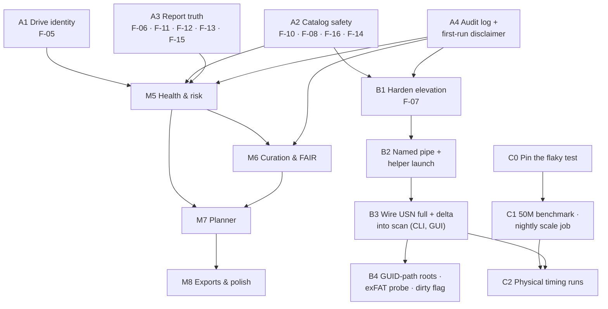

# Drive Fusion — Status and Roadmap (Plan Addendum A)

| | |
|---|---|
| **Date** | 2026-10-28 |
| **Baseline** | `main` at `ce03f64` (PR #8 merged) |
| **Relation to other documents** | Adds to [PLAN.md](PLAN.md); doesn't replace it. PLAN stays the design. This addendum records where the code stands against PLAN §15, what is still owed by milestones marked done, and the order of work to reach M5–M8. It draws on [REVIEW.md](REVIEW.md) (findings F-01 … F-16) and [VV.md](VV.md) (requirements R-*, tests VV-*) |
| **Status** | Accepted 2026-10-28 with the default answer to every decision in §6. Track A is in progress: **A2, A1 and A3 done** (§4) |

---

## 1. Evidence gathered for this assessment

Everything below was re-run on 2026-10-28 against `ce03f64`, on Linux (Python 3.13) with the Qt
runtime libraries installed, so the GUI suite ran rather than skipping.

| Check | Result |
|---|---|
| `python tools/ro_lint.py` | clean, 54 files |
| `python -m pytest -q` | **336 passed, 5 skipped** (Windows-only) on most runs. **One run of the first ~20 had 1 failure** that hasn't reproduced in 55 full runs since; see §3.4 |
| `python tools/review_repro.py` | R1–R4 `NOT FOUND` (F-01 to F-04 fixed). R5–R12 **`FOUND`**: F-05, F-06, F-08 (7 probes), F-10, F-11, F-12, F-13, F-14 are still present |
| `python -m vv all` (simulated, 3, 6 and 9 drives, fresh seeds) | **PASS** on every run: 37 PASS, 1 N/A (VV-CAT-06, unreadable files can't be planted as root), 1 DEFERRED (VV-VER-01, M6) |
| GitHub | No open pull requests or issues |
| Code checks | `apply_delta` and `run_helper` have no caller outside their own modules. `elevation.request` has no caller. Nothing writes to the `audit` table. `core/export/` is a docstring. Schema is version 4. There is no `standards/` directory |

---

## 2. Milestone status

Legend: **Done**, meaning delivered and verified · **Done, with debt**, meaning the
deliverable exists but an acceptance criterion or listed item is still owed (§3) ·
**Not started**.

| # | Milestone | Status | Notes |
|---|---|---|---|
| **M0** | Skeleton and guardrails | **Done, with debt** | Gateway, lint, no-touch test, VHDX harness and the PyInstaller build are all in place. The lint has blind spots (F-08), so the guardrail is weaker than PLAN §3.2 implies |
| **M1** | Catalog core | **Done, with debt** | Benchmark gate passed at 3M files, decision: one database. The 50M-file run PLAN §7.2 calls for hasn't been done. F-12 (wrong "last scanned") lives here |
| **M2** | Fast enumeration | **Done, with debt** | The parsers, journal logic, batch walker, helper and delta are tested libraries. **Not wired**: every user scan is a full walk (SR-17). The exFAT retrieval-pointer check (PLAN §6.6, "verification task at M2") has been deferred three times and never done. Direct `$MFT` parsing is deferred, so the NTFS < 5 min budget can't be met |
| **M3** | Identity and analysis | **Done, with debt** | The VV rescan defect is fixed and every VV identity, redundancy and fixity test passes. F-05 (serial-less volumes overstated copies) was fixed in A1. Still open: F-06 (verify reports an edit as corruption) |
| **M4** | GUI shell | **Done, with debt** | Four of the eight PLAN §11 screens exist. The elevation launcher has no caller and isn't hardened (F-07, SR-16). Cancel works every 10,000 files, not per directory (F-13) |
| **M5** | Health and risk | **Not started** | `drive` has the purchase and location columns. No `drive_health` table, no smartctl, no AFR data, no durability arithmetic |
| **M6** | Curation and FAIR | **Not started** | VV-VER-01 test data is already planted |
| **M7** | Planner | **Not started** | `ortools` is listed as an optional extra |
| **M8** | Exports and polish | **Not started** | `core/export/` is a docstring only |

**Use cases (PLAN §2).** Use case 1 (catalog) and use case 2 (confirm redundancy, by copy
count) work from both the CLI and the GUI. Use case 2's *probability* half, P(loss), needs M5.
Use case 3 (plan the merge) needs M7 and M8.

---

## 3. What the "done" milestones still owe

PLAN §13 says the performance budgets "are the acceptance criteria for M1–M4… Missing one is a
milestone failure, not a footnote." Taken literally, M1–M4 aren't closed. This section lists
every open item so each one can be closed, scheduled, or formally waived.

### 3.1 Open review findings (from REVIEW.md, re-confirmed)

| ID | Sev. | Why it matters for what comes next |
|---|---|---|
| F-05 | Med | **Blocks M5.** P(loss) is a product over *drives*. If two partitions of one disk count as two drives, durability is overstated in exactly the unsafe direction REVIEW §2.3 warns about |
| F-06 | Med | Fixity incidents feed M6's NDSA Integrity score and M7's `verify` steps. A false alarm there costs credibility |
| F-10 | Med | **Blocks any schema migration.** M5 adds tables (schema v5). The backup taken before that migration has to be consistent |
| F-11 | Med | Cloud placeholders drop out of the catalog, so they're invisible to every later report |
| F-08 | Med | M5 introduces the first legitimate `subprocess` call (smartctl). The lint has to learn to tell an allowlisted call from any other one first, or the guardrail gets weaker just when it's needed |
| F-07 | Med | Has to be fixed before the helper is wired (§4, Track B) |
| F-12 | Low | Staleness is a headline PLAN §6.4 promise, and M5's "last seen 12 days ago" uses the same field |
| F-13 | Low | Cancel granularity; it gets worse once hashing runs per drive in parallel (M5) |
| F-14 | Low | Hides "access denied" from the helper, so it has to be fixed before wiring |
| F-15 | Low | Coverage wording |
| F-16 | Low | TOCTOU in `open_read`; check the handle after opening |

### 3.2 PLAN commitments with no owner yet

These are in PLAN but not attached to any milestone. This addendum assigns them.

| Item | PLAN | Proposed owner |
|---|---|---|
| First-run disclaimer, acknowledged and recorded (SR-25) | §1 | Track A (A4) |
| Append-only, hash-chained audit log (SR-26) | §7.3, §8.3 R1.2 | Track A (A4). Elevation consent (B) and FAIR R1.2 provenance (M6) both need it |
| Opening roots by volume GUID path, so a root follows its drive to a new letter | §4 | Track B |
| `AppData\Local\Temp` default exclusion | §4 | Track A (trivial) |
| Portable mode and `platformdirs` location | §12 | M8 |
| Catalog refused anywhere on a catalogued *volume* (not just inside a root); export root check | §3.2, F-03 | Volume check in Track A, export check in M8 |
| Dry-run "likely changed?" probe for exFAT, dirty-volume flag | §6.4, §6.7 | Track B |
| Sparse/compressed allocated size, Server Dedup flag, ADS | §6.7 | M5 or later. They matter for capacity, so the M7 footprint needs at least allocated size |
| FTS5 filename and directory-path indexes | §7.4 | M6. The Collections screen needs path search |

### 3.3 Unmeasured acceptance budgets (PLAN §13)

| Budget | State | How to close |
|---|---|---|
| Catalog bytes/file, merge rate, RSS, duplicate scan | Measured at 3M, projected to 50M | Run `tools/benchmark.py --files 50000000` (~11 GB scratch) and record the result in PLAN §7.2 |
| exFAT full enumeration < 30 min, rescan < 35 min (10M files) | **Not measured** | Physical exFAT drive, or a large VHDX on the Windows runner, timed through `scan` |
| NTFS USN delta < 60 s | **Can't be measured until wired** (Track B) | After B3 |
| NTFS full enumeration < 5 min | **Can't be met** without `$MFT` parsing | Decision needed (§6, D3): waive for now, or schedule `$MFT` parsing |
| Quick hash, 5M candidates, external HDD < 8 h | **Not measured** | Physical HDD run |
| Report across 50M rows < 5 min | Projected 47 s | Confirmed by the 50M benchmark |
| GUI first page < 200 ms, UI-thread op < 50 ms | **Not asserted** anywhere | Add timing assertions to the GUI tests against a benchmark-sized catalog |
| Nightly scale test | **Doesn't exist** | A scheduled CI job (Track C) |

### 3.4 Test-suite health

* **One intermittent failure. Root cause found 2026-10-28 (A3).** It recurred during A3 and
  was caught with seed `244279970315808`. `test_simulated_drives_fit_the_size_they_were_given`
  summed file sizes per *path*, so a large file hardlinked three times onto the 12 MB drive
  was counted three times (12.78 MB) although it was stored once (11.52 MB, within the size).
  The generator was right and the test was wrong. The test now counts each inode once, and
  the seed is pinned as a regression test. The bench tests already print their seed on
  failure, which is what made this one catchable (C0).
* **GUI suite on Linux** skips silently unless `libEGL` and its companions are installed. CI
  installs them and asserts that Qt starts, so CI is sound. A local developer can still get a
  misleading green. README's development section should say so.
* PLAN §14 lists tests that don't exist yet: cross-filesystem parity on VHDX images,
  rename-on-exFAT on a *real* exFAT volume (VV covers it on simulated drives only),
  journal invalidation against a real journal (the decision logic is unit-tested), a
  placeholder with both reparse and recall attributes (F-11), and the scale test. The planner
  and scorecard tests belong to M6 and M7.

---

## 4. Plan of work

Four tracks. **A** closes the correctness debt that M5 builds on. **B** delivers the parts of M2
and M4 that were never wired. **C** produces the performance evidence. Then come the
remaining milestones. A comes first. B and C can run alongside M5, because they touch
different modules.

*Figure 1 — Dependencies. An arrow means "must be done first".*

### Track A — Correctness close-out ("M4.1")

Goal: every open finding that can make a report wrong, or that weakens a guardrail, is fixed
before durability numbers are layered on top. Each item ships with the regression test REVIEW
asks for, flips its `review_repro.py` line to `NOT FOUND`, and leaves the V&V bench green.

| Item | Work | Done when |
|---|---|---|
| **A1** F-05 drive identity · **Done 2026-10-28** | At discovery, group serial-less volumes by disk number plus disk signature or GUID (`IOCTL_VOLUME_GET_VOLUME_DISK_EXTENTS`, `IOCTL_DISK_GET_DRIVE_LAYOUT_EX`). Add a `drive.identity_confidence` column (`serial` / `disk-layout` / `unverified`). The report and GUI mark any copy count that depends on an unverified drive. A user can confirm or merge drives (CLI `drives merge`, and Drives screen) | R6 `NOT FOUND`. New VV requirement **R-RED-06**, "copies on two volumes of one device count once": the bench registers two simulated volumes on one mock device **Result:** done as planned, with two changes. The column is `drive.identity` (`serial` / `disk-layout` / `user`; *unverified* is a volume with no drive). And an unverified volume gets two counts, proven for protection and possible for reclamation, so neither report errs unsafely. The CLI verbs are `drives list / confirm / assign` ("merge" read like an operation on data). VV-RED-06 passes on 3–10 drives and fails against the previous code. The audit-log entry for a user's confirmation waits for A4 |
| **A2** Catalog and guardrail safety · **Done 2026-10-28** | F-10: back up with `Connection.backup()`. F-08: add lint rules for `subprocess`/`os.system`/`os.startfile`/`os.popen`, `os.write`, `io.open`/`io.FileIO`, non-literal `os.open` flags, `sqlite3.connect` outside `core/store`, Win32 mutator names, and `getattr` with a non-literal name on `os`/`shutil`/`pathlib`. Add an explicit, reviewed allowlist mechanism (needed for smartctl in M5) and a test-time `sys.addaudithook` that fails on write-mode opens, renames, removes and `subprocess.Popen` outside the catalog directory. F-16: check handle attributes after opening. F-14: declare `restype`/`argtypes` for every Win32 call. ~~Refuse a catalog anywhere on a catalogued volume, with an explicit `--allow-catalog-on-scanned-volume` override recorded in the audit log~~: replaced by the rule decided in D8, which needs no override | R8 (all 7 probes), R9 and R10 `NOT FOUND`. The audit hook runs during the no-touch test. **Result:** all met, plus a new R13 for F-16. Lint rules DF008–DF013, a `PROCESS_LAUNCH_MODULES` allowlist with a stated reason per entry, `tests/fixtures/audit_guard.py` around the whole no-touch cycle, 70 new tests (406 pass). V&V PASS on 3, 6 and 10 simulated drives |
| **A3** Report truth · **Done 2026-10-28** | F-06: `verify` stats first and records `modified` when size or mtime changed, `mismatch` only when they didn't. F-11: test dehydration before reparse, and tell cloud reparse tags apart from links. F-12: add `volume.last_scanned_at`, set in `finish_scan`. F-13: pass a cancel callable into `scan_root` and `hash_pass`, checked per directory and per file. F-15: count unreadable directories separately from files. Add the `AppData\Local\Temp` exclusion | R5, R7, R11, R12 `NOT FOUND`. New VV checks: **VV-FIX-04** (an edited file between rescan and verify is `modified`, not `mismatch`; the bench gets a "touch after rescan" mutation) and **VV-CAT-08** (staleness reflects the last scan) **Result:** all done, with two departures. F-06 compares mtime only: a size change with the date kept looks like damage, not an edit, so it is still hashed. F-11 went further: downloaded cloud, dedup and WOF files were also dropped as links, and are now catalogued, classified by reparse tag. Also: prefix exclusions now match whole folders (`C:\Windows` no longer excludes `C:\WindowsBackups`). V&V adds R-FIX-04 and R-CAT-08; VV-FIX-04 fails against the previous code. Every `review_repro.py` line is now `NOT FOUND` |
| **A4** Audit log and disclaimer | Implement the hash-chained, append-only writer in `core/store` (SR-26): `audit.append(actor, action, detail)` with `prev_hash` and `entry_hash`, plus a `drivefusion audit verify` check of the chain. Write entries for scope changes, scans, hash and verify passes, and the disclaimer. First run of the CLI and the GUI shows the PLAN §1 disclaimer and needs acknowledgement (SR-25). The CLI takes `--accept-disclaimer` for scripted use, which is also recorded | Chain verification test, including tamper detection. GUI test that nothing is scanned before acknowledgement. SR-25 and SR-26 move to Met |

**Exit criterion for A:** REVIEW status columns updated. R1–R12 all `NOT FOUND`, except R6
if A1 is waived. VV green on simulated 3/6/10-drive runs **and** one physical run with at
least one NTFS and one exFAT device (the PLAN §14.1 gate, re-run on the A build).

### Track B — Wire the fast path (finishing M2 and M4)

| Item | Work | Done when |
|---|---|---|
| **B1** F-07 elevation hardening | Before `runas`, verify the helper against a SHA-256 pinned at build time (and Authenticode once signing exists). Build parameters with `subprocess.list2cmdline`. Refuse a helper in a user-writable directory unless its hash matches | Tests for a tampered helper, a wrong hash, and arguments with spaces and quotes |
| **B2** Output channel | A named pipe whose ACL admits only the launching user's SID. The helper writes framed records to it instead of stdout when launched elevated. `helper/client` reads from either | A stand-in child test over a real pipe on the Windows runner |
| **B3** Wire USN into `scan` | `cmd_scan` and the GUI call `journal.decide()` with the real elevation state. `usn-full` and `usn-delta` run through the helper, and `apply_delta` merges. The GUI Scope screen offers "Fast scan (requires administrator)" per NTFS volume, and the consent goes in the audit log (A4). `scan.method` and `scan.elevated` record what ran | SR-16 and SR-17 Met. Windows CI on an elevated NTFS VHDX: delta after a known set of changes equals a full rescan, and the three journal-invalidation cases (deleted, rotated, cursor purged) fall back to a full pass. The VV bench gains a `--method usn` mode for physical NTFS drives (VV.md §9 lists this as a limit today) |
| **B4** Follow-ons | Open roots through `\\?\Volume{GUID}\` so a root follows its drive to a new letter. Read the dirty-volume flag and report it. Add the exFAT "likely changed?" probe, labelled as a hint. Do the retrieval-pointer check on real exFAT (PLAN §6.6) and record the result in PLAN, either way | PLAN §4 and §6.4 "as built" notes removed. Retrieval-pointer result written into PLAN §6.6 and the exFAT hashing budget re-stated if needed |

### Track C — Performance evidence

| Item | Work |
|---|---|
| **C0** | Seed reporting in `tests/test_vv.py` (§3.4). Optionally a CI job that runs the bench tests over N seeds |
| **C1** | `tools/benchmark.py --files 50000000`, with the result recorded in PLAN §7.2. A scheduled (nightly or weekly) workflow at a smaller size that fails on a budget regression. GUI latency assertions (first page < 200 ms) against a benchmark catalog |
| **C2** | Physical runs on the target hardware: exFAT 10M-file walk, NTFS delta (after B3), quick hash on an external HDD. **Needs the user's drives**. Results go into a new PLAN §13 "measured" column |

### M5 — Health and risk

Starts when Track A is done. Proposed breakdown:

| Item | Work |
|---|---|
| **M5.1** Schema v5 | `drive_health` per PLAN §7.3. Migration backed up by A2's consistent backup |
| **M5.2** Drive metadata | CLI `drives list / edit` and an editable Drives screen for purchase date, price, vendor, warranty, role, location, disaster zone, nickname and retired date. `batch_key` derived from manufacturer + model + purchase month, overridable. Every edit audited |
| **M5.3** smartctl | Bundle smartmontools. Call it through **one** allowlisted module, `core/health/smart.py`, with a fixed argv of read-only queries only: `smartctl -j -i -H -A [-l selftest] -d <type> <dev>`. A lint rule rejects any argv containing `-t`, `-s`, `-o`, `-S`, `--set`, `-X` or `--test`, since smartctl *can* change device state, so this is a read-only-guarantee question, not a convenience. Parse JSON into `drive_health`. "Unknown" when the bridge doesn't pass SMART through |
| **M5.4** AFR model | `standards/afr/<source>-<version>.json` with base AFR by model family, versioned and citable (PLAN §8.3). Age, duty, SMART and bus factors per PLAN §8.2, each a pure function with its own tests. `confidence = measured / estimated / unknown` |
| **M5.5** Durability | P(loss) per content over its drive set with `corr(D)` for a shared `batch_key` or `disaster_zone`. Expected bytes lost per year, in total and per under-protected group. Under-protected ranked by `size × P(loss)` instead of size. Report and Dashboard show it, together with confidence |
| **M5.6** Per-drive parallel hashing | Deferred from M3. 1–2 readers on HDD, 4–8 on SSD, by discovered media type, with per-file cancel from A3 |
| **M5.7** V&V | New requirements **R-HL-01** (no SMART → `unknown`, never a number), **R-HL-02** (two copies on one `batch_key` score worse than two copies across batches), **R-HL-03** (expected loss equals the oracle's independent arithmetic for the planted drive metadata), **R-HL-04** (smartctl is never called with a state-changing argument). The bench plants purchase dates, models and mock SMART JSON per simulated drive |

### M6, M7, M8 — outline

These are scoped in PLAN §8.3–§10 and §15. Each should get its own breakdown, like M5's above,
when it starts, and its V&V requirements added to `vv/requirements.py` as `status="planned"`
with data planted *before* implementation (VV.md §9).

* **M6 Curation and FAIR.** Collection inference over `dir_rollup`, the confirmation queue,
  rules-based membership, the unfiled bucket and coverage, version sets (VV-VER-01 moves from
  DEFERRED to live), `standards/` rubric files pinned from primary sources, FAIR and NDSA
  scorecards with golden tests, FTS5 indexes, and the Collections and Duplicates & Versions
  screens.
* **M7 Planner.** Placement units, the greedy solver plus CP-SAT, cluster-aware footprint,
  plan documents with simulation, the Plan screen, and property tests (never fewer copies,
  never over capacity). Needs allocated-size data (§3.2) for footprints.
* **M8 Exports and polish.** The `core/export` writer with the root assertion, RO-Crate,
  BagIt, DataCite, per-drive manifests, naming-template mappings, HTML and CSV reports, the
  copy-only command denylist linter, portable mode, the export-root half of F-03, Authenticode
  signing, and the Exports screen.

---

## 5. Recommended next step

**Track A, starting with A2 then A1. *(A2, A1 and A3 are done; A4 is next.)*** A2 (consistent backup, lint closure, audit hook) is
small, low-risk, and protects every later change, including the M5 migration. A1 (drive
identity) is the one correctness issue that would make M5's headline number wrong. A3 and A4
can follow in either order, and C0 is a one-line change that can ride along with any of them.

Suggested PR granularity: one PR per item (A1, A2, A3, A4), each with its tests, its
`review_repro.py` flip, and its REVIEW and PLAN status updates, so the V&V bench result can be
attached to each one.

---

## 6. Decisions needed from you

| # | Question | Default if not decided |
|---|---|---|
| D1 | Do Track A items gate M5, as proposed, or should M5.2 (drive metadata editing, no risk math) start in parallel? | A gates M5 |
| D2 | Is Track B (wiring the elevated USN path) still wanted before M7, given the cold-archive assumption (PLAN §17) and that half the fleet is exFAT anyway? | Yes, after A, alongside M5 |
| D3 | The NTFS full-enumeration budget (< 5 min, 10M files) needs direct `$MFT` parsing. Waive it, defer it to after M8, or schedule it? | Formally waive for now and record that in PLAN §13 |
| D4 | Do the §13 budgets have to be *measured on physical drives* (C2) before M1–M4 are called closed, or is the 50M synthetic benchmark plus VHDX timing enough? | Synthetic plus VHDX closes M1–M4. C2 is a release gate |
| D5 | Can you provide physical test drives (≥ 1 NTFS, ≥ 1 exFAT, ideally an external HDD) for the PLAN §14.1 V&V gate and C2? | Simulated-only until you can |
| D6 | AFR source for M5.4: Backblaze public drive stats (needs a pinned snapshot) or manufacturer-rated AFR/MTBF? | Backblaze snapshot, with the manufacturer rating as a fallback |
| D7 | F-05: is a user-confirmed "merge these two volumes into one drive" acceptable as the final word when hardware gives no identity? | Yes, recorded in the audit log |
| D8 | *Raised while doing A2.* The default catalog is `~\.drivefusion\catalog.db`, on `C:`. Refusing a catalog anywhere on a catalogued volume would therefore refuse the out-of-the-box setup for anyone who scopes a folder on `C:` | **Decided 2026-10-28:** the catalog can't be in a folder being scanned, nor on a drive holding one, except the system drive, where it may sit anywhere outside the scanned folders. Scanning the whole system drive therefore leaves nowhere on it for the catalog. No override. **Done** (PLAN §3.2 as-built note, REVIEW F-03) |
